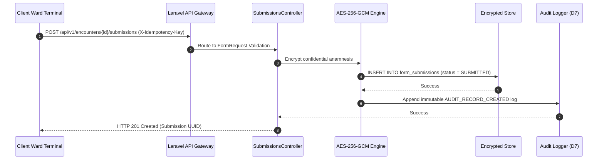

# API Specification

## Conventions

- **Base URL**: `https://simrs.klinikform.local/api/v1`
- **API Versioning**: URL-versioned under `/api/v1/` for all REST interoperability endpoints and bridging services.
- **Content Types**: All requests and responses must communicate using `Content-Type: application/json` and `Accept: application/json`.
- **Authentication**: 
  - Internal portal endpoints and bridging test routes require authenticated session cookies with CSRF validation (`auth:web`).
  - Outbound interoperability endpoints (`/api/v1/fhir/*`) and BPJS simulation endpoints require Bearer Token authentication or specialized HMAC header authentication (`X-cons-id`, `X-timestamp`, `X-signature`, `user_key`).
- **Pagination**: List endpoints support cursor-based or offset-based pagination via query parameters `page` (default 1) and `per_page` (default 25, maximum 100). Metadata is returned in the response envelope.
- **Rate Limits**: Configured at 120 requests per minute per authenticated user session. Exceeding this limit returns HTTP 429 Too Many Requests.

## Error format

All error responses return a standardized JSON structure containing an error code, message, and an optional validation errors dictionary for FormRequest failures.

```json
{
  "success": false,
  "error": {
    "code": "VALIDATION_ERROR",
    "message": "The given data was invalid.",
    "details": {
      "systolic": [
        "Nilai sistol harus di antara 40 dan 300 mmHg."
      ]
    }
  },
  "timestamp": "2025-03-01T14:22:05Z"
}
```

## Endpoints

### 1. Patient Lookup by NIK
- **Method**: `GET`
- **Path**: `/patients/search`
- **Auth Required**: Yes (`Triage Nurse`, `DPJP`, `Admin`)
- **Request Parameters**:
  - `nik`: string (16 digits required)
- **Response Schema**:
  ```json
  {
    "success": true,
    "data": {
      "id": "a0eebc99-9c0b-4ef8-bb6d-6bb9bd380a11",
      "medical_record_number": "00-48-21",
      "full_name": "Tn. Joko Susanto",
      "birth_date": "1983-05-12",
      "gender": "male",
      "nik_masked": "331501******0001",
      "bpjs_card_number": "0001234567890",
      "ihs_patient_id": "P00012345678"
    }
  }
  ```
- **Errors**: HTTP 401 (Unauthenticated), HTTP 422 (Invalid NIK format), HTTP 404 (Patient not found).

### 2. Submit Clinical Intake Form
- **Method**: `POST`
- **Path**: `/encounters/{encounter_id}/submissions`
- **Auth Required**: Yes (`Triage Nurse`, `DPJP`)
- **Request Schema**:
  ```json
  {
    "form_template_id": "c1a2b3c4-5d6e-7f8a-9b0c-1d2e3f4a5b6c",
    "schema_version": 2,
    "payload_data": {
      "triage_category": "urgent",
      "systolic": 130,
      "diastolic": 85,
      "heart_rate": 92,
      "respiratory_rate": 20,
      "body_temperature": 37.1,
      "gcs": {
        "eye": 3,
        "verbal": 4,
        "motor": 5,
        "total": 12,
        "category": "apatis"
      },
      "pain_markers": [
        {
          "x": 48.2,
          "y": 32.5,
          "region": "epigastrium",
          "severity": 7
        }
      ]
    },
    "encrypted_anamnesis": "Nyeri ulu hati sejak 2 hari yang lalu, disertai mual dan muntah."
  }
  ```
- **Response Schema**:
  ```json
  {
    "success": true,
    "message": "Clinical intake submission successfully saved.",
    "data": {
      "submission_id": "f8e7d6c5-b4a3-2f1e-0d9c-8b7a6f5e4d3c",
      "encounter_id": "e3f2a1b0-9c8d-7e6f-5a4b-3c2d1e0f9a8b",
      "status": "SUBMITTED",
      "created_at": "2025-03-01T14:22:05Z"
    }
  }
  ```
- **Errors**: HTTP 401, HTTP 403 (Unauthorized role), HTTP 422 (Validation failure).

### 3. Sign and Lock Clinical Assessment
- **Method**: `POST`
- **Path**: `/assessments/{submission_id}/sign`
- **Auth Required**: Yes (`DPJP`)
- **Request Schema**:
  ```json
  {
    "primary_icd10_code": "K29.7",
    "objective_findings": "Abdomen: Nyeri tekan epigastrium (+), defans muskular (-)."
  }
  ```
- **Response Schema**:
  ```json
  {
    "success": true,
    "message": "Assessment successfully signed and permanently locked.",
    "data": {
      "submission_id": "f8e7d6c5-b4a3-2f1e-0d9c-8b7a6f5e4d3c",
      "status": "LOCKED",
      "signature_hash": "e3b0c44298fc1c149afbf4c8996fb92427ae41e4649b934ca495991b7852b855",
      "signed_by": "Dr. Budi, Sp.PD",
      "signed_at": "2025-03-01T14:30:00Z"
    }
  }
  ```
- **Errors**: HTTP 401, HTTP 403 (Non-DPJP user), HTTP 409 (Record already locked).

### 4. Get SatuSehat FHIR Encounter Resource
- **Method**: `GET`
- **Path**: `/fhir/Encounter/{encounter_id}`
- **Auth Required**: Yes (Bearer Token / OAuth2)
- **Request Parameters**: None
- **Response Schema**:
  ```json
  {
    "resourceType": "Encounter",
    "id": "enc-uuid-004821",
    "identifier": [
      {
        "system": "https://simrs.klinikform.local/encounter",
        "value": "ENC-202503-0012"
      }
    ],
    "status": "finished",
    "class": {
      "system": "http://terminology.hl7.org/CodeSystem/v3-ActCode",
      "code": "EMER",
      "display": "emergency"
    },
    "subject": {
      "reference": "Patient/P00012345678"
    },
    "participant": [
      {
        "individual": {
          "reference": "Practitioner/DR987654321",
          "display": "Dr. Budi, Sp.PD"
        }
      }
    ],
    "period": {
      "start": "2025-03-01T14:00:00Z",
      "end": "2025-03-01T15:00:00Z"
    }
  }
  ```
- **Errors**: HTTP 401, HTTP 404.

### 5. Get SatuSehat FHIR Condition Resource
- **Method**: `GET`
- **Path**: `/fhir/Condition`
- **Auth Required**: Yes (Bearer Token / OAuth2)
- **Request Parameters**:
  - `encounter`: string (Encounter UUID)
- **Response Schema**:
  ```json
  {
    "resourceType": "Bundle",
    "type": "searchset",
    "total": 1,
    "entry": [
      {
        "resource": {
          "resourceType": "Condition",
          "id": "cond-uuid-001",
          "clinicalStatus": {
            "coding": [
              {
                "system": "http://terminology.hl7.org/CodeSystem/condition-clinical",
                "code": "active"
              }
            ]
          },
          "code": {
            "coding": [
              {
                "system": "http://hl7.org/fhir/sid/icd-10",
                "code": "K29.7",
                "display": "Gastritis, unspecified"
              }
            ]
          },
          "subject": {
            "reference": "Patient/P00012345678"
          },
          "encounter": {
            "reference": "Encounter/enc-uuid-004821"
          }
        }
      }
    ]
  }
  ```
- **Errors**: HTTP 401, HTTP 400 (Missing encounter parameter).

### 6. BPJS VClaim SEP Insertion Simulator
- **Method**: `POST`
- **Path**: `/bpjs/vclaim/sep/insert`
- **Auth Required**: Yes (HMAC-SHA256 headers: `X-cons-id`, `X-timestamp`, `X-signature`, `user_key`)
- **Request Schema**:
  ```json
  {
    "t_sep": {
      "noKartu": "0001234567890",
      "tglSep": "2025-03-01",
      "ppkPelayanan": "0301R001",
      "jnsPelayanan": "2",
      "klsRawat": {
        "klsRawatHak": "3",
        "klsRawatNaik": "",
        "pembiayaan": "",
        "penanggungJawab": ""
      },
      "noMR": "00-48-21",
      "rujukan": {
        "asalRujukan": "1",
        "tglRujukan": "2025-02-28",
        "noRujukan": "RJV-00921",
        "ppkRujukan": "0301F002"
      },
      "catatan": "Pasien nyeri ulu hati akut",
      "diagAwal": "K29.7",
      "poli": {
        "tujuan": "IGD",
        "eksekutif": "0"
      },
      "cob": {
        "cob": "0"
      },
      "katarak": {
        "katarak": "0"
      },
      "jknKeluarga": {
        "anakKe": "0",
        "tertanggung": "0"
      },
      "noTelp": "081234567890",
      "user": "SimrsAdmin"
    }
  }
  ```
- **Response Schema**:
  ```json
  {
    "metaData": {
      "code": "200",
      "message": "Sukses"
    },
    "response": {
      "sep": {
        "noSep": "0301R0010325B0000142",
        "tglSep": "2025-03-01",
        "noKartu": "0001234567890",
        "nama": "Tn. Joko Susanto",
        "jnsPelayanan": "Rawat Jalan",
        "poli": "IGD",
        "diagnosa": "K29.7 - Gastritis, unspecified",
        "catatan": "Pasien nyeri ulu hati akut"
      }
    }
  }
  ```
- **Errors**: HTTP 401 (Invalid signature or timestamp drift > 300s), HTTP 422 (Missing BPJS parameters).

## Status codes

| Status Code | Description | Usage Condition |
| :--- | :--- | :--- |
| **200 OK** | Request succeeded | Standard GET reads, successful updates, search matches. |
| **201 Created** | Resource successfully created | Successful POST form submission, patient registration, or SEP generation. |
| **400 Bad Request** | Malformed request structure | Missing query parameters, malformed JSON body. |
| **401 Unauthorized** | Authentication failure | Missing/invalid session, expired bearer token, or invalid BPJS HMAC signature / timestamp drift. |
| **403 Forbidden** | Authorization boundary violation | User authenticated but lacking required role (e.g., Nurse attempting DPJP sign-off). |
| **404 Not Found** | Resource does not exist | Patient NIK, encounter UUID, or form template code not found in database. |
| **409 Conflict** | State conflict | Attempting to modify a locked clinical record (`status = 'LOCKED'`). |
| **422 Unprocessable Entity** | Validation failure | FormRequest validation failure (e.g., vital signs outside clinical bounds). |
| **429 Too Many Requests** | Rate limit exceeded | Exceeding 120 requests per minute per user. |
| **500 Internal Server Error** | Unexpected server fault | Unhandled database exception or encryption failure. |

## Idempotency

- **Idempotency Header**: Outbound API write requests and critical clinical form submissions support an optional header `X-Idempotency-Key` (UUIDv4).
- **Behavior**: If a request with a previously executed `X-Idempotency-Key` is received within a 24-hour window, the API returns the cached HTTP 201 response without re-executing database persistence or triggering duplicate interoperability jobs.

## Webhooks

The system dispatches asynchronous webhooks to registered hospital enterprise subscribers upon key clinical lifecycle events.

- **Endpoint Registration**: Configured via Admin portal under `/admin/webhooks`.
- **Signature Verification**: Outbound webhooks include header `X-KlinikForm-Signature` calculated as `hash_hmac('sha256', $requestBody, $webhookSecret)`.

### Supported Event Types
1. `clinical.submission.created`: Dispatched when a nurse successfully submits a new intake form.
2. `clinical.assessment.locked`: Dispatched when an attending doctor signs off and locks an assessment record.
3. `interoperability.satusehat.synced`: Dispatched when an encounter and condition bundle successfully syncs to SatuSehat.

## OpenAPI or Mermaid Sequence Excerpt


## Endpoints added during implementation

Not in the original endpoint list. Each exists because a requirement elsewhere
in the specification cannot be met without it; the portal drives the first
three over the same routes.

### A. Register a walk-in patient
- **Method**: `POST`
- **Path**: `/patients`
- **Auth Required**: Yes (`Triage Nurse`, `DPJP`, `Admin`)
- **Request Body**: `medical_record_number`, `full_name`, `birth_date`, `gender`, `nik` (16 digits), and optionally `phone`, `address`, `bpjs_card_number` (13 digits), `ihs_patient_id`.
- **Response Schema**: `id`, `medical_record_number`, `full_name`, `nik_masked`.
- **Notes**: The NIK is never echoed back and never reaches the database in clear; `nik_hash` is derived from it in the same write. The shared secret is generated server-side, never accepted from the client.
- **Errors**: HTTP 403 (role without `create` on `Patient`), HTTP 422 (duplicate `medical_record_number`, malformed NIK/BPJS, future `birth_date`).

### B. Read a patient record
- **Method**: `GET`
- **Path**: `/patients/{patient}`
- **Response Schema**: as endpoint 1's `data`, plus `age`, `blood_type`, `allergies`.
- **Errors**: HTTP 403, HTTP 404.

### C. List a patient's encounters
- **Method**: `GET`
- **Path**: `/encounters`
- **Request Parameters**: `patient_id` (optional), `status` (optional), `per_page` (optional, default 25).
- **Response Schema**: paginated encounter list with `id`, `visit_type`, `status`, `started_at`, `finished_at`.
- **Notes**: Powers the encounter table under the NIK search on the intake screen.

### D. Synchronise a draft
- **Method**: `PUT`
- **Path**: `/encounters/{encounter}/drafts/{form_template}`
- **Request Body**: `draft_payload`, `client_saved_at`.
- **Notes**: The 30 s server-side half of the R-03 dual-buffer draft strategy. The 5 s local half is `localStorage` and never leaves the workstation.

### E. Confirming and revoking MFA (session-authenticated, not API)
- `GET|POST /portal/account/two-factor`, `POST /portal/account/two-factor/confirm`, `DELETE /portal/account/two-factor`
- security.md §MFA defines the requirement but names no route. `POST` issues a candidate secret and returns an `otpauth://` URI; `confirm` verifies a live 6-digit code, sets `two_factor_secret_confirmed_at` and issues recovery codes once; `DELETE` re-asks for the current password so a hijacked session cannot downgrade a login.

### F. Webhook subscriber registry (session-authenticated, not API)
- `GET|POST /admin/webhooks`, `PUT|DELETE /admin/webhooks/{id}`
- Admin only, gated on `manage` against `App\Models\WebhookEndpoint`. The selectable event list is read from `WebhookDispatcher::EVENTS`, so the form cannot offer a subscription that no code emits.

### Disagreements with the original specification

1. **`Encounter.serviceType`** — this section models `serviceType` as an array. FHIR R4's `Encounter.serviceType` is `0..1 CodeableConcept`, so the transformer emits a single element. Documented here rather than changed in place.
2. **Schema versioning** — several examples in this document render `version` as a string (`"2"`). The column is `integer`, so JSON payloads carry `2`. The examples are illustrative; the type is not.
3. **SEP number format** — erd.md implies a 19-character SEP number. The concrete example in section 6 is 20 characters (`0001R1234 2024B1234567`), and `App\Services\Interoperability\Bpjs\SepService` validates that example's shape.
