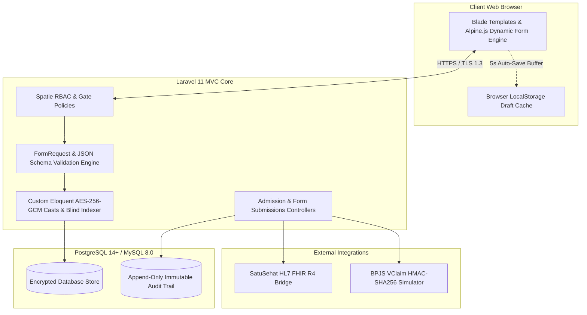
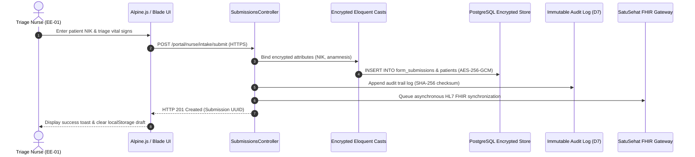

# System Architecture

## System Overview

## Components and responsibilities

| Component | Responsibility |
| :--- | :--- |
| **Dynamic Form Schema Engine** | Parses versioned JSON schemas (`form_templates`) into interactive Blade/Alpine.js clinical intake interfaces without requiring database migrations. |
| **Custom Eloquent Encryption Casts** | Executes transparent AES-256-GCM authenticated encryption and decryption for sensitive patient records (`nik`, `phone`, `address`, `anamnesis`) using the application master key. |
| **Blind Indexing Service** | Generates deterministic HMAC-SHA256 hashes (`nik_hash`) using an isolated system pepper to allow $O(1)$ database searches on encrypted NIK values. |
| **Clinical Calculation & Canvas Widget** | Evaluates real-time Glasgow Coma Scale (GCS) sums, pediatric dosage formulas, and coordinate-mapped anatomical pain canvas selections. |
| **Cryptographic Sign-Off & Locking Service** | Computes SHA-256 payload integrity hashes upon attending physician (DPJP) approval, locking records against post-signature modifications per Permenkes No. 24/2022. |
| **Immutable Audit Logger** | Records append-only log entries (`audit_logs`) capturing user ID, role, IP address, user-agent, action verb, and SHA-256 payload checksums for every system access. |
| **SatuSehat FHIR Interoperability Gateway** | Serializes internal clinical encounters, patient records, and ICD-10 diagnoses into HL7 FHIR Release 4 JSON resource bundles. |
| **BPJS VClaim Simulator** | Implements the official BPJS authentication protocol (ConsID, SecretKey, UserKey, UTC timestamp validation, and HMAC-SHA256 signature generation) to return valid *Surat Eligibilitas Peserta* (SEP) payloads. |

## Technology decisions and rationale

| Technology Choice | Rationale |
| :--- | :--- |
| **Laravel 11 (PHP 8.3)** | Mandated by target project requirements; provides a robust MVC architecture, expressive Eloquent ORM, custom attribute casting, and strict FormRequest validation pipelines. |
| **Blade + Alpine.js + Tailwind CSS** | Eliminates heavy single-page application (SPA) runtime overhead, guaranteeing instant rendering and reliable execution on entry-level hospital ward workstations and 10-inch tablets. |
| **PostgreSQL 14+ / MySQL 8.0** | Native support for JSONB column storage, GIN indexing for dynamic form schemas, transactional row-level locks, and strict trigger enforcement for immutable audit tables. |
| **AES-256-GCM Encryption** | Provides authenticated encryption (confidentiality and integrity) meeting the rigorous data protection standards of Indonesian Ministry of Health Regulation Permenkes No. 24/2022. |
| **Pest PHP & PHPUnit** | Enables comprehensive automated unit, feature, and integration testing across core clinical workflows, form validation rules, and bridging gateways. |
| **PHPStan (Level 8)** | Enforces strict static code analysis to eliminate edge-case intake bugs, type mismatches, and null pointer exceptions prior to deployment. |

## Request and data flow through the system

## Module boundaries

- **Authentication & RBAC Module (`App\Http\Middleware`, `Spatie\Permission`)**: Manages session state and enforces role segregation across `Triage Nurse`, `DPJP Doctor`, `Admin`, and `Rekam Medis` roles via Laravel Gates and Policies.
- **Dynamic Form Engine Module (`App\Services\FormEngine`)**: Handles JSON schema parsing, version resolution, client-side Alpine binding generation, and field-level validation rules.
- **Cryptography & Security Module (`App\Casts`, `App\Services\Security`)**: Encapsulates AES-256-GCM Eloquent casts, blind index HMAC generation, and cryptographic sign-off hash verification.
- **Clinical Calculation Module (`App\Services\Clinical`)**: Executes GCS point aggregation, pediatric dosage computations, and anatomical coordinate normalization.
- **Interoperability Gateway Module (`App\Services\Interoperability`)**: Houses transformers mapping internal data models into HL7 FHIR R4 resources and executes BPJS VClaim HMAC-SHA256 signature handshakes.
- **Audit & Compliance Module (`App\Listeners`, `App\Models\AuditLog`)**: Intercepts model lifecycle events to append immutable audit trail entries and expose compliance reporting interfaces.

## Caching strategy

- **Schema Definition Caching**: Active JSON form templates (`form_templates`) are cached in Redis / application memory using template code and version keys to eliminate repeated database JSON parsing during high-volume ward intake hours.
- **Client-Side Draft Caching**: Alpine.js buffers active form payloads in browser `localStorage` every 5 seconds, surviving local hospital Wi-Fi dropouts and preventing data loss during network interruptions.
- **Server-Side Ephemeral Drafts**: Debounced AJAX requests sync form state to `draft_submissions` every 30 seconds, maintaining a 72-hour TTL that is purged immediately upon successful server-side form submission.

## Async processing and queues

- **Interoperability Dispatch Queue (`database` queue driver)**: Outbound requests to the external Kemenkes SatuSehat FHIR repository and BPJS VClaim simulator are dispatched to asynchronous background queues (`Queue::later`, `dispatch(new SyncEncountersToSatuSehatJob($submission))`).
- **Failure & Retry Policy**: Failed API dispatches due to transient regional network drops automatically execute exponential backoff retries (3 attempts), falling back to a `SATUSEHAT_PENDING_MAPPING` database status flag if unreachable.

## Scaling approach

- **Stateless Application Servers**: Laravel backend nodes operate entirely statelessly behind a load balancer, allowing horizontal scaling of application worker instances to handle peak morning hospital admission rushes.
- **Database Indexing & Partitioning**: High-frequency tables (`audit_logs`, `form_submissions`) utilize B-Tree indexes on foreign keys and Gin inverted indexes on JSONB payload columns. Append-only audit tables support range partitioning by month to maintain query speed at scale.

## Failure modes and resilience

- **Network Disruption**: Client-side `localStorage` and server-side `draft_submissions` ensure zero data loss during localized hospital intranet outages. Recovery banners allow clinicians to restore working state instantly upon reconnection.
- **Clock Drift Mitigation**: The BPJS VClaim simulator validates incoming request timestamps against server time, rejecting requests with a $\pm 300\text{ second}$ threshold to prevent replay exploits and enforce synchronization alerts.
- **Cryptographic Key Compromise**: Application encryption keys (`APP_KEY` and `BLIND_INDEX_PEPPER`) are strictly injected via environment variables and excluded from source control. Dedicated artisan commands support envelope key rotation.

## Observability

- **Structured Audit Logging**: Every system interaction is recorded in `audit_logs` capturing user ID, role, IP address, user-agent, action verb, and a SHA-256 payload checksum.
- **Static Analysis & Test Coverage**: Codebase health is continuously verified using **PHPStan Level 8** for strict static type checking and Pest PHP suites maintaining $>90\%$ automated test coverage.
- **Health Check Endpoints**: Dedicated monitoring routes (`/up`) report database connectivity, cache driver status, and storage disk availability for hospital IT infrastructure dashboards.

## Key architecture decisions recorded as short ADRs

### ADR-1: Metadata-Driven Dynamic Form Engine
- **Status**: Accepted
- **Context**: Regional Indonesian hospitals frequently modify intake paperwork (*Asesmen Awal*, triage sheets), requiring rapid schema adjustments without hardcoded code deployments.
- **Decision**: Store form structures as versioned JSON schemas (`form_templates`) rendered dynamically via Blade and Alpine.js.
- **Consequences**: Eliminates database table migrations for form modifications; historical submissions bind permanently to their originating schema version.

### ADR-2: Field-Level AES-256-GCM Encryption with Blind Indexing
- **Status**: Accepted
- **Context**: Permenkes No. 24/2022 mandates strict data security for sensitive patient identifiers (NIK, contact details, confidential anamnesis) at rest.
- **Decision**: Implement custom Eloquent Casts using AES-256-GCM for storage while generating a deterministic HMAC-SHA256 blind index (`nik_hash`) for fast indexed lookups.
- **Consequences**: Guarantees zero plaintext persistence of sensitive attributes while maintaining $O(1)$ search performance.

### ADR-3: Immutable Append-Only Audit Logging
- **Status**: Accepted
- **Context**: Regulatory compliance requires tamper-evident access logs tracking every view, update, and export of medical records.
- **Decision**: Implement an append-only `audit_logs` table protected by database rules that block all SQL `UPDATE` and `DELETE` queries.
- **Consequences**: Provides mathematically verifiable, tamper-evident audit trails satisfying government regulatory reviews.

### ADR-4: Asynchronous Interoperability Gateway
- **Status**: Accepted
- **Context**: Outbound communication with national gateways (SatuSehat FHIR and BPJS VClaim) is subject to regional hospital network latency and third-party API downtimes.
- **Decision**: Decouple core clinical intake persistence from external bridging services by queuing outbound requests asynchronously.
- **Consequences**: Prevents external API failures from blocking frontline clinical ward data entry.