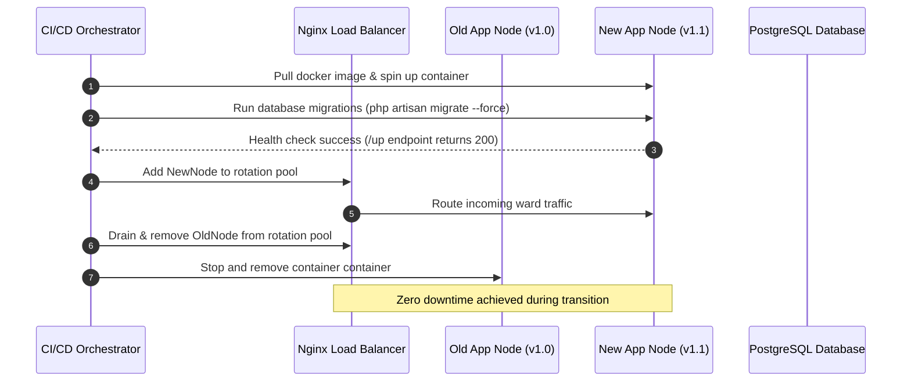

# Deployment Plan

## Environments

| Environment Name | Purpose & Isolation Level | Host Server & Network Access | Data Persistence & Seeding | Deployment Trigger |
| :--- | :--- | :--- | :--- | :--- |
| **Local Development** | Developer workstation testing, rapid iteration, and unit test execution. | Local Docker container on developer laptop (`127.0.0.1`). No public exposure. | Ephemeral SQLite or local PostgreSQL container seeded with synthetic patient datasets. | Manual local execution (`docker compose up`). |
| **Staging / UAT** | Pre-production validation, end-to-end testing, and regional hospital pilot rehearsal. | Isolated cloud VPS (`staging.simrs.klinikform.local`). Restricted IP whitelist. | Production-clone database schema with anonymized test records and mock SatuSehat/BPJS endpoints. | Automatic push to `staging` Git branch via GitHub Actions CI. |
| **Production** | Live regional hospital ward intake operations (e.g., Grobogan/Purwodadi Type C/D facilities). | Secured production cluster (`simrs.klinikform.local`). Internal hospital LAN + TLS 1.3 WAN. | Persistent PostgreSQL 14+ database with encrypted sensitive fields, immutable audit logs, and live backups. | Manual release tag approval (`v*.*.*`) after staging UAT sign-off. |

---

## Build and release pipeline

```mermaid
graph TD
    subgraph GitHub Actions CI Pipeline
        A[Git Push / Tag Release] --> B[Checkout Code & Setup PHP 8.3 / Node.js 20]
        B --> C[Composer Install & npm run build]
        C --> D[PHP CS Fixer & PHPStan Level 8 Static Analysis]
        D --> E[Execute Pest PHP Test Suite (>90% Coverage)]
        E --> F{Tests & Static Analysis Passed?}
        F -->|No| G[Abort Pipeline & Alert Developer]
        F -->|Yes| H[Build Immutable Docker Container Image]
        H --> I[Push Image to Container Registry with Version Tag]
        I --> J[Trigger Zero-Downtime Rolling Deployment via SSH/Webhook]
    end
```

### Pipeline Execution Steps
1. **Trigger & Checkout**: Developer pushes code changes or tags a release (`v1.0.0`). GitHub Actions checks out the repository.
2. **Dependency Resolution**: Installs PHP dependencies via Composer (`composer install --no-dev --optimize-autoloader`) and compiles frontend assets via Vite (`npm run build`).
3. **Quality & Static Analysis**: Executes Laravel Pint/PHP CS Fixer and `phpstan analyse --level=8`. Any warning or error aborts the pipeline.
4. **Automated Testing**: Runs the Pest PHP test suite, ensuring $\ge 90\%$ branch and line coverage across clinical validation, encryption casts, and interoperability gateways.
5. **Container Packaging**: Builds a lean, production-ready Docker image containing PHP 8.3-FPM, Nginx, and compiled Laravel assets. Pushes the image to the secure container registry.
6. **Deployment Trigger**: Connects to target hosting infrastructure via secure SSH tunnel to initiate zero-downtime rolling updates.

---

## Hosting and infrastructure as code

```mermaid
graph LR
    subgraph Production Hospital Infrastructure
        LB[Nginx Load Balancer / Reverse Proxy (TLS 1.3)] --> App1[App Node 1: PHP 8.3-FPM + Nginx]
        LB --> App2[App Node 2: PHP 8.3-FPM + Nginx]
        App1 --> Redis[(Redis 7.2 Cache & Queue Broker)]
        App2 --> Redis
        App1 --> DB[(PostgreSQL 14+ Primary DB Cluster)]
        App2 --> DB
        DB --> Backup[Encrypted Daily Object Storage Snapshots]
    end
```

### Infrastructure Provisioning Details
- **Infrastructure as Code (IaC)**: Provisioned via Terraform and containerized with Docker Compose, standardizing environments from staging to production.
- **Load Balancer**: Nginx reverse proxy terminating TLS 1.3 with HSTS enabled, distributing incoming hospital intranet traffic across stateless application worker nodes.
- **Application Nodes**: Horizontally scalable VPS instances (e.g., AWS EC2 t3.medium or DigitalOcean Premium Droplets) running PHP 8.3-FPM and Nginx.
- **Database & Cache**: Managed PostgreSQL 14+ cluster supporting JSONB indexing and strict trigger execution, backed by a dedicated Redis 7.2 cluster for session storage and queue coordination.

---

## Configuration and secrets

- **Environment Injection**: All configuration parameters and operational secrets are injected exclusively through runtime environment variables (`.env`).
- **Secret Management Standards**:
  - `APP_KEY`: Application master AES-256 symmetric encryption key.
  - `BLIND_INDEX_PEPPER`: Isolated cryptographic pepper used for HMAC-SHA256 blind indexing of patient NIKs (`nik_hash`).
  - Database credentials, Redis URLs, and external gateway tokens (`SATUSEHAT_CLIENT_ID`, `BPJS_CONS_ID`, `BPJS_SECRET_KEY`, `BPJS_USER_KEY`).
- **Security Control**: `.env` files are strictly excluded from source control via `.gitignore`. Key rotation is supported via dedicated artisan commands that re-encrypt ciphertexts under newly provisioned keys without downtime.

---

## Database migrations strategy

- **Backward-Compatible Migrations**: All database schema alterations must be strictly additive or backward-compatible to allow zero-downtime rolling deployments. Breaking changes (e.g., dropping columns) are executed across multiple staged deployments.
- **Migration Execution Order**:
  1. Deploy application code supporting both old and new schema structures.
  2. Run migration command (`php artisan migrate --force`) during deployment window.
  3. Deploy subsequent application code cleaning up legacy code paths.
- **Safety Locks**: Production migrations require the `--force` flag. Automated CI checks verify migration files for destructive SQL operations (such as `DROP TABLE` or column renames without alias handling).

---

## Rollout strategy (staged, canary, blue/green)

- **Staged Rollout Methodology**:
  1. **Phase 1 (Staging Environment)**: Full automated test suite and UAT verification in regional hospital staging cluster.
  2. **Phase 2 (Canary Deployment)**: Route 5% of live hospital ward intake traffic (e.g., a single non-critical polyclinic) to the new application container node for 2 hours, monitoring error rates and response latency.
  3. **Phase 3 (Full Production Rollout)**: Automatically promote the canary node to 100% traffic once error rates remain at $0.00\%$ and response latency stays beneath performance thresholds.
- **Rollback Mechanism**: If anomalies or high error rates are detected during canary deployment, traffic is instantly reverted to the previous stable container image tag stored in the container registry, and database migrations are rolled back only if explicitly backward-compatible.

---

## Zero-downtime procedure



---

## Monitoring, alerting, and on-call

- **Health Check Endpoints**: Dedicated monitoring route (`/up`) continuously checks database connectivity, Redis cache responsiveness, and disk storage capacity.
- **Application Performance Monitoring (APM)**: Monitored via Laravel Telescope and Prometheus/Grafana scrapers tracking request throughput, P95 latency, database query execution times, and queue backlogs.
- **Alerting Thresholds**:
  - HTTP 500 error rate $> 1\%$ over 5 minutes $\rightarrow$ PagerDuty alert to on-call engineer.
  - Database connection failures or queue worker stalls $\rightarrow$ Immediate SMS/Slack notification.
- **On-Call Rotation**: Primary and secondary SRE on-call rotation managed through PagerDuty with a 15-minute SLA for critical production incidents.

---

## Backup and disaster recovery with RTO and RPO

- **Backup Frequency & Retention**:
  - **Database Full Backups**: Executed daily at 00:00 UTC, retained for 30 days.
  - **Incremental & WAL Archiving**: Continuous PostgreSQL Write-Ahead Log (WAL) archiving captured every 15 minutes.
  - **Encrypted Storage Snapshots**: Daily automated snapshots of application configuration and encrypted volume storage.
- **Recovery Metrics**:
  - **Recovery Point Objective (RPO)**: $< 15$ minutes (guaranteed by continuous WAL archiving).
  - **Recovery Time Objective (RTO)**: $< 30$ minutes for full cluster restoration from automated object storage backups.
- **Disaster Recovery Testing**: Quarterly disaster recovery fire drills execute complete database restoration into an isolated staging recovery cluster to verify backup integrity.

---

## Runbook for common incidents

### Incident 1: Database Connection Pool Exhaustion (HTTP 500 Spike)
1. **Detection**: Prometheus alert triggers when active database connections exceed 80% of PostgreSQL `max_connections`.
2. **Triage**: Check application logs for slow queries or unclosed transactions (`tail -n 100 storage/logs/laravel.log`).
3. **Mitigation**:
   - Flush Redis cache and restart stuck queue workers: `php artisan queue:restart`.
   - If traffic surge is overwhelming the database, restart PHP-FPM pool to terminate hanging connections: `sudo systemctl restart php8.3-fpm`.
   - Scale application worker nodes horizontally if persistent.

### Incident 2: BPJS VClaim Handshake Failure / Timestamp Drift
1. **Detection**: Outbound bridging logs report HTTP 401 with body `{"metaData": {"code": "401", "message": "Timestamp kadaluarsa"}}`.
2. **Triage**: Verify server system clock synchronization against national NTP time servers.
3. **Mitigation**:
   - Force immediate NTP time sync on application host: `sudo ntpdate -s time.nist.gov` or `sudo chronyc makestep`.
   - Verify environment credentials (`BPJS_CONS_ID`, `BPJS_SECRET_KEY`) remain correctly configured.

### Incident 3: SatuSehat FHIR Sync Queue Stalling
1. **Detection**: Monitoring dashboard reports growing backlog in `satusehat_sync_queue`.
2. **Triage**: Check queue worker status (`php artisan queue:failed`).
3. **Mitigation**:
   - Restart queue workers with increased timeout: `php artisan queue:work --timeout=60`.
   - Retry failed jobs: `php artisan queue:retry all`. If specific payloads fail due to malformed ICD-10 codes, inspect submission record and correct mapping.

---

## Post-deployment checklist

- [ ] All automated Unit, Integration, and E2E Dusk tests passed successfully in CI pipeline.
- [ ] Static analysis verified clean execution under PHPStan Level 8 (0 errors).
- [ ] Database migrations executed successfully with `--force` flag; zero schema synchronization errors.
- [ ] Health check endpoint (`/up`) responds with HTTP 200 across all application nodes.
- [ ] Encrypted database connection and AES-256-GCM Eloquent decryption verified via test roundtrip.
- [ ] SatuSehat FHIR R4 test payload successfully transmitted and acknowledged by staging test harness.
- [ ] BPJS VClaim HMAC-SHA256 signature handshake and SEP generation verified successfully.
- [ ] Audit logging pipeline confirmed functional; append-only trigger verified on `audit_logs`.
- [ ] Monitoring dashboards (Grafana/Prometheus) report normal CPU, memory, and latency metrics.
- [ ] Canary deployment promoted to 100% traffic; zero error rate recorded over 2-hour observation window.
- [ ] Formal deployment sign-off recorded and communicated to regional hospital medical records officer.
## Path B: Render (free, no credit card)

For a demo that has to keep answering for months without a bill. See the
[README](../README.md#deploying-it-free) for the click-by-click version; this
section is the part that is not obvious from the platform's own docs.

### Container targets

| Target | SAPI | Used by |
| :--- | :--- | :--- |
| `base` | `artisan serve` | Development and the test suites. Copies no source — compose mounts it. |
| `deploy` | `artisan serve` | PaaS hosts. Source copied, `composer install --no-dev`, assets built. |
| `fpm` | `php-fpm` | The VPS path, behind Nginx per deployment.md §5. |
| `dusk` | `artisan serve` + Chromium | Browser tests. |

### Why the `assets` stage is mandatory

`/public/build` is in `.gitignore`, so the compiled CSS and JS are never in the
repository. Without the `node:22-alpine` stage that runs `npm ci && npm run
build`, an image built from this Dockerfile serves the application with **no
stylesheet and no script at all** — the login page renders as unstyled Times
New Roman. Any deployment path that does not go through that stage is broken.

### Why Redis is not used

`SESSION_DRIVER`, `CACHE_STORE` and `QUEUE_CONNECTION` all default to `redis`
in `.env.example` because that is the correct shape for the local compose
stack. On a PaaS host, a hosted Redis is a second billable service and the
tables it would replace (`cache`, `sessions`, `jobs`, `job_batches`,
`failed_jobs`) already ship in the migrations. Switch all three to `database`.

### Two ceilings worth naming

- **`QUEUE_CONNECTION=sync` on Render.** The SatuSehat sync job runs inline in
  the request that created the encounter, costing about a second on that one
  request. A separate queue worker would consume more of the 750 free
  instance-hours than a demo is worth. Upgrade path: set it to `database` and
  add a Render background worker running `php artisan queue:work`.
- **The 0.1 vCPU free instance.** The NFR-03 latency figure in `testing.md` was
  measured on 12 vCPU, not on the free tier. Treat it as a regression guard
  from CI, not as a claim about the hosted demo.

### First boot

```bash
php artisan migrate --force    # configured as the blueprint's preDeployCommand
php artisan db:seed            # once, from the platform shell
```

`APP_KEY`, `BLIND_INDEX_PEPPER` and `FAPI_TOKEN` are generated by the blueprint
and injected at boot rather than baked into the image — an `APP_KEY` inside a
published container image is a published secret.

### Before making it public

Rotate `BLIND_INDEX_PEPPER` and `FAPI_TOKEN` if they have ever been pasted into
a screenshot, a chat window or a commit. On a fresh Neon project there is no
encrypted data to lose, so a rotation now is free — the same change made later,
after real records exist, is not.
