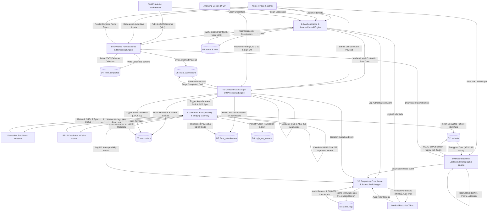
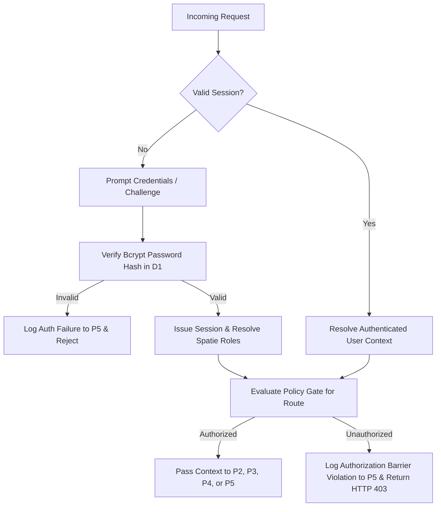
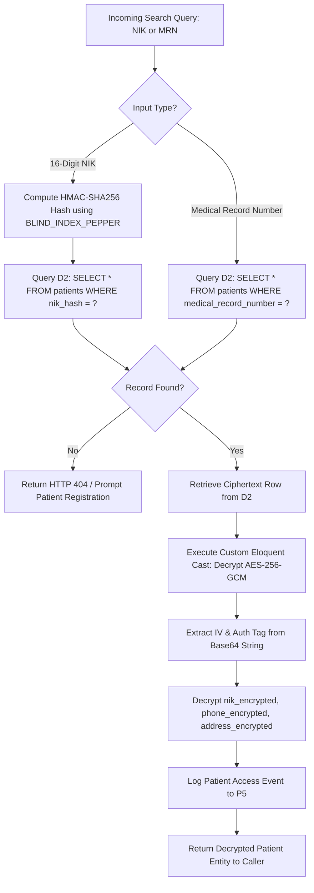
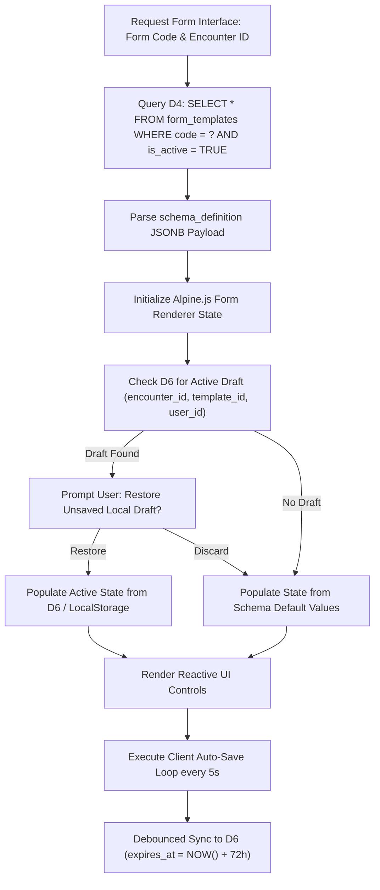
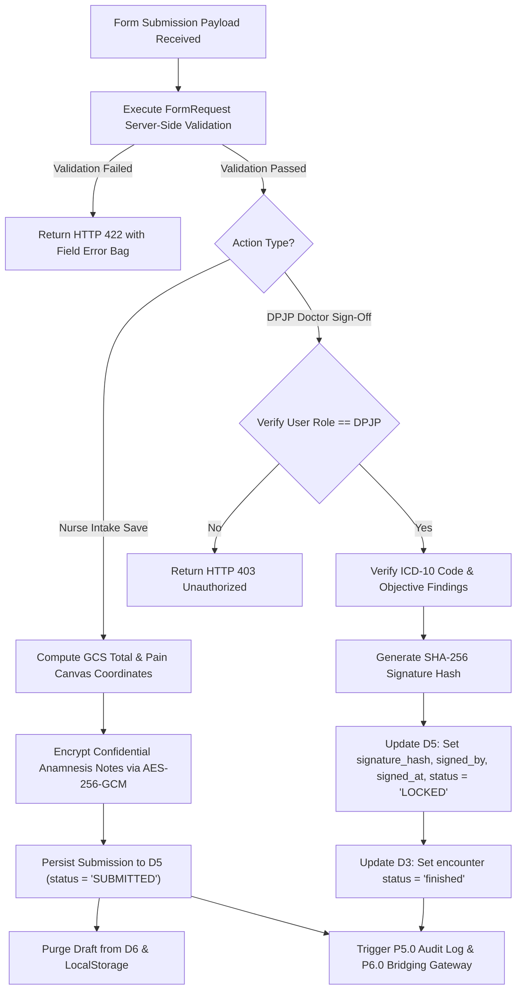
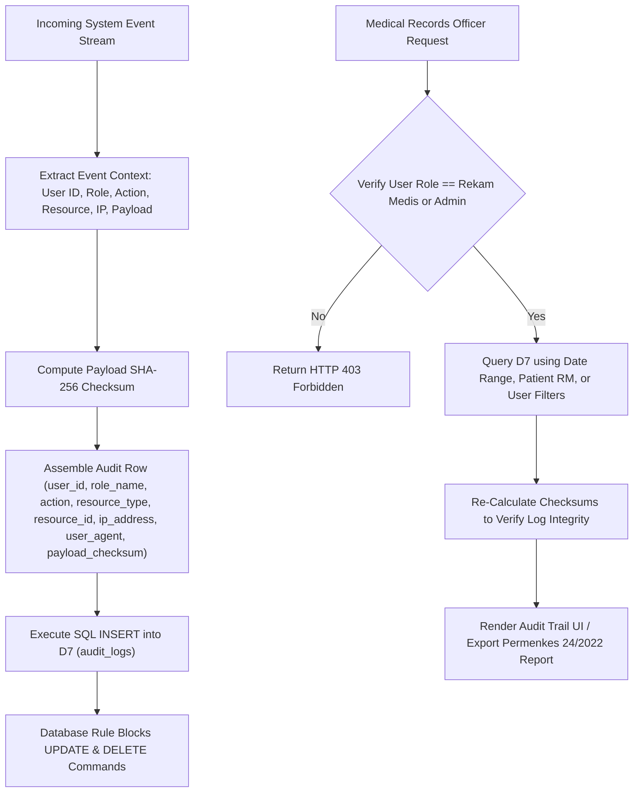
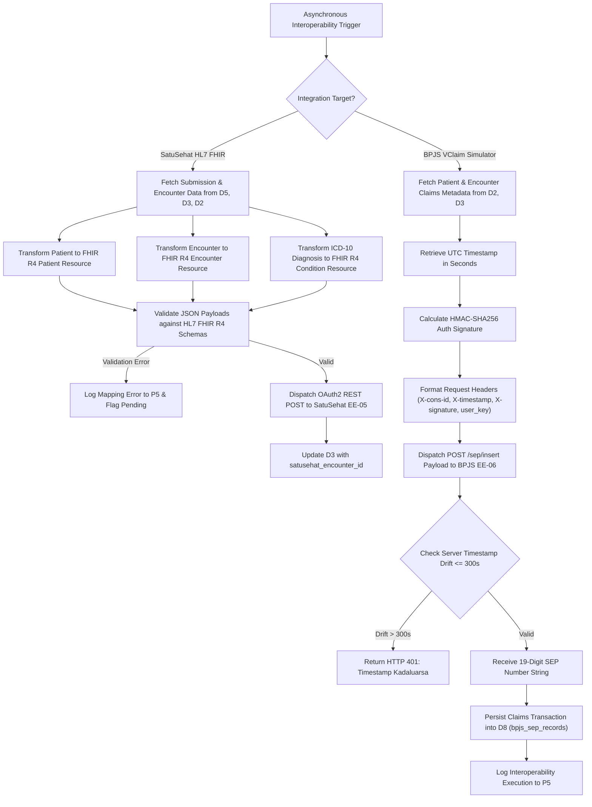
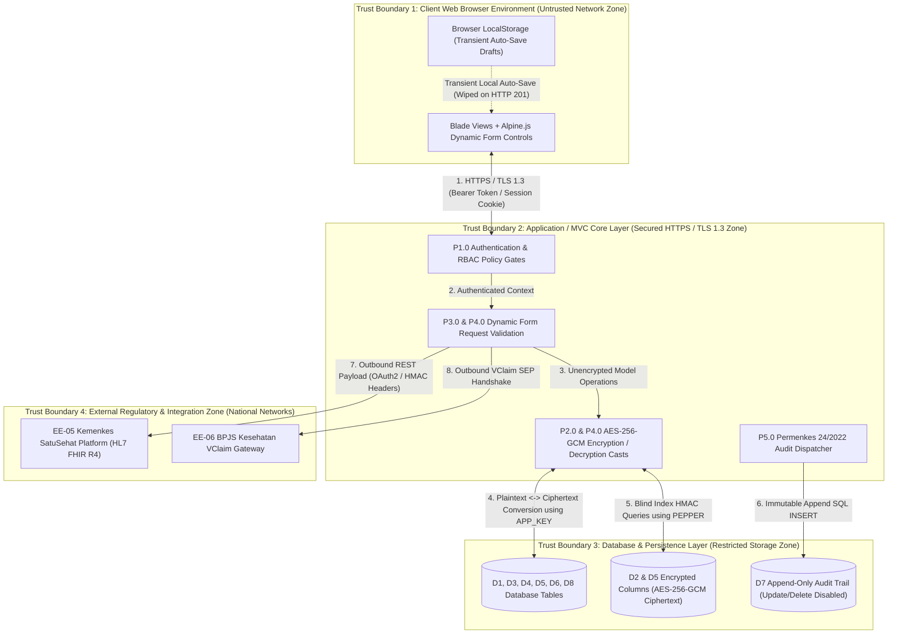

# Data Flow Diagram

## Context Diagram (Level 0)

The Context Diagram (Level 0) defines the system boundary of **KlinikForm SIMRS**. The subsystem acts as a secure, metadata-driven clinical intake engine that interfaces human actors across hospital wards with regulatory health authorities and insurance clearinghouses.

```mermaid
graph TD
    subgraph KlinikForm SIMRS Subsystem
        P0["0.0 KlinikForm SIMRS Subsystem<br/>(Laravel 11 Core, Dynamic Form Engine, AES-256 Cryptography & Interoperability Gateway)"]
    end

    EE_Nurse["Nurse (Triage & Ward)<br/>[Triage & Intake Operations]"]
    EE_Doctor["Attending Doctor (DPJP)<br/>[Diagnostic & Clinical Sign-Off]"]
    EE_Admin["SIMRS Admin / Implementer<br/>[Schema & Configuration Management]"]
    EE_RekamMedis["Medical Records Officer<br/>[Audit & Compliance Review]"]
    EE_SatuSehat["Kemenkes SatuSehat Platform<br/>[National HL7 FHIR R4 Repository]"]
    EE_BPJS["BPJS Kesehatan VClaim Server<br/>[Insurance Eligibility & SEP Gateway]"]

    %% Nurse Flows
    EE_Nurse -->|"1. Patient NIK / RM Lookup & Intake Data<br/>2. GCS Values & Pain Canvas Coordinates"| P0
    P0 -->|"1. Active Intake Schema & Calculated Scores<br/>2. Local Draft Recovery Prompts & Submission Status"| EE_Nurse

    %% Doctor Flows
    EE_Doctor -->|"1. Worklist Request & Objective Findings<br/>2. ICD-10 Diagnostic Search & Cryptographic Sign-Off"| P0
    P0 -->|"1. Decrypted Nurse Anamnesis & Patient History<br/>2. Locked Record Verification Stamp"| EE_Doctor

    %% Admin Flows
    EE_Admin -->|"1. JSON Schema Definition Updates (v1.x)<br/>2. Bridging Configuration & Test Payloads"| P0
    P0 -->|"1. Schema Validation Reports & Version Logs<br/>2. Interoperability Handshake Status"| EE_Admin

    %% Medical Records Flows
    EE_RekamMedis -->|"1. Permenkes 24/2022 Audit Filters<br/>2. Archival & Compliance Report Requests"| P0
    P0 -->|"1. Immutable Audit Trail Logs<br/>2. Signed Integrity Checksum Verification Reports"| EE_RekamMedis

    %% SatuSehat Interoperability
    P0 -->|"1. FHIR R4 Encounter Payload (JSON)<br/>2. FHIR R4 Condition Payload (ICD-10)"| EE_SatuSehat
    EE_SatuSehat -->|"1. IHS Patient ID & IHS Practitioner ID<br/>2. Transaction Acknowledgement (HTTP 200/201)"| P0

    %% BPJS VClaim Interoperability
    P0 -->|"1. HMAC-SHA256 Auth Headers (ConsID, Timestamp, Signature)<br/>2. SEP Creation Payload (Kartu BPJS, Poli, Referral)"| EE_BPJS
    EE_BPJS -->|"1. 19-Digit SEP Number & Participant Coverage Status<br/>2. VClaim Error Response (e.g., Code 401 Timestamp Expired)"| P0
```

### Context Boundary Description
- **System Boundary**: Encompasses the Laravel 11 application layer, dynamic JSON schema renderer, custom Eloquent AES-256-GCM encryption cast, blind index calculation engine, client-side Alpine.js state managers, append-only audit logger, and outbound FHIR/VClaim API serializers.
- **Inputs**: User credentials, 16-digit patient NIKs, vital sign measurements, Glasgow Coma Scale (GCS) sub-scores, anatomical pain map relative percentages, free-text anamnesis notes, ICD-10 diagnosis selections, versioned JSON schema definitions, and BPJS verification queries.
- **Outputs**: Rendered Blade dynamic forms, real-time calculated GCS totals and pediatric drug dosages, encrypted database persistence, locked digital record stamps with SHA-256 payload signatures, HL7 FHIR R4 `Encounter` and `Condition` JSON bundles, 19-character BPJS *Surat Eligibilitas Peserta* (SEP) strings, and Permenkes No. 24/2022 compliance audit exports.

---

## Level 1 Decomposition

The Level 1 Data Flow Diagram decomposes Process 0.0 into six discrete functional processes, illustrating data movement between processing engines, field-encrypted data stores, and external systems.

---

## External Entities

The system interfaces with four internal human user roles and two external government/insurer network entities.

| Entity ID | Entity Name | Type | Description | Primary Data Inputs to System | Primary Data Outputs from System | Protocol / Interface | Trust Level |
| :--- | :--- | :--- | :--- | :--- | :--- | :--- | :--- |
| **EE-01** | **Triage & Ward Nurse** | Human Persona | Frontline nurse executing physical intake in IGD or inpatient wards. | Credentials, Patient NIK, Vital signs, GCS scores, Pain coordinates, Free-text anamnesis. | Dynamic forms, Validation feedback, Calculated GCS/dosages, Saved status indicators. | HTTPS / Web Browser (Blade + Alpine.js) | Authenticated (Role: `Triage Nurse`) |
| **EE-02** | **Attending Doctor (DPJP)** | Human Persona | Examining physician responsible for diagnostic sign-off and treatment. | Credentials, Objective exam notes, ICD-10 search queries, Prescription overrides, Sign-off trigger. | Worklist, Decrypted nurse intake, ICD-10 suggestions, Locked record status, Digital stamp. | HTTPS / Web Browser (Blade + Alpine.js) | Authenticated (Role: `DPJP`) |
| **EE-03** | **SIMRS Admin / Engineer** | Human Persona | Implementer managing hospital ward schemas and bridging setups. | Credentials, Versioned JSON form schemas, Field mapping rules, API staging credentials. | Schema validation logs, Syntax error banners, System metrics, Version activation history. | HTTPS / Web Browser (Blade Admin UI) | Authenticated (Role: `Admin`) |
| **EE-04** | **Medical Records Officer** | Human Persona | Regulatory officer overseeing Permenkes No. 24/2022 compliance. | Credentials, Audit search filters (date range, RM number, action type), Export requests. | Access audit trails, Checksum verification states, Permenkes compliance PDF reports. | HTTPS / Web Browser (Compliance UI) | Authenticated (Role: `Rekam Medis`) |
| **EE-05** | **Kemenkes SatuSehat Platform** | Remote System | Indonesian MoH national health data repository (HL7 FHIR R4). | IHS Patient ID, IHS Practitioner ID, Resource sync HTTP status (200/201/400/500). | HL7 FHIR R4 `Encounter` JSON resources, HL7 FHIR R4 `Condition` JSON resources. | HTTPS / REST API (OAuth2 + JSON) | External Boundary (TLS 1.3 Strict) |
| **EE-06** | **BPJS Kesehatan VClaim Server** | Remote System | National health insurance clearinghouse for SEP claim verification. | SEP creation response (`noSep`, `catatan`), HTTP status, BPJS error metadata. | Authorization headers (`X-cons-id`, `X-timestamp`, `X-signature`, `user_key`), SEP request payload. | HTTPS / REST API (HMAC-SHA256 Auth) | External Boundary (TLS 1.3 Strict) |

---

## Data Stores

The system maintains eight logical data stores supporting field-level encryption, dynamic JSON schema querying, auto-save buffers, and append-only auditing.

| Store ID | Data Store Name | Primary Entity / Table | Physical Storage Engine | Encryption & Security Constraints | Access Operations (Read / Write) |
| :--- | :--- | :--- | :--- | :--- | :--- |
| **D1** | **User Credentials & RBAC Store** | `users`, `roles`, `model_has_roles` | PostgreSQL / MySQL Relational | Passwords hashed via Bcrypt/Argon2id. Sensitive practitioner NIKs blind-indexed (`nik_hash`). | **Read**: P1 (Auth), P4 (Sign-off), P5 (Audit). **Write**: System setup / Admin management. |
| **D2** | **Encrypted Patient Registry** | `patients` | PostgreSQL / MySQL Relational | `nik_encrypted`, `phone_encrypted`, `address_encrypted` encrypted via AES-256-GCM. `nik_hash` HMAC-SHA256 indexed. | **Read**: P2 (Lookup), P4 (Intake), P6 (Bridging). **Write**: P2 (Patient creation/update). |
| **D3** | **Clinical Encounters Registry** | `encounters` | PostgreSQL / MySQL Relational | Unencrypted operational visit records. Soft locks enforced upon status transition to `finished`. | **Read**: P4 (Intake), P6 (Bridging), P5 (Audit). **Write**: P4 (Status transition, DPJP assignment). |
| **D4** | **Dynamic Form Schema Store** | `form_templates` | PostgreSQL / MySQL (`JSONB` column) | Schema definitions stored as versioned JSONB. Partial unique index guarantees single active version per code. | **Read**: P3 (Rendering), P4 (Validation). **Write**: P3 (Schema version creation by Admin). |
| **D5** | **Clinical Submissions Store** | `form_submissions` | PostgreSQL / MySQL (`JSONB` column) | Narrative anamnesis encrypted via AES-256-GCM inside JSON/text. SHA-256 `signature_hash` enforces immutability when `status = 'LOCKED'`. | **Read**: P4 (Doctor review), P6 (Bridging), P5 (Audit). **Write**: P4 (Nurse intake save, Doctor sign-off). Update/Delete blocked when LOCKED. |
| **D6** | **Auto-Save Draft Storage** | `draft_submissions` | PostgreSQL / MySQL (`JSONB` column) + LocalStorage | Ephemeral buffers with a 72-hour `expires_at` TTL. Purged immediately upon form submission. | **Read**: P3 (Draft restore), P4 (Submission conversion). **Write**: P3 (Debounced sync), P4 (Draft purge). |
| **D7** | **Immutable Access Audit Trail** | `audit_logs` | PostgreSQL / MySQL Append-Only Table | Append-only store. Database rules/triggers reject all SQL `UPDATE` and `DELETE` commands. Payload checksums stored as SHA-256. | **Read**: P5 (Compliance review). **Write**: P5 (Append log event from P1, P2, P3, P4, P6). Modifying existing rows strictly blocked. |
| **D8** | **BPJS VClaim Claims Registry** | `bpjs_sep_records` | PostgreSQL / MySQL Relational | Stores calculated HMAC signatures, request timestamps, 19-digit SEP strings, and raw JSON response payloads. | **Read**: P6 (Claim review), EE-01/02 (SEP print). **Write**: P6 (SEP generation persistence). |

---

## Process Specifications

### Process 1.0: Authentication & Access Control Engine

#### Processing Logic & Rules
1. **Credential Verification**:
   - Accepts login credentials (`email`, `password`). Queries `users` table in **D1**.
   - Computes `Hash::check(password, user.password)`. If invalid, triggers `P5.0` (`action = 'LOGIN_FAILED'`) and returns HTTP 401.
2. **Role & Policy Resolution**:
   - Loads Spatie roles and permissions from `model_has_roles` and `roles` in **D1**.
   - Evaluates Laravel Gate policies (`NursePolicy`, `DoctorPolicy`, `AdminPolicy`, `AuditPolicy`) for requested route actions:
     - `Nurse`: Permitted to execute `P2.0` (lookup), `P3.0` (drafting), `P4.0` (submit intake). Blocked from signing assessments or publishing schemas.
     - `DPJP Doctor`: Permitted to execute `P2.0`, `P4.0` (edit medical findings, assign ICD-10, sign & lock). Blocked from editing schemas.
     - `Admin`: Permitted to execute `P3.0` (publish schemas), manage users. Blocked from modifying signed clinical notes without emergency flags.
     - `Rekam Medis`: Permitted to execute `P5.0` (view audit trails, export reports). Read-only clinical access.
3. **Session Context Propagation**:
   - Binds authenticated `user_id`, active `role_name`, client `ip_address`, and `user_agent` to execution context for downstream audit logging.

---

### Process 2.0: Patient Identifier Lookup & Cryptographic Engine

#### Processing Logic & Rules
1. **Blind Index Computation**:
   - For NIK search (`3315012345670001`), normalizes input string (strips spaces/dashes).
   - Computes deterministic blind index:
     $$\text{nik\_hash} = \text{hash\_hmac}('sha256', \text{nik\_normalized}, \text{config}('app.blind\_index\_pepper'))$$
   - Queries store **D2**: `SELECT * FROM patients WHERE nik_hash = :nik_hash LIMIT 1`. Executed in $O(1)$ time without scanning unencrypted rows.
2. **AES-256-GCM Field Decryption**:
   - Retrieves stored Base64 string from `nik_encrypted`, `phone_encrypted`, or `address_encrypted`.
   - Decodes Base64 structure containing: `payload` (ciphertext), `iv` (12-byte initialization vector), and `tag` (16-byte authentication tag).
   - Decrypts using OpenSSL:
     $$\text{plaintext} = \text{openssl\_decrypt}(\text{ciphertext}, \text{'aes-256-gcm'}, \text{APP\_KEY}, 0, \text{iv}, \text{tag})$$
   - If tag validation fails (indicating database tampering), throws a `CryptographicIntegrityException` and alerts `P5.0`.
3. **Audit Attribution**:
   - Dispatches read event to `P5.0` recording `action = 'VIEW'`, `resource_type = 'Patient'`, `resource_id = patient.id`.

---

### Process 3.0: Dynamic Form Schema & Rendering Engine

#### Processing Logic & Rules
1. **Schema Retrieval & Version Binding**:
   - Receives form code (e.g., `TRIAGE-ED-01`) and encounter UUID.
   - Queries **D4** for active version (`is_active = TRUE`). Parses `schema_definition` JSON structure containing field configurations, validation constraints, and conditional visibility rules.
   - If rendering a historical submission, queries **D4** using the specific `schema_version` bound to the submission record rather than the latest version.
2. **Dynamic Rule Evaluation**:
   - Binds Alpine.js reactive components to JSON directives:
     - Conditional evaluation: `travel_endemic_area` field displays only when `body_temperature >= 38.0`.
     - Numeric boundary checks: Systolic BP enforced strictly within range $[40, 300]\text{ mmHg}$.
3. **Dual-Tier Draft Buffering**:
   - Client writes state to browser `localStorage` key `draft_{encounter_id}_{template_id}` every 5 seconds.
   - Debounced background AJAX worker posts state to **D6** (`draft_submissions`) every 30 seconds, maintaining server-side draft recovery across device crashes.

---

### Process 4.0: Clinical Intake & Sign-Off Processing Engine

#### Processing Logic & Rules
1. **Dynamic Validation & Clinical Calculations**:
   - Validates incoming request parameters against schema rules stored in **D4**.
   - Computes Glasgow Coma Scale (GCS) total:
     $$\text{GCS}_{\text{total}} = \text{Eye} (1\text{--}4) + \text{Verbal} (1\text{--}5) + \text{Motor} (1\text{--}6)$$
     Assigns consciousness category: $\text{Coma} (3)$, $\text{Sopor} (4\text{--}8)$, $\text{Somnolent} (9\text{--}11)$, $\text{Apatis} (12\text{--}14)$, $\text{Compos Mentis} (15)$.
   - Converts anatomical pain markers into normalized JSON arrays: `[{"x": 48.2, "y": 32.5, "region": "epigastrium", "severity": 7}]`.
2. **Anamnesis Encryption**:
   - Encrypts confidential narrative notes using AES-256-GCM prior to SQL `INSERT` into `form_submissions.encrypted_anamnesis` in **D5**.
3. **Cryptographic Sign-Off & Lock Enforcement**:
   - Upon DPJP sign-off request, verifies user holds role `DPJP` via **D1**.
   - Formulates signature concatenation payload:
     $$\text{sig\_payload} = \text{submission\_id} + \text{payload\_json} + \text{dpjp\_user\_id} + \text{timestamp}$$
   - Calculates cryptographic SHA-256 hash:
     $$\text{signature\_hash} = \text{hash}('sha256', \text{sig\_payload})$$
   - Sets `status = 'LOCKED'`, `signature_hash`, `signed_by`, and `signed_at`.
   - Post-condition: Database triggers block subsequent SQL `UPDATE` and `DELETE` commands on locked submission UUIDs in **D5**.
4. **Draft Clearance & Pipeline Escalation**:
   - Purges corresponding draft row in **D6**.
   - Dispatches event to `P5.0` (`action = 'LOCK'`) and queues background jobs for `P6.0`.

---

### Process 5.0: Regulatory Compliance & Access Audit Logger

#### Processing Logic & Rules
1. **Event Capture & Checksum Generation**:
   - Intercepts all application events (`VIEW`, `CREATE`, `UPDATE`, `LOCK`, `EXPORT`, `LOGIN`).
   - Computes SHA-256 checksum of target resource state:
     $$\text{payload\_checksum} = \text{hash}('sha256', \text{json\_encode}(\text{target\_model\_attributes}))$$
2. **Immutable Persistence**:
   - Appends audit row to store **D7** (`audit_logs`).
   - Enforces table immutability: Store **D7** has explicit database rules overriding update/delete attempts (`ON UPDATE DO INSTEAD NOTHING`, `ON DELETE DO INSTEAD NOTHING`).
3. **Compliance Audit Inspection**:
   - Receives query filters from Medical Records Officer via **D1** authorized session.
   - Returns paginated audit trail. Verifies payload checksums against active database states; flags discrepancies as potential unauthorized database modifications.

---

### Process 6.0: External Interoperability & Bridging Gateway

#### Processing Logic & Rules
1. **SatuSehat HL7 FHIR R4 Mapping**:
   - Fetches locked submission data from **D5**, encounter from **D3**, and decrypted patient from **D2**.
   - Serializes data into HL7 FHIR R4 resource definitions:
     - `Encounter`: `status` (`arrived` $\rightarrow$ `finished`), `class` (`EMER` or `IMP`), `subject` (`Patient/{ihs_patient_id}`), `participant` (`Practitioner/{ihs_practitioner_id}`), `period` (`admission_time` to `discharge_time`).
     - `Condition`: `clinicalStatus` (`active`), `verificationStatus` (`confirmed`), `code.coding` (`system: "http://hl7.org/fhir/sid/icd-10"`, `code: primary_icd10_code`).
   - Dispatches payload to Kemenkes SatuSehat REST API (**EE-05**). Updates `satusehat_encounter_id` in **D3** upon HTTP 201 response.
2. **BPJS VClaim HMAC-SHA256 Handshake & SEP Generation**:
   - Calculates BPJS authorization signature header using UTC timestamp $T$:
     $$\text{sig\_string} = \text{ConsID} + \text{"\&"} + T$$
     $$\text{X-signature} = \text{base64\_encode}(\text{hash\_hmac}('sha256', \text{sig\_string}, \text{SecretKey}, \text{true}))$$
   - Sends request to BPJS VClaim Gateway (**EE-06**) with headers: `X-cons-id`, `X-timestamp`, `X-signature`, `user_key`.
   - Validates that server timestamp $T_{\text{server}}$ satisfies $|T_{\text{client}} - T_{\text{server}}| \le 300\text{ seconds}$. If drifted, returns HTTP 401 with BPJS code `401: Timestamp kadaluarsa`.
   - Upon successful verification, receives 19-character SEP string formatted as `0301R001{MM}{YY}B{7-digit-counter}` and stores transaction payload in **D8** (`bpjs_sep_records`). Logs event to `P5.0`.

---

## Trust Boundaries

The system is compartmentalized into four distinct security trust boundaries to enforce defense-in-depth isolation across networks, application runtime layers, persistent data stores, and external government API boundaries.

### Trust Boundary Details

| Boundary ID | Boundary Name | Cross-Boundary Data Flows | Inbound Protection Mechanisms | Outbound Sanitization / Encryption | Risk & Mitigation |
| :--- | :--- | :--- | :--- | :--- | :--- |
| **TB-01** | **Client Web Browser Zone** | User inputs $\rightarrow$ System; Rendered forms $\rightarrow$ User. | Session cookies with `HttpOnly`, `Secure`, `SameSite=Strict`. CSRF tokens on all POST requests. | Inputs sanitized via HTML entity encoding; XSS protection in Blade templating (`{{ }}`). | **Risk**: Unsubmitted draft exposure on shared hospital workstations. **Mitigation**: LocalStorage draft keys purged immediately upon HTTP 201 receipt; auto-wipe after 72 hours. |
| **TB-02** | **Application / MVC Core Zone** | HTTP Requests $\rightarrow$ Controllers; Controllers $\rightarrow$ DB Models / APIs. | Authentication middleware (`auth:web`), Spatie RBAC Gates/Policies, FormRequest schema validation. | Decrypted patient attributes restricted to memory scope during execution; never rendered in debug logs. | **Risk**: Privilege escalation / unauthorized clinical edit. **Mitigation**: Strict role checks (`Nurse` vs `DPJP`); record status locking prevents edits once signed. |
| **TB-03** | **Database Persistence Zone** | App Models $\rightarrow$ DB Tables; DB Tables $\rightarrow$ App Models. | PostgreSQL/MySQL socket access isolated to application host IP. Cryptographic keys injected via env. | Fields `nik`, `phone`, `address`, `anamnesis` encrypted via AES-256-GCM. NIK hashed via HMAC-SHA256 pepper. | **Risk**: Plaintext exposure during database backup leaks or infrastructure breach. **Mitigation**: 100% encryption at rest for sensitive fields; audit table triggers block updates/deletes. |
| **TB-04** | **External Integration Zone** | App $\rightarrow$ SatuSehat / BPJS; SatuSehat / BPJS $\rightarrow$ App. | Mutual TLS / TLS 1.3 encryption, OAuth2 bearer tokens, HMAC-SHA256 signature verification. | Strips internal system identifiers; formats identity to national standard specs (`nik`, `ihs_id`, `bpjs_card`). | **Risk**: Replay attacks / timestamp spoofing on BPJS VClaim claim submissions. **Mitigation**: Enforces strict $\pm 300\text{ second}$ timestamp validation window; unique HMAC signatures per request. |

### Data Crossing Verification Matrix

1. **Crossing TB-01 to TB-02 (Browser to Application Server)**:
   - All incoming form data must pass `FormRequest` validation. Unvalidated JSON inputs are rejected with HTTP 422 before reaching business logic or data persistence services.
2. **Crossing TB-02 to TB-03 (Application Server to Persistent Database)**:
   - Sensitive fields pass through custom Eloquent Casts (`EncryptedGcm`). The engine generates a unique 12-byte IV per write operation, executes AES-256-GCM encryption using `APP_KEY`, and appends a 16-byte authentication tag. Plaintext sensitive data never crosses into raw SQL queries.
3. **Crossing TB-02 to TB-04 (Application Server to External Gateways)**:
   - Patient identity attributes are mapped to official government standards (NIK mapped to `https://fhir.kemkes.go.id/id/nik`). Headers calculated using SHA-256 HMAC prevent tampering during network transmission to Kemenkes SatuSehat or BPJS Kesehatan.