# Entity Relationship Diagram

## Entities
The database schema for **KlinikForm SIMRS** is designed to support high-throughput clinical data intake, versioned dynamic form definitions, field-level authenticated AES-256-GCM encryption, blind-indexed searching for Indonesian national identifiers (NIK), SatuSehat HL7 FHIR R4 interoperability mapping, BPJS VClaim transactions, and an immutable Permenkes No. 24/2022 compliant access audit trail.

The core domain consists of the following 10 logical entities:
1. `users`: System operators and clinical personnel (nurses, attending doctors/DPJP, medical records officers, SIMRS engineers).
2. `roles`: Spatie-compatible RBAC role definitions enforcing clinical privilege boundaries.
3. `model_has_roles`: Polymorphic role-to-user assignment pivot entity.
4. `patients`: Master patient demographic registry containing encrypted NIK, phone, and address data with deterministic blind index hashes.
5. `encounters`: Clinical service visits (IGD emergency or rawat inap inpatient) tying patients to attending practitioners and care periods.
6. `form_templates`: Metadata registry storing versioned dynamic clinical form JSON schemas with activation flags.
7. `form_submissions`: Instantiated clinical form payloads holding calculated clinical values, encrypted anamnesis text, and cryptographic sign-off hashes.
8. `draft_submissions`: Short-lived temporary storage for client-side auto-save synchronization to guard against network dropouts.
9. `audit_logs`: Append-only, tamper-evident audit store tracking every access, read, write, export, and authentication event per Permenkes No. 24/2022.
10. `bpjs_sep_records`: Simulated and verified BPJS VClaim *Surat Eligibilitas Peserta* records binding patient encounters to insurance claims.

---

## Attributes with types, nullability, and defaults

### 1. `users`
Represents hospital personnel authorized to interact with the SIMRS clinical intake module.

| Column | Data Type | Nullable | Default | Description |
| :--- | :--- | :--- | :--- | :--- |
| `id` | `UUID` | No | `gen_random_uuid()` | Primary Key (UUIDv4). |
| `name` | `VARCHAR(255)` | No | None | Clinician or operator full name with academic titles. |
| `email` | `VARCHAR(255)` | No | None | Unique system login username / corporate email. |
| `password` | `VARCHAR(255)` | No | None | Bcrypt / Argon2id password hash. |
| `sip_number` | `VARCHAR(100)` | Yes | `NULL` | Surat Izin Praktik (Practitioner License Number). |
| `nik_hash` | `CHAR(64)` | Yes | `NULL` | HMAC-SHA256 blind index hash of practitioner NIK. |
| `ihs_practitioner_id` | `VARCHAR(64)` | Yes | `NULL` | SatuSehat MoH Practitioner Master ID (IHS number). |
| `remember_token` | `VARCHAR(100)` | Yes | `NULL` | Laravel remember me token. |
| `created_at` | `TIMESTAMP WITH TIME ZONE` | No | `CURRENT_TIMESTAMP` | Row creation timestamp. |
| `updated_at` | `TIMESTAMP WITH TIME ZONE` | No | `CURRENT_TIMESTAMP` | Row update timestamp. |

### 2. `roles`
Role definitions for role-based access control.

| Column | Data Type | Nullable | Default | Description |
| :--- | :--- | :--- | :--- | :--- |
| `id` | `BIGINT UNSIGNED` | No | Auto-increment | Primary key. |
| `name` | `VARCHAR(125)` | No | None | Role identifier (`Triage Nurse`, `DPJP`, `Admin`, `Rekam Medis`). |
| `guard_name` | `VARCHAR(125)` | No | `'web'` | Authentication guard boundary. |
| `created_at` | `TIMESTAMP WITH TIME ZONE` | No | `CURRENT_TIMESTAMP` | Record creation timestamp. |
| `updated_at` | `TIMESTAMP WITH TIME ZONE` | No | `CURRENT_TIMESTAMP` | Record update timestamp. |

### 3. `model_has_roles`
Polymorphic join table mapping roles to user models.

| Column | Data Type | Nullable | Default | Description |
| :--- | :--- | :--- | :--- | :--- |
| `role_id` | `BIGINT UNSIGNED` | No | None | Foreign key referencing `roles.id`. |
| `model_type` | `VARCHAR(255)` | No | None | Polymorphic model class (`App\Models\User`). |
| `model_id` | `UUID` | No | None | Polymorphic model UUID referencing `users.id`. |

### 4. `patients`
Demographic patient registry. Fields `nik_encrypted`, `phone_encrypted`, and `address_encrypted` store Base64 AES-256-GCM ciphertexts including 12-byte IV and 16-byte authentication tags.

| Column | Data Type | Nullable | Default | Description |
| :--- | :--- | :--- | :--- | :--- |
| `id` | `UUID` | No | `gen_random_uuid()` | Primary Key (UUIDv4). |
| `medical_record_number` | `VARCHAR(32)` | No | None | Hospital Medical Record Number (*Nomor Rekam Medis*). |
| `nik_encrypted` | `TEXT` | No | None | AES-256-GCM encrypted 16-digit national ID. |
| `nik_hash` | `CHAR(64)` | No | None | Deterministic HMAC-SHA256 blind index hash of NIK. |
| `full_name` | `VARCHAR(255)` | No | None | Patient legal name matching KTP identity. |
| `birth_date` | `DATE` | No | None | Date of birth for age and dosage calculations. |
| `gender` | `VARCHAR(10)` | No | None | Biological sex (`male`, `female`). |
| `phone_encrypted` | `TEXT` | Yes | `NULL` | AES-256-GCM encrypted primary contact telephone. |
| `address_encrypted` | `TEXT` | Yes | `NULL` | AES-256-GCM encrypted residential address. |
| `ihs_patient_id` | `VARCHAR(64)` | Yes | `NULL` | SatuSehat MoH Patient Master ID (IHS number). |
| `bpjs_card_number` | `VARCHAR(16)` | Yes | `NULL` | 13-digit Indonesian BPJS Kesehatan insurance card number. |
| `created_at` | `TIMESTAMP WITH TIME ZONE` | No | `CURRENT_TIMESTAMP` | Row creation timestamp. |
| `updated_at` | `TIMESTAMP WITH TIME ZONE` | No | `CURRENT_TIMESTAMP` | Row update timestamp. |
| `deleted_at` | `TIMESTAMP WITH TIME ZONE` | Yes | `NULL` | Soft deletion timestamp. |

### 5. `encounters`
Admission encounters representing outpatient, emergency, or inpatient visits.

| Column | Data Type | Nullable | Default | Description |
| :--- | :--- | :--- | :--- | :--- |
| `id` | `UUID` | No | `gen_random_uuid()` | Primary Key (UUIDv4). |
| `encounter_number` | `VARCHAR(64)` | No | None | Human-readable encounter code (e.g., `ENC-202503-0012`). |
| `patient_id` | `UUID` | No | None | Foreign key referencing `patients.id`. |
| `dpjp_user_id` | `UUID` | Yes | `NULL` | Attending physician foreign key referencing `users.id`. |
| `encounter_type` | `VARCHAR(32)` | No | None | Class of encounter (`EMER` emergency, `IMP` inpatient, `AMB` outpatient). |
| `status` | `VARCHAR(32)` | No | `'arrived'` | FHIR encounter status (`arrived`, `in-progress`, `finished`, `cancelled`). |
| `service_unit` | `VARCHAR(64)` | No | None | Hospital department/ward (e.g., `IGD`, `Bangsal Dahlia`). |
| `admission_time` | `TIMESTAMP WITH TIME ZONE` | No | `CURRENT_TIMESTAMP` | Actual admission timestamp. |
| `discharge_time` | `TIMESTAMP WITH TIME ZONE` | Yes | `NULL` | Actual discharge / transfer timestamp. |
| `satusehat_encounter_id`| `VARCHAR(64)` | Yes | `NULL` | Synchronized SatuSehat FHIR Encounter Resource UUID. |
| `created_at` | `TIMESTAMP WITH TIME ZONE` | No | `CURRENT_TIMESTAMP` | Row creation timestamp. |
| `updated_at` | `TIMESTAMP WITH TIME ZONE` | No | `CURRENT_TIMESTAMP` | Row update timestamp. |

### 6. `form_templates`
Definitions of dynamic clinical instruments stored as declarative JSON schemas.

| Column | Data Type | Nullable | Default | Description |
| :--- | :--- | :--- | :--- | :--- |
| `id` | `UUID` | No | `gen_random_uuid()` | Primary Key (UUIDv4). |
| `code` | `VARCHAR(64)` | No | None | Template family code (`TRIAGE-ED-01`, `ASSESS-INPAT-01`). |
| `name` | `VARCHAR(255)` | No | None | Human-readable form title. |
| `version` | `INTEGER` | No | `1` | Monotonically increasing schema version number. |
| `schema_definition` | `JSONB` | No | None | JSON schema specifications (fields, rules, widgets). |
| `is_active` | `BOOLEAN` | No | `FALSE` | Active indicator for template code family. |
| `created_by` | `UUID` | No | None | Foreign key to `users.id` who authored this version. |
| `created_at` | `TIMESTAMP WITH TIME ZONE` | No | `CURRENT_TIMESTAMP` | Row creation timestamp. |
| `updated_at` | `TIMESTAMP WITH TIME ZONE` | No | `CURRENT_TIMESTAMP` | Row update timestamp. |

### 7. `form_submissions`
Persisted clinical intake records. Contains dynamic payload JSON, computed clinical indicators, encrypted anamnesis data, and cryptographic sign-off attributes.

| Column | Data Type | Nullable | Default | Description |
| :--- | :--- | :--- | :--- | :--- |
| `id` | `UUID` | No | `gen_random_uuid()` | Primary Key (UUIDv4). |
| `form_template_id` | `UUID` | No | None | Foreign key referencing immutable `form_templates.id`. |
| `encounter_id` | `UUID` | No | None | Foreign key referencing `encounters.id`. |
| `patient_id` | `UUID` | No | None | Redundant reference to `patients.id` for fast indexing. |
| `authored_by` | `UUID` | No | None | Foreign key to `users.id` who entered the initial form. |
| `schema_version` | `INTEGER` | No | None | Captured version number matching template at submission. |
| `payload_data` | `JSONB` | No | None | Dynamic payload values, GCS, coordinates, pain score. |
| `encrypted_anamnesis`| `TEXT` | Yes | `NULL` | AES-256-GCM encrypted narrative anamnesis text. |
| `status` | `VARCHAR(32)` | No | `'DRAFT'` | Submission lifecycle status (`DRAFT`, `SUBMITTED`, `LOCKED`). |
| `gcs_total` | `SMALLINT` | Yes | `NULL` | Materialized total Glasgow Coma Scale score (3 to 15). |
| `triage_category` | `VARCHAR(32)` | Yes | `NULL` | Triage priority (`resuscitation`, `emergent`, `urgent`, etc.). |
| `primary_icd10_code` | `VARCHAR(16)` | Yes | `NULL` | ICD-10 diagnosis code assigned during assessment. |
| `signature_hash` | `CHAR(64)` | Yes | `NULL` | Tamper-evident SHA-256 hash of payload + signer + timestamp. |
| `signed_by` | `UUID` | Yes | `NULL` | Foreign key referencing physician `users.id` who signed. |
| `signed_at` | `TIMESTAMP WITH TIME ZONE` | Yes | `NULL` | Official doctor sign-off timestamp. |
| `created_at` | `TIMESTAMP WITH TIME ZONE` | No | `CURRENT_TIMESTAMP` | Row creation timestamp. |
| `updated_at` | `TIMESTAMP WITH TIME ZONE` | No | `CURRENT_TIMESTAMP` | Row update timestamp. |

### 8. `draft_submissions`
Ephemeral server-side backing storage for client-side auto-save synchronization.

| Column | Data Type | Nullable | Default | Description |
| :--- | :--- | :--- | :--- | :--- |
| `id` | `UUID` | No | `gen_random_uuid()` | Primary Key (UUIDv4). |
| `encounter_id` | `UUID` | No | None | Foreign key referencing `encounters.id`. |
| `form_template_id` | `UUID` | No | None | Foreign key referencing `form_templates.id`. |
| `user_id` | `UUID` | No | None | Foreign key to `users.id` who owns the active draft. |
| `draft_payload` | `JSONB` | No | None | Working unvalidated form state. |
| `expires_at` | `TIMESTAMP WITH TIME ZONE` | No | None | Expiration boundary (TTL 72 hours from update). |
| `created_at` | `TIMESTAMP WITH TIME ZONE` | No | `CURRENT_TIMESTAMP` | Draft creation timestamp. |
| `updated_at` | `TIMESTAMP WITH TIME ZONE` | No | `CURRENT_TIMESTAMP` | Draft latest sync timestamp. |

### 9. `audit_logs`
Permenkes No. 24/2022 compliant, immutable, append-only record tracking all access, updates, and exports.

| Column | Data Type | Nullable | Default | Description |
| :--- | :--- | :--- | :--- | :--- |
| `id` | `BIGINT UNSIGNED` | No | Auto-increment | Primary Key (Monotonically increasing 64-bit integer). |
| `user_id` | `UUID` | Yes | `NULL` | Foreign key to `users.id` (null on anonymous/system action). |
| `role_name` | `VARCHAR(64)` | No | None | Snapshot of active user role executing the operation. |
| `action` | `VARCHAR(32)` | No | None | Action verb (`VIEW`, `CREATE`, `UPDATE`, `LOCK`, `EXPORT`). |
| `resource_type` | `VARCHAR(128)` | No | None | Fully qualified class name or entity identifier. |
| `resource_id` | `UUID` | No | None | UUID of target entity record being accessed. |
| `ip_address` | `VARCHAR(45)` | No | None | IPv4 or IPv6 client network address. |
| `user_agent` | `TEXT` | No | None | Browser user-agent client string. |
| `payload_checksum` | `CHAR(64)` | No | None | SHA-256 hash of accessed or modified record state. |
| `created_at` | `TIMESTAMP WITH TIME ZONE` | No | `CURRENT_TIMESTAMP` | Precise append timestamp (UTC). |

### 10. `bpjs_sep_records`
BPJS VClaim *Surat Eligibilitas Peserta* bridge registry.

| Column | Data Type | Nullable | Default | Description |
| :--- | :--- | :--- | :--- | :--- |
| `id` | `UUID` | No | `gen_random_uuid()` | Primary Key (UUIDv4). |
| `encounter_id` | `UUID` | No | None | Foreign key referencing `encounters.id`. |
| `patient_id` | `UUID` | No | None | Foreign key referencing `patients.id`. |
| `sep_number` | `VARCHAR(32)` | No | None | Unique 19-character SEP number (e.g. `0301R0010325B0000142`). |
| `bpjs_card_number` | `VARCHAR(16)` | No | None | 13-digit BPJS card number. |
| `poli_code` | `VARCHAR(16)` | No | None | BPJS service polyclinic code (e.g., `IGD`, `INT`). |
| `faskes_rujukan_code`| `VARCHAR(32)` | Yes | `NULL` | Referral healthcare facility code. |
| `diagnosis_icd10` | `VARCHAR(16)` | No | None | Primary ICD-10 code for admission claim. |
| `signature_used` | `VARCHAR(128)`| No | None | HMAC-SHA256 signature calculated for handshake. |
| `request_timestamp` | `BIGINT` | No | None | Unix epoch timestamp used in `X-timestamp` header. |
| `response_payload` | `JSONB` | No | None | Full JSON response returned by VClaim mock/gateway. |
| `created_at` | `TIMESTAMP WITH TIME ZONE` | No | `CURRENT_TIMESTAMP` | Row creation timestamp. |
| `updated_at` | `TIMESTAMP WITH TIME ZONE` | No | `CURRENT_TIMESTAMP` | Row update timestamp. |

---

## Primary and foreign keys

### Primary Keys
- `users.id`: Primary Key (`UUID`)
- `roles.id`: Primary Key (`BIGINT UNSIGNED`)
- `model_has_roles.(role_id, model_id, model_type)`: Composite Primary Key
- `patients.id`: Primary Key (`UUID`)
- `encounters.id`: Primary Key (`UUID`)
- `form_templates.id`: Primary Key (`UUID`)
- `form_submissions.id`: Primary Key (`UUID`)
- `draft_submissions.id`: Primary Key (`UUID`)
- `audit_logs.id`: Primary Key (`BIGINT UNSIGNED`)
- `bpjs_sep_records.id`: Primary Key (`UUID`)

### Foreign Keys
- `model_has_roles.role_id` $\rightarrow$ `roles.id` (`ON DELETE CASCADE`)
- `model_has_roles.model_id` $\rightarrow$ `users.id` (`ON DELETE CASCADE`)
- `encounters.patient_id` $\rightarrow$ `patients.id` (`ON DELETE RESTRICT`)
- `encounters.dpjp_user_id` $\rightarrow$ `users.id` (`ON DELETE SET NULL`)
- `form_templates.created_by` $\rightarrow$ `users.id` (`ON DELETE RESTRICT`)
- `form_submissions.form_template_id` $\rightarrow$ `form_templates.id` (`ON DELETE RESTRICT`)
- `form_submissions.encounter_id` $\rightarrow$ `encounters.id` (`ON DELETE RESTRICT`)
- `form_submissions.patient_id` $\rightarrow$ `patients.id` (`ON DELETE RESTRICT`)
- `form_submissions.authored_by` $\rightarrow$ `users.id` (`ON DELETE RESTRICT`)
- `form_submissions.signed_by` $\rightarrow$ `users.id` (`ON DELETE SET NULL`)
- `draft_submissions.encounter_id` $\rightarrow$ `encounters.id` (`ON DELETE CASCADE`)
- `draft_submissions.form_template_id` $\rightarrow$ `form_templates.id` (`ON DELETE CASCADE`)
- `draft_submissions.user_id` $\rightarrow$ `users.id` (`ON DELETE CASCADE`)
- `audit_logs.user_id` $\rightarrow$ `users.id` (`ON DELETE SET NULL`)
- `bpjs_sep_records.encounter_id` $\rightarrow$ `encounters.id` (`ON DELETE RESTRICT`)
- `bpjs_sep_records.patient_id` $\rightarrow$ `patients.id` (`ON DELETE RESTRICT`)

---

## Relationships and cardinality

- **Users to Roles (`users` $\leftrightarrow$ `roles`)**: Many-to-Many via `model_has_roles`. A user may possess zero or more roles; a role may be assigned to zero or many users.
- **Patients to Encounters (`patients` $\rightarrow$ `encounters`)**: One-to-Many ($1:N$). A patient has one or many clinical encounters. An encounter belongs to exactly one patient.
- **Users to Encounters as DPJP (`users` $\rightarrow$ `encounters`)**: One-to-Many ($1:N$). A doctor may be assigned as attending DPJP to multiple encounters. An encounter has at most one DPJP.
- **Users to Form Templates (`users` $\rightarrow$ `form_templates`)**: One-to-Many ($1:N$). A SIMRS deployment engineer / admin user creates zero or more form template versions.
- **Form Templates to Form Submissions (`form_templates` $\rightarrow$ `form_submissions`)**: One-to-Many ($1:N$). An immutable template version instantiates zero or many clinical form submissions. A submission references exactly one template version record.
- **Encounters to Form Submissions (`encounters` $\rightarrow$ `form_submissions`)**: One-to-Many ($1:N$). An encounter contains one or more form submissions (e.g., one triage intake sheet and one initial inpatient assessment). A form submission belongs to exactly one encounter.
- **Patients to Form Submissions (`patients` $\rightarrow$ `form_submissions`)**: One-to-Many ($1:N$). A patient record relates directly to all historical submissions across all encounters.
- **Users to Form Submissions as Author (`users` $\rightarrow$ `form_submissions`)**: One-to-Many ($1:N$). A triage nurse or clinician authors one or many form submissions.
- **Users to Form Submissions as Signer (`users` $\rightarrow$ `form_submissions`)**: One-to-Many ($1:N$). A doctor signs off on zero or many locked submissions.
- **Encounters to Draft Submissions (`encounters` $\rightarrow$ `draft_submissions`)**: One-to-Many ($1:N$). An encounter can hold zero or several unsubmitted temporary drafts across different form templates.
- **Users to Draft Submissions (`users` $\rightarrow$ `draft_submissions`)**: One-to-Many ($1:N$). A user owns zero or more active draft buffers.
- **Users to Audit Logs (`users` $\rightarrow$ `audit_logs`)**: One-to-Many ($1:N$). A user generates zero or many append-only audit trail logs.
- **Encounters to BPJS SEP Records (`encounters` $\rightarrow$ `bpjs_sep_records`)**: One-to-One / One-to-Many ($1:N$). An encounter has zero, one, or multiple BPJS SEP certificates (in cases of multi-day claim revisions). Each SEP record binds to one encounter.
- **Patients to BPJS SEP Records (`patients` $\rightarrow$ `bpjs_sep_records`)**: One-to-Many ($1:N$). A patient can have multiple historical SEP records across their care lifetime.

---

## Indexes

### Unique Indexes
- `users_email_unique`: `users(email)`
- `users_ihs_practitioner_id_unique`: `users(ihs_practitioner_id) WHERE ihs_practitioner_id IS NOT NULL`
- `roles_name_guard_name_unique`: `roles(name, guard_name)`
- `patients_medical_record_number_unique`: `patients(medical_record_number)`
- `patients_nik_hash_unique`: `patients(nik_hash)`
- `patients_ihs_patient_id_unique`: `patients(ihs_patient_id) WHERE ihs_patient_id IS NOT NULL`
- `encounters_encounter_number_unique`: `encounters(encounter_number)`
- `form_templates_code_version_unique`: `form_templates(code, version)`
- `draft_submissions_encounter_template_user_unique`: `draft_submissions(encounter_id, form_template_id, user_id)`
- `bpjs_sep_records_sep_number_unique`: `bpjs_sep_records(sep_number)`

### Performance & Filter B-Tree Indexes
- `patients_full_name_index`: `patients(full_name)`
- `patients_birth_date_index`: `patients(birth_date)`
- `patients_bpjs_card_number_index`: `patients(bpjs_card_number) WHERE bpjs_card_number IS NOT NULL`
- `encounters_patient_id_index`: `encounters(patient_id)`
- `encounters_dpjp_user_id_index`: `encounters(dpjp_user_id)`
- `encounters_status_index`: `encounters(status)`
- `encounters_admission_time_index`: `encounters(admission_time DESC)`
- `encounters_satusehat_encounter_id_index`: `encounters(satusehat_encounter_id) WHERE satusehat_encounter_id IS NOT NULL`
- `form_templates_code_is_active_index`: `form_templates(code, is_active)`
- `form_submissions_encounter_id_index`: `form_submissions(encounter_id)`
- `form_submissions_patient_id_index`: `form_submissions(patient_id)`
- `form_submissions_authored_by_index`: `form_submissions(authored_by)`
- `form_submissions_signed_by_index`: `form_submissions(signed_by)`
- `form_submissions_status_index`: `form_submissions(status)`
- `form_submissions_triage_category_index`: `form_submissions(triage_category)`
- `form_submissions_primary_icd10_code_index`: `form_submissions(primary_icd10_code)`
- `form_submissions_created_at_index`: `form_submissions(created_at DESC)`
- `draft_submissions_expires_at_index`: `draft_submissions(expires_at)`
- `audit_logs_user_id_index`: `audit_logs(user_id)`
- `audit_logs_resource_type_resource_id_index`: `audit_logs(resource_type, resource_id)`
- `audit_logs_action_index`: `audit_logs(action)`
- `audit_logs_created_at_index`: `audit_logs(created_at DESC)`
- `bpjs_sep_records_patient_id_index`: `bpjs_sep_records(patient_id)`
- `bpjs_sep_records_encounter_id_index`: `bpjs_sep_records(encounter_id)`
- `bpjs_sep_records_bpjs_card_number_index`: `bpjs_sep_records(bpjs_card_number)`

### JSONB Inverted Gin Indexes
- `form_templates_schema_definition_gin`: `form_templates USING GIN (schema_definition)`
- `form_submissions_payload_data_gin`: `form_submissions USING GIN (payload_data)`
- `draft_submissions_draft_payload_gin`: `draft_submissions USING GIN (draft_payload)`

---

## Constraints

### Check Constraints
- `chk_patients_gender`:
  `gender IN ('male', 'female')`
- `chk_encounters_type`:
  `encounter_type IN ('EMER', 'IMP', 'AMB')`
- `chk_encounters_status`:
  `status IN ('arrived', 'in-progress', 'finished', 'cancelled')`
- `chk_encounters_dates`:
  `discharge_time IS NULL OR discharge_time >= admission_time`
- `chk_form_templates_version`:
  `version >= 1`
- `chk_form_submissions_status`:
  `status IN ('DRAFT', 'SUBMITTED', 'LOCKED')`
- `chk_form_submissions_gcs`:
  `gcs_total IS NULL OR (gcs_total >= 3 AND gcs_total <= 15)`
- `chk_form_submissions_lock_integrity`:
  `(status = 'LOCKED' AND signature_hash IS NOT NULL AND signed_by IS NOT NULL AND signed_at IS NOT NULL) OR (status != 'LOCKED')`
- `chk_audit_logs_action`:
  `action IN ('VIEW', 'CREATE', 'UPDATE', 'DELETE', 'LOCK', 'EXPORT', 'LOGIN', 'LOGOUT')`
- `chk_bpjs_sep_number_format`:
  `sep_number ~ '^0301R[0-9]{3}[0-9]{4}B[0-9]{7}$'`
- `chk_bpjs_card_number_length`:
  `LENGTH(bpjs_card_number) = 13`

### Exclusion / Single Active Version Constraint
To enforce that exactly one schema per template code is active at any time, a partial unique index is applied on `form_templates`:
```sql
CREATE UNIQUE INDEX form_templates_single_active_version_idx
ON form_templates (code)
WHERE is_active = TRUE;
```

---

## Data Integrity Rules

1. **Permenkes No. 24/2022 Cryptographic Lock Rule**:
   Once a row in `form_submissions` has `status = 'LOCKED'`, database triggers and Laravel model policies prohibit any subsequent `UPDATE` or `DELETE` operations on `payload_data`, `encrypted_anamnesis`, and `primary_icd10_code`. Any subsequent clinical corrections require an addendum recorded as an independent submission row linked to the encounter.
2. **Immutable Audit Store Enforcement**:
   The `audit_logs` table is strictly append-only. No application role or service account possesses SQL `UPDATE` or `DELETE` permissions on `audit_logs`. A PostgreSQL rule/trigger revokes modification queries:
   ```sql
   CREATE OR REPLACE RULE audit_logs_no_update AS ON UPDATE TO audit_logs DO INSTEAD NOTHING;
   CREATE OR REPLACE RULE audit_logs_no_delete AS ON DELETE TO audit_logs DO INSTEAD NOTHING;
   ```
3. **Blind Index Salt Isolation**:
   The `nik_hash` column is generated deterministically using HMAC-SHA256 initialized with `BLIND_INDEX_PEPPER`. Under no circumstances is the raw plain-text NIK persisted. Encryption of `nik_encrypted`, `phone_encrypted`, and `address_encrypted` employs AES-256-GCM initialized with unique 12-byte initialization vectors per field persistence.
4. **Referential Preservation on Historical Templates**:
   Rows in `form_templates` are immutable. When an administrator edits a template, an incremental row with version $V+1$ is inserted, and the previous version is updated to `is_active = FALSE`. The foreign key constraint `ON DELETE RESTRICT` on `form_submissions.form_template_id` guarantees historical submissions always reference the exact schema version under which they were entered.
5. **Draft Expiration & Automatic Cleanup**:
   Rows in `draft_submissions` maintain a strict 72-hour `expires_at` timestamp. Successful insertion of a record into `form_submissions` immediately deletes the corresponding active draft in `draft_submissions`. A scheduled worker sweeps expired drafts older than 72 hours.
6. **BPJS Time Window Verification**:
   The `request_timestamp` stored on `bpjs_sep_records` must fall within $\pm 300$ seconds of the server's current UTC Unix epoch time during initial generation, preventing replay exploits.

---

## Mermaid erDiagram

```mermaid
erDiagram
    USERS ||--o{ MODEL_HAS_ROLES : assigned_to
    ROLES ||--o{ MODEL_HAS_ROLES : contains
    USERS ||--o{ ENCOUNTERS : attends_as_dpjp
    USERS ||--o{ FORM_TEMPLATES : authors
    USERS ||--o{ FORM_SUBMISSIONS : creates
    USERS ||--o{ FORM_SUBMISSIONS : signs
    USERS ||--o{ DRAFT_SUBMISSIONS : buffers
    USERS ||--o{ AUDIT_LOGS : triggers

    PATIENTS ||--o{ ENCOUNTERS : registers
    PATIENTS ||--o{ FORM_SUBMISSIONS : has_history
    PATIENTS ||--o{ BPJS_SEP_RECORDS : owns

    ENCOUNTERS ||--o{ FORM_SUBMISSIONS : documents
    ENCOUNTERS ||--o{ DRAFT_SUBMISSIONS : holds_drafts
    ENCOUNTERS ||--o{ BPJS_SEP_RECORDS : linked_to

    FORM_TEMPLATES ||--o{ FORM_SUBMISSIONS : instantiates
    FORM_TEMPLATES ||--o{ DRAFT_SUBMISSIONS : structures

    USERS {
        uuid id PK
        varchar name
        varchar email UK
        varchar password
        varchar sip_number
        char nik_hash
        varchar ihs_practitioner_id UK
        varchar remember_token
        timestamptz created_at
        timestamptz updated_at
    }

    ROLES {
        bigint id PK
        varchar name
        varchar guard_name
        timestamptz created_at
        timestamptz updated_at
    }

    MODEL_HAS_ROLES {
        bigint role_id PK,FK
        varchar model_type PK
        uuid model_id PK,FK
    }

    PATIENTS {
        uuid id PK
        varchar medical_record_number UK
        text nik_encrypted
        char nik_hash UK
        varchar full_name
        date birth_date
        varchar gender
        text phone_encrypted
        text address_encrypted
        varchar ihs_patient_id UK
        varchar bpjs_card_number
        timestamptz created_at
        timestamptz updated_at
        timestamptz deleted_at
    }

    ENCOUNTERS {
        uuid id PK
        varchar encounter_number UK
        uuid patient_id FK
        uuid dpjp_user_id FK
        varchar encounter_type
        varchar status
        varchar service_unit
        timestamptz admission_time
        timestamptz discharge_time
        varchar satusehat_encounter_id
        timestamptz created_at
        timestamptz updated_at
    }

    FORM_TEMPLATES {
        uuid id PK
        varchar code
        varchar name
        int version
        jsonb schema_definition
        boolean is_active
        uuid created_by FK
        timestamptz created_at
        timestamptz updated_at
    }

    FORM_SUBMISSIONS {
        uuid id PK
        uuid form_template_id FK
        uuid encounter_id FK
        uuid patient_id FK
        uuid authored_by FK
        int schema_version
        jsonb payload_data
        text encrypted_anamnesis
        varchar status
        smallint gcs_total
        varchar triage_category
        varchar primary_icd10_code
        char signature_hash
        uuid signed_by FK
        timestamptz signed_at
        timestamptz created_at
        timestamptz updated_at
    }

    DRAFT_SUBMISSIONS {
        uuid id PK
        uuid encounter_id FK
        uuid form_template_id FK
        uuid user_id FK
        jsonb draft_payload
        timestamptz expires_at
        timestamptz created_at
        timestamptz updated_at
    }

    AUDIT_LOGS {
        bigint id PK
        uuid user_id FK
        varchar role_name
        varchar action
        varchar resource_type
        uuid resource_id
        varchar ip_address
        text user_agent
        char payload_checksum
        timestamptz created_at
    }

    BPJS_SEP_RECORDS {
        uuid id PK
        uuid encounter_id FK
        uuid patient_id FK
        varchar sep_number UK
        varchar bpjs_card_number
        varchar poli_code
        varchar faskes_rujukan_code
        varchar diagnosis_icd10
        varchar signature_used
        bigint request_timestamp
        jsonb response_payload
        timestamptz created_at
        timestamptz updated_at
    }
```


## Tables added during implementation

The 10 entities above are the domain. These carry the security and integration
requirements the entity list does not name, and are not part of that count.

| Table | Why it exists |
| :--- | :--- |
| `webhook_endpoints` | The registry behind `/admin/webhooks` (architecture.md §Integration). Holds the subscriber URL, the event list, a system-generated shared secret encrypted with `EncryptedGcm`, and an active flag so an endpoint can be disabled without losing its history. |
| `idempotency_keys` | Backs the `X-Idempotency-Key` replay behaviour in api-spec.md. Stores the key, the actor, a request fingerprint and the serialised 201 so a repeated submit within 24 h is answered from cache rather than persisted twice. |
| `telescope_entries` | Installed by `laravel/telescope`; deployment.md requires request and query inspection in a deployed environment. |

Columns added to an existing entity:

- `users.two_factor_secret` — the RFC 6238 TOTP shared secret, `EncryptedGcm`.
- `users.two_factor_secret_confirmed_at` — non-null once a clinician has
  proved possession of a live code. The login challenge keys on this column
  rather than on the secret, so a half-finished enrolment cannot lock anyone
  out of their account.
- `users.two_factor_recovery_codes` — single-use recovery codes, stored as a
  hash rather than in clear, and shown to the clinician exactly once.
- `encounters.satusehat_encounter_id`, `encounters.satusehat_sync_status` —
  the outbound sync state behind `interoperability.satusehat.synced`.

### Note on `form_submissions.payload_data`

`payload_data` is JSONB and therefore readable in clear by design: it holds
structured clinical values that the portal must render back for review. Any
field the schema marks `confidential` is lifted out of it by
`App\Services\FormEngine\SubmissionService` and stored in the separately
encrypted `encrypted_anamnesis` column instead. The flag lives in the schema
(`"confidential": true`), not in code, so a ward adding a field cannot
accidentally store a narrative in clear.
