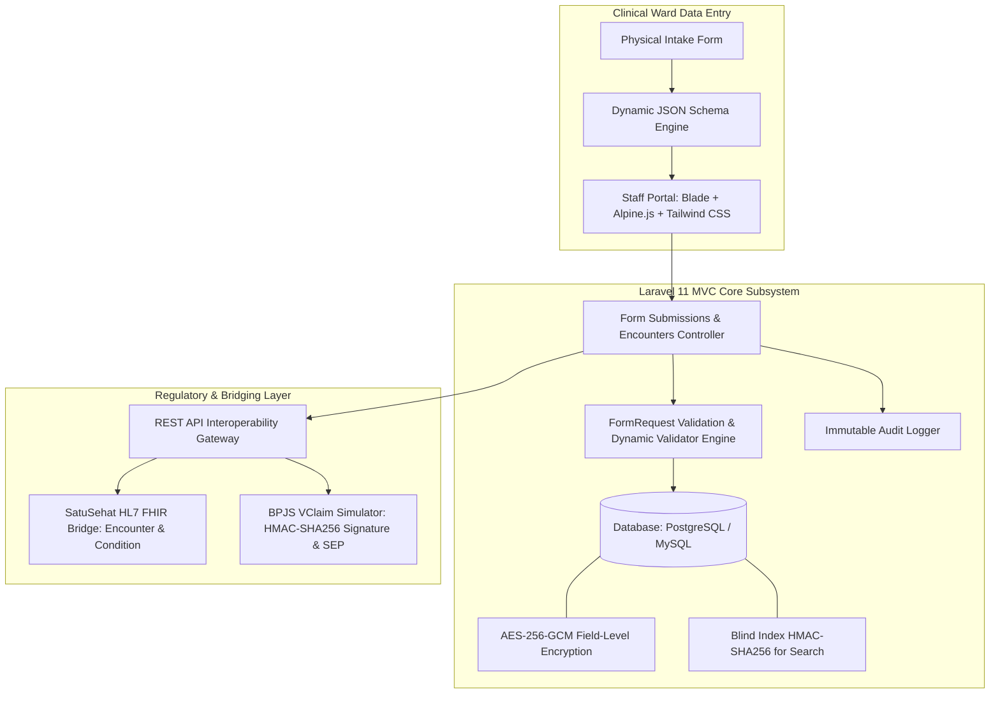
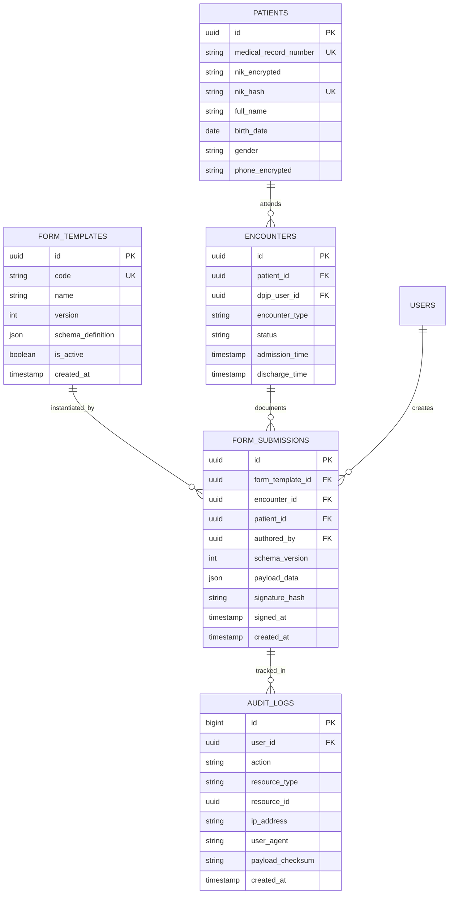
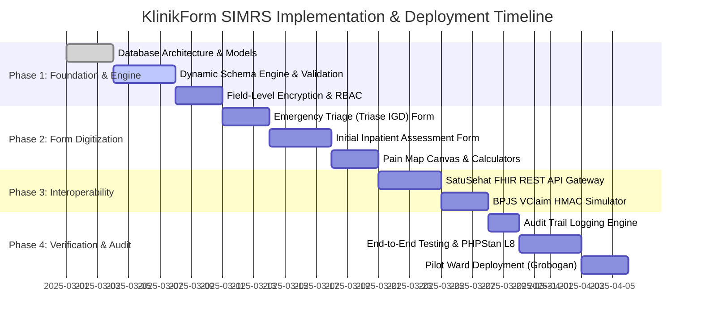

# Product Requirements Document

## Context & Problem
Regional hospitals in Indonesia (specifically Type C and Type D facilities in regions such as Grobogan, Purwodadi, and Central Java) face operational bottlenecks when transitioning from physical paper records to hospital information systems (*Sistem Informasi Manajemen Rumah Sakit* or SIMRS). Standard admission instruments—specifically the *Formulir Triase Gawat Darurat* (Emergency Department Triage) and *Asesmen Awal Keperawatan dan Medis Rawat Inap* (Inpatient Initial Nursing and Medical Assessment)—contain clinical evaluations such as Glasgow Coma Scale (GCS) scoring, pediatric dosage formulas, and anatomical pain mapping. In current hospital deployments, modifying these intake instruments requires engineering redeployments of database schemas and backend controllers for each ward.

Concurrently, healthcare facilities must comply with strict national regulatory mandates:
1. **Permenkes No. 24/2022**: Demands complete digitization of medical records, authenticated role-based access, field-level confidentiality protections, and immutable access logging.
2. **Kemenkes SatuSehat Interoperability**: Mandates standardized clinical encounter data transmission conforming to HL7 FHIR (Fast Healthcare Interoperability Resources) Release 4 specifications (`Patient`, `Encounter`, and `Condition` resources).
3. **BPJS Kesehatan Integration**: Requires operational verification of patient coverage via BPJS VClaim APIs using HMAC-SHA256 timestamped signature handshakes for *Surat Eligibilitas Peserta* (SEP) issuance.

KlinikForm SIMRS resolves these challenges as a modular, schema-driven clinical intake subsystem built on Laravel 11. It transforms paper intake records into versioned digital interfaces, enforces AES-256-GCM encryption at rest, maintains immutable audit trails, and provides bridging endpoints for SatuSehat and BPJS VClaim.

---

## Goals & Non-Goals

### Goals
- **Metadata-Driven Form Architecture**: Render, validate, and store hospital admission and triage intake forms directly from versioned JSON schemas, eliminating code deployments or database table alterations when form layouts or clinical prompts change.
- **Permenkes No. 24/2022 Compliance**: Encrypt sensitive patient identifiers (*Nomor Induk Kependudukan* [NIK], telephone numbers, and free-text anamnesis notes) at rest using AES-256-GCM, while logging every view, update, and export in a tamper-evident audit table.
- **National Interoperability Gateway**: Expose RESTful API endpoints that convert internal form submission data into standardized HL7 FHIR R4 resources (`Patient`, `Encounter`, `Condition`) compliant with Indonesian Ministry of Health (Kemenkes) SatuSehat integration requirements.
- **BPJS VClaim Verification Simulation**: Provide a testable BPJS VClaim bridging service that implements the official BPJS authentication protocol (ConsID, SecretKey, UserKey, UTC timestamp, and HMAC-SHA256 signature generation) and returns compliant SEP payloads.
- **Clinical Data Entry Acceleration**: Accelerate nurse and doctor data entry through interactive widgets (Glasgow Coma Scale calculator, automated pediatric drug dosage calculator, normalized anatomical pain canvas selector) and client-side draft recovery.

### Non-Goals
- **Comprehensive SIMRS ERP Scope**: The system will not provide billing, general ledger accounting, hospital human resources, procurement, or staff payroll functionality.
- **Inpatient Pharmacy Inventory Depletion**: The system captures medication history and intake prescriptions within assessments, but does not track warehouse inventory levels, batch expiration, or physical drug dispensing.
- **Direct Live BPJS Production Gateway**: The application will not transmit financial claims to production BPJS endpoints without formal hospital credentials; it provides a production-grade staging simulator mirroring exact production protocols.
- **Native Mobile Binaries**: The system will not distribute native iOS or Android apps; responsive browser interfaces (desktop and tablet) cover all clinical ward requirements.
- **PACS / DICOM Image Storage**: Anatomical pain markings are captured as vector coordinate arrays and body region metadata, not full radiology Picture Archiving and Communication Systems (PACS).

---

## Personas

| Persona | Role & Unit | Responsibilities & Clinical Needs | Technical Profile |
| :--- | :--- | :--- | :--- |
| **Nurse Siti (Triage & Ward Nurse)** | Emergency Department (IGD) & Inpatient Wards | Performs rapid physical intake, checks vital signs, computes GCS, records pediatric weights, marks pain locations, and saves drafts during rounds. | Uses ward desktop PCs and ruggedized Android tablets running Google Chrome. Needs fast keyboard navigation and draft auto-saving. |
| **Dr. Budi, Sp.PD (Attending Physician / DPJP)** | Inpatient Medical Staff (*Dokter Penanggung Jawab Pelayanan*) | Reviews nursing anamnesis, records physical diagnostic findings, assigns ICD-10 diagnostic codes, defines therapy plans, and signs the medical assessment. | Uses desktop workstation in consultation room. Requires complete anamnesis visibility and fast validation feedback. |
| **Rian (SIMRS Deployment Engineer)** | IT / SIMRS Vendor Implementer (Medify) | Configures ward-specific intake schemas, updates clinical form versions, manages role permissions, and verifies bridging test payloads. | Advanced user. Works with JSON schema configurations, REST clients (Postman/Curl), and database management tools. |
| **Dewi, A.Md.RMIK (Medical Records Officer)** | Medical Records Department (*Perekam Medis*) | Monitors compliance with Permenkes No. 24/2022, verifies audit logs for unauthorized record access, monitors SatuSehat sync queues, and exports archival records. | Proficient with web-based reporting interfaces. Needs transparent access trails, export verification, and complete audit tracking. |

---

## User Stories with Acceptance Criteria

### US-01: Dynamic Form Rendering and Schema Execution
**As a** Triage Nurse,  
**I want** the intake interface to automatically render structured input fields based on the ward's active form schema,  
**So that** I can enter emergency triage data without using physical paper forms.

#### Acceptance Criteria
- **AC-01.1**: Given an active JSON form schema with version `v1.2` assigned to the Emergency Department, when the nurse opens the intake view, the system renders all schema-defined input fields (vital signs, triage category dropdown, free-text chief complaint) with correct field labels, input types, and required validations.
- **AC-01.2**: Given an input field with numeric validation boundaries (e.g., Systolic Blood Pressure between 40 and 300 mmHg), when the nurse enters `350`, the client-side Alpine.js validator immediately flags the field with an inline red error message, and form submission is blocked.
- **AC-01.3**: When an older submission created under schema `v1.0` is loaded for viewing, the system retrieves the historical `v1.0` schema to render the record without layout discrepancies caused by `v1.2` modifications.

### US-02: Glasgow Coma Scale (GCS) and Pediatric Dosage Calculator
**As a** Ward Nurse,  
**I want** interactive calculators for GCS scoring and weight-based pediatric dosages inside the assessment form,  
**So that** I do not need manual bedside calculations that introduce clinical error.

#### Acceptance Criteria
- **AC-02.1**: Given the GCS input widget, when the nurse selects Eye Response = 3 (*To Speech*), Verbal Response = 4 (*Confused*), and Motor Response = 5 (*Localizes Pain*), the widget immediately computes and displays total GCS = `12` (Moderate Impairment) without a page reload.
- **AC-02.2**: Given a pediatric patient record with weight `14 kg` and a medication rule defining Amoxicillin at `25 mg/kg/dose`, the intake calculator auto-populates the recommended dosage field with `350 mg` and allows manual DPJP override with documented justification.

### US-03: Anatomical Pain Marking Diagram
**As a** Triage Nurse,  
**I want** to click or tap an interactive anatomical body map to mark pain sites and record severity levels,  
**So that** pain location and intensity are documented visually and structured digitally.

#### Acceptance Criteria
- **AC-03.1**: Given the anatomical pain map canvas component, when the nurse taps on the anterior epigastric region, the canvas renders a numbered indicator and prompts for a Numeric Rating Scale (NRS) pain score from 0 to 10.
- **AC-03.2**: When the form is saved, the component converts marked points into an array of JSON objects containing `{"x": 48.2, "y": 32.5, "region": "epigastrium", "severity": 7}`, persisting relative coordinate percentages so coordinates scale across all screen resolutions.

### US-04: Offline Draft Recovery and Auto-Save
**As a** Ward Nurse,  
**I want** form inputs to automatically buffer locally during physical patient rounds,  
**So that** I do not lose clinical assessment data if the hospital Wi-Fi disconnects.

#### Acceptance Criteria
- **AC-04.1**: While editing an intake form, Alpine.js writes the entire working state to browser `localStorage` keyed by `patient_id` and `encounter_id` every 5 seconds or upon field change.
- **AC-04.2**: If the browser tab crashes or network connectivity drops to 0 kbps, upon reopening the assessment URL, the system displays a banner: *"Unsaved draft recovered from [timestamp]. Restore or Discard?"* Selecting "Restore" repopulates all inputs without server interaction.
- **AC-04.3**: Once the form is successfully submitted to the server and an HTTP 201 response is received, the corresponding `localStorage` draft key is cleared.

### US-05: Sensitive Field Encryption and Blind Indexed Lookups
**As a** Medical Records Officer,  
**I want** patient national identity numbers (NIK) and free-text anamnesis notes encrypted in the database while remaining searchable,  
**So that** physical database backups comply with Permenkes No. 24/2022 security mandates.

#### Acceptance Criteria
- **AC-05.1**: When a patient intake record is saved, the fields `nik`, `phone_number`, and `anamnesis_notes` are encrypted at the Eloquent model layer using AES-256-GCM prior to SQL persistence. Raw database inspection confirms values are stored as Base64-encoded ciphertext strings containing an initialization vector (IV) and authentication tag.
- **AC-05.2**: The system computes a deterministic HMAC-SHA256 blind index hash of the normalized 16-digit NIK using an isolated application secret key (`BLIND_INDEX_KEY`) and saves it in column `nik_hash`.
- **AC-05.3**: When an authorized user queries for a patient by NIK `3315012345670001`, the query executes `SELECT * FROM patients WHERE nik_hash = ?` using the HMAC-SHA256 hash, returning the decrypted patient record in under 100 milliseconds without executing a full-table scan decryption.

### US-06: SatuSehat HL7 FHIR Interoperability Gateway
**As a** SIMRS Deployment Engineer,  
**I want** clinical encounter and assessment records mapped into HL7 FHIR R4 JSON payloads,  
**So that** regional hospitals satisfy Ministry of Health SatuSehat transmission requirements.

#### Acceptance Criteria
- **AC-06.1**: A `GET /api/v1/fhir/Encounter/{id}` request returns an HL7 FHIR R4 compliant `Encounter` resource containing: `status`, `class`, `subject` (Patient reference), `participant` (DPJP Practitioner reference), `period` (start and end times), and `serviceType`.
- **AC-06.2**: A `GET /api/v1/fhir/Condition?encounter={encounter_id}` request returns an HL7 FHIR `Bundle` of `Condition` resources containing valid ICD-10 clinical codes in `code.coding.code`, `system: "http://hl7.org/fhir/sid/icd-10"`, and `clinicalStatus: "active"`.
- **AC-06.3**: All generated FHIR JSON payloads pass validation against the official HL7 FHIR R4 schema definitions with 0 schema violations.

### US-07: BPJS VClaim Bridging Simulator
**As an** Admission Clerk or Nurse,  
**I want** to simulate BPJS eligibility verification and generate a *Surat Eligibilitas Peserta* (SEP),  
**So that** insurance eligibility is confirmed using standard BPJS API integration patterns.

#### Acceptance Criteria
- **AC-07.1**: The system computes request headers: `X-cons-id`, `X-timestamp` (seconds since Unix epoch), and `X-signature` calculated as `base64_encode(hash_hmac('sha256', $consId . "&" . $timestamp, $secretKey, true))`.
- **AC-07.2**: A POST request to `/api/v1/bpjs/vclaim/sep/insert` with a valid payload (Kartu BPJS number, referral faskes code, poli destination, diagnosis ICD-10) generates a compliant SEP response containing a unique 19-character SEP number formatted as `0301R001{MM}{YY}B{7-digit-counter}`.
- **AC-07.3**: If the calculated `X-timestamp` differs from server time by more than 300 seconds, the simulator rejects the request with HTTP 401 and BPJS response code `401: Timestamp kadaluarsa`.

### US-08: Tamper-Evident Medical Record Access Auditing
**As a** Medical Records Officer,  
**I want** an immutable audit record generated for every clinical record access, edit, and export,  
**So that** our hospital passes Permenkes No. 24/2022 regulatory compliance audits.

#### Acceptance Criteria
- **AC-08.1**: Every `view`, `create`, `update`, `soft-delete`, or `export` operation targeting an intake form creates an entry in table `audit_logs` capturing: `user_id`, `role`, `ip_address`, `user_agent`, `action`, `resource_type`, `resource_id`, and a SHA-256 payload checksum.
- **AC-08.2**: The database schema prevents SQL updates and hard deletions on `audit_logs` via database-level triggers or strict application repository restrictions (no `update` or `destroy` methods exposed).

---

## Functional Requirements

### 1. Form Schema Engine & Registry

- **FR-01**: The system shall store dynamic form structures in table `form_templates` using structured JSON schemas containing arrays of fields with attributes: `name`, `label`, `type` (text, number, select, radio, checkbox, gcs_calculator, pain_canvas, dosage_calculator), `validation_rules`, `default_value`, and `conditional_display`.
- **FR-02**: The form engine shall support semantic versioning (integer increment) per form template code. Modifying an active template creates a new database record with version `v+1`, preserving previous versions as read-only.
- **FR-03**: The form renderer shall dynamically evaluate `conditional_display` rules in real time via Alpine.js (e.g., show "Pregnancy Week" only when gender is "Female" and age is between 10 and 55).
- **FR-04**: The form engine shall provide two seed schemas conforming to Indonesian Ministry of Health standards upon deployment:
  1. `TRIAGE-ED-01`: *Formulir Triase Gawat Darurat* (ATS / Emergency Triage Protocol: Resuscitation, Emergent, Urgent, Less Urgent, Non-Urgent).
  2. `ASSESS-INPAT-01`: *Asesmen Awal Keperawatan & Medis Rawat Inap* (Anamnesis, Physical Exam, GCS, Anatomical Pain, Fall Risk Morse Scale, ICD-10 Preliminary Diagnosis).

### 2. Clinical Calculation & Interactive Widgets
- **FR-05**: The GCS calculation widget shall dynamically capture Eye (1–4), Verbal (1–5), and Motor (1–6) scores, calculate total sum (3–15), determine the consciousness categorization (Coma, Sopor, Somnolent, Apatis, Compos Mentis), and save sub-scores and totals into the submission payload.
- **FR-06**: The anatomical pain selector shall load a normalized SVG illustration (Anterior and Posterior human body views). Clicking on a region shall save normalized coordinate percentages (`x`, `y` from `0.00` to `100.00`), anatomical zone identifier (`head`, `chest`, `epigastrium`, etc.), pain quality, and an integer severity score (0 to 10 NRS scale).
- **FR-07**: The pediatric dosage calculator shall evaluate formulas bound to weight and age: compute calculated dosage in mg/day, divide into dosage frequencies, and display a validation warning if calculated values exceed Indonesian Pharmacopeia maximum daily doses.

### 3. Data Persistence & Cryptography
- **FR-08**: Patient records in table `patients` shall store the 16-digit NIK, phone number, and address using AES-256-GCM encryption with an authentication tag using Laravel 11's custom Eloquent Casts.
- **FR-09**: Table `patients` shall maintain a deterministic HMAC-SHA256 blind index column `nik_hash`, calculated with an isolated cryptographic key (`BLIND_INDEX_PEPPER`), allowing $O(1)$ indexed searching without exposing plain text.
- **FR-10**: Clinical anamnesis notes within `form_submissions.payload_data` marked as confidential in the schema definition shall be encrypted with AES-256-GCM before saving into the JSON document column.
- **FR-11**: Doctor sign-off shall compute a SHA-256 cryptographic hash of the consolidated submission payload concatenated with doctor user UUID and sign timestamp, storing it in `form_submissions.signature_hash`. Once signed, the record state transitions to `LOCKED`, preventing further modifications.

### 4. Permenkes No. 24/2022 Audit Trail
- **FR-12**: The application shall implement an immutable audit event listener recording every execution of `view`, `create`, `update`, `delete`, and `export` across clinical entities.
- **FR-13**: Audit log entries must contain: autoincrement ID, authenticated user ID, active role name, client IP address, client User-Agent string, action verb, fully qualified target model class, target record UUID, request payload SHA-256 hash, and UTC timestamp.
- **FR-14**: The audit log interface shall only be accessible to users holding the `Medical Records Officer` or `Hospital Admin` role. Search filters must include date ranges, user ID, patient medical record number, and action type.

### 5. Role-Based Access Control (RBAC)
- **FR-15**: The system shall enforce role segregation via Laravel Gates and Policies using three pre-configured clinical roles and one administrative role:
  - `Triage Nurse`: Create/read/edit draft intake forms; cannot sign off as DPJP; cannot edit form schemas.
  - `Attending Doctor (DPJP)`: Create/read/edit medical assessments; complete diagnostic sections; sign off on clinical records (`LOCKED` status); view all clinical history.
  - `Medical Records Officer`: Read-only access to all clinical records; full access to audit trails; export archive records.
  - `System Administrator`: Full access to configure form JSON schemas, manage user accounts, and view system metrics; no access to edit locked medical notes without an emergency access audit flag.

### 6. SatuSehat HL7 FHIR Interoperability Gateway
- **FR-16**: The REST API Gateway shall expose `GET /api/v1/fhir/Patient/{id}`, serializing internal patient attributes into an HL7 FHIR R4 `Patient` resource, formatting NIK under identifier system `https://fhir.kemkes.go.id/id/nik`.
- **FR-17**: The REST API Gateway shall expose `GET /api/v1/fhir/Encounter/{id}` and `POST /api/v1/fhir/Encounter`, translating encounter records into HL7 FHIR R4 `Encounter` resources matching SatuSehat Encounter specifications:
  - Identifier: SIMRS internal encounter number.
  - Status: `arrived`, `in-progress`, `finished`, or `cancelled`.
  - Class: `EMER` (emergency) or `IMP` (inpatient).
  - Subject: Reference to `Patient/{id}`.
  - Participant: Reference to `Practitioner/{id}`.
  - Period: Start and end timestamps in ISO-8601 format.
- **FR-18**: The REST API Gateway shall expose `GET /api/v1/fhir/Condition?encounter={encounter_id}`, mapping clinical diagnoses from the assessment schema into an HL7 FHIR R4 `Condition` bundle with ICD-10 codings verified against standard nomenclature.

### 7. BPJS VClaim Bridging Simulator
- **FR-19**: The BPJS simulator shall implement the standard BPJS signature verification algorithm:
  $$\text{Signature} = \text{Base64}\left(\text{HMAC-SHA256}\left(\text{ConsID} + \text{"\&"} + \text{Timestamp}, \text{SecretKey}\right)\right)$$
  Incoming API requests must include headers `X-cons-id`, `X-timestamp`, `X-signature`, and `user_key`.
- **FR-20**: The simulator shall validate that `X-timestamp` is within $\pm 300$ seconds of current server time. Requests failing this check must return HTTP 401 with response body:
  `{"metaData": {"code": "401", "message": "Timestamp kadaluarsa"}}`.
- **FR-21**: Endpoint `POST /api/v1/bpjs/vclaim/sep/insert` shall validate mandatory input fields (Nomor Kartu BPJS 13-digits, Kode Faskes Rujukan, Poli Tujuan, NIK 16-digits) and return a successful JSON structure with code `200` and generated SEP details matching the official BPJS VClaim 2.0 schema.

---

## Non-Functional Requirements

### Performance
- **NFR-01**: Dynamic intake forms must achieve a First Contentful Paint (FCP) of less than 1.2 seconds and Time to Interactive (TTI) of less than 1.8 seconds on standard hospital hardware (Intel Core i3, 4GB RAM) over a 10 Mbps local ward connection.
- **NFR-02**: Field-level encryption and decryption overhead must not exceed 25 milliseconds per record read/write operation.
- **NFR-03**: All FHIR REST API read endpoints (`/api/v1/fhir/*`) must respond with complete JSON payloads within 250 milliseconds under a concurrency of 50 simultaneous requests.
- **NFR-04**: Patient blind index lookups using `nik_hash` must execute within 50 milliseconds across a database table containing up to 1,000,000 patient records.

### Availability & Reliability
- **NFR-05**: The intake subsystem must provide 99.9% uptime during operational hospital hours (24/7/365).
- **NFR-06**: In the event of network disruption, Alpine.js client-side caching must guarantee zero data loss of in-progress form inputs, preserving up to 5 MB of draft data in local storage for a minimum of 72 hours or until manual form dispatch.

### Accessibility & Usability
- **NFR-07**: The clinical intake user interface must comply with WCAG 2.1 Level AA standards, maintaining a minimum color contrast ratio of 4.5:1 for all clinical data entry labels and alert states.
- **NFR-08**: The web portal must provide full keyboard navigation across the entire triage form, enabling nurses to traverse fields, calculate GCS, and submit forms without mouse interaction using standard tab and keyboard shortcuts.
- **NFR-09**: The layout must be fully responsive for viewports ranging from 1024px width (standard ward tablets and wall-mount terminals) to 1920px (DPJP desktop monitors).

### Compliance & Security
- **NFR-10**: The application codebase must maintain 0 errors under static analysis with **PHPStan at Level 8** and pass all Laravel Pint / PSR-12 styling rules.
- **NFR-11**: The test suite (Pest PHP / PHPUnit) must achieve greater than 90% code coverage across all Form Requests, Encryption Casts, Dynamic Validation Services, and FHIR Mapping Controllers.
- **NFR-12**: All data at rest must be protected in compliance with Indonesian Ministry of Health Regulation Permenkes No. 24/2022. Master application encryption keys (`APP_KEY` and `BLIND_INDEX_PEPPER`) must be injected exclusively via environment variables and never checked into source control.

---

## Success Metrics

| Metric | Target Objective | Measurement Method | Verification Frequency |
| :--- | :--- | :--- | :--- |
| **Form Deployment Velocity** | $< 4$ hours from physical sheet to active digital form | Time tracking from receipt of paper form schema to active production template, requiring 0 schema migrations. | Per new clinical form rollout |
| **Emergency Triage Entry Duration** | $< 180$ seconds (3 minutes) per patient intake | Automated telemetry recording duration from form opening to successful draft submission by ward nurses. | Continuous weekly average |
| **Plain-Text Data Exposure** | 0 unencrypted sensitive fields in database | Automated security audit query inspecting database storage for raw NIK patterns (`^[0-9]{16}$`) and raw anamnesis notes. | Automated daily CI & production cron check |
| **SatuSehat FHIR Compliance** | 100% schema validation pass rate | Validation of sample output payloads against official HL7 FHIR R4 JSON schemas and Kemenkes test harnesses. | Every release commit via CI pipeline |
| **Automated Test Coverage** | $\ge 90\%$ test coverage; PHPStan Level 8 clean | Automated PHPUnit/Pest coverage reports and `phpstan analyse --level=8` execution. | Every Git pull request and merge |

---

## Out of Scope
The following operational areas are explicitly excluded from the KlinikForm SIMRS core release:
- Integration with external physical laboratory testing hardware or real-time vital sign telemetry monitors (e.g., bedside patient monitors via HL7 MLLP).
- Financial ledger, cash billing, invoice reconciliation, and cost accounting modules.
- Pharmacy inventory management, warehouse shelf batch tracking, and pharmaceutical expiration management.
- Live transmission of insurance claims to BPJS production environments without hospital-specific cryptographic credentials.
- Digital radiological image storage and viewing (DICOM / PACS).
- Native application packaging for Apple iOS App Store or Google Play Store.

---

## Risks & Assumptions

### Risks and Mitigations

| Risk Event | Severity | Likelihood | Impact Details | Mitigation Strategy |
| :--- | :--- | :--- | :--- | :--- |
| **R-01: Encryption Key Rotation Complexity** | High | Low | If `APP_KEY` is rotated or compromised, existing AES-256-GCM medical records become unreadable. | Implement a dedicated key rotation artisan command (`php artisan klinikform:rotate-keys`) that re-encrypts historical records under a new key using an envelope encryption pattern. |
| **R-02: Schema Modification Breaking Historical Records** | High | Medium | Changes to active form fields could cause rendering errors or null exceptions when reading historical submissions. | Immutable schema versioning: every update creates a new schema row with an incremented version ID. Historical submissions permanently bind to the original schema version record. |
| **R-03: Client Browser Storage Eviction** | Medium | Low | Hospital shared workstations configured in Incognito mode might clear `localStorage`, losing unsubmitted drafts. | Implement a dual-tier draft mechanism: local storage writes are mirrored by a debounced background AJAX draft sync to a temporary `draft_submissions` database table every 30 seconds when an active network connection is detected. |
| **R-04: SatuSehat Specification Divergence** | Medium | Medium | Ministry of Health (Kemenkes) periodically updates SatuSehat FHIR mapping profiles. | Decouple the core form engine from the FHIR bridging layer using dedicated Resource Transformer classes, allowing profile updates without modifying database persistence logic. |

### Technical Assumptions
- Hospital workstations and tablet devices operate modern evergreen web browsers (Google Chrome 110+, Microsoft Edge 110+, or Firefox 110+) supporting HTML5 Canvas, Web Cryptography, and ES6+ modules.
- The hospital's central server infrastructure runs PHP 8.3 with extensions `openssl`, `pdo_pgsql` / `pdo_mysql`, `mbstring`, and `bcmath` enabled.
- Database servers are configured with UTF-8 character encoding (`utf8mb4`) and provide native indexing for JSONB / JSON data types.

---

## Release Plan

### Phase 1: Foundation & Security Architecture (Days 1–10)
- **Deliverables**:
  - Laravel 11 project scaffold with PHP 8.3 configuration, strict types enabled.
  - Database migrations: `users`, `roles`, `patients`, `encounters`, `form_templates`, `form_submissions`, `audit_logs`.
  - Custom Eloquent Cast `EncryptedGcm` for AES-256-GCM encryption and blind indexing listener for `nik_hash`.
  - Spatie Laravel-Permission role configuration (`Nurse`, `Doctor`, `Admin`, `RekamMedis`).
  - Unit tests validating cryptographic encryption roundtrips and blind index lookups.

### Phase 2: Dynamic Form Engine & Clinical Digitization (Days 11–20)
- **Deliverables**:
  - Blade, Alpine.js, and Tailwind CSS dynamic form rendering layout.
  - Custom form widgets:
    - Glasgow Coma Scale (GCS) reactive calculator.
    - Interactive Anatomical Pain Map Canvas with coordinate recording.
    - Pediatric drug dosage calculator component.
  - Standard seed schemas configured and tested:
    - *Formulir Triase Gawat Darurat (IGD)*.
    - *Asesmen Awal Pasien Rawat Inap*.
  - Client-side auto-save and draft restoration module using `localStorage`.

### Phase 3: Interoperability Gateways (Days 21–27)
- **Deliverables**:
  - SatuSehat HL7 FHIR Interoperability Gateway endpoints:
    - `GET /api/v1/fhir/Patient/{id}`
    - `GET /api/v1/fhir/Encounter/{id}`
    - `GET /api/v1/fhir/Condition?encounter={id}`
  - BPJS VClaim Bridging Simulator:
    - Middleware validating `X-cons-id`, `X-timestamp`, and `X-signature` (HMAC-SHA256).
    - Mock endpoint `POST /api/v1/bpjs/vclaim/sep/insert` returning compliant SEP JSON responses.
  - Automated integration tests verifying FHIR R4 schema compliance and BPJS signature calculations.

### Phase 4: Audit Trails, Hardening, and Pilot Deployment (Days 28–35)
- **Deliverables**:
  - Permenkes No. 24/2022 compliant audit logging pipeline capturing view, edit, and export events.
  - Audit log review interface with search and filter capabilities for Medical Records Officers.
  - Static analysis verification reaching 0 errors at PHPStan Level 8.
  - Full automated test suite completion achieving $>90\%$ branch and line coverage.
  - User acceptance testing (UAT) sign-off in regional hospital pilot staging environment (Grobogan, Central Java).