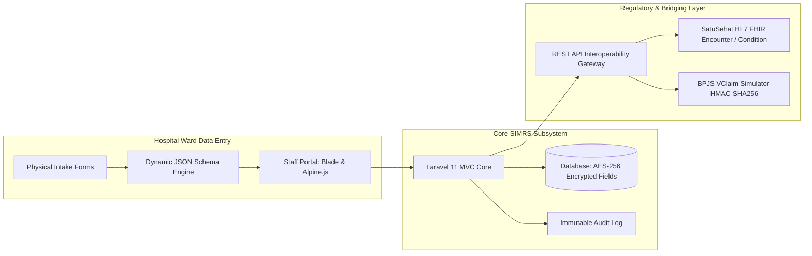

# Project Brief

## Problem Statement
Regional hospitals in Indonesia (such as Type C and D facilities in Grobogan, Purwodadi, and adjacent regions) face severe operational delays during hospital information system (SIMRS) rollouts due to the manual conversion of complex, physical intake paperwork into digital systems. Standard physical instruments—such as the *Formulir Triase Gawat Darurat* (Emergency Triage) and *Asesmen Awal Medis dan Keperawatan* (Initial Medical and Nursing Assessments)—contain dynamic, specialized components including Glasgow Coma Scale (GCS) scoring, anatomical pain diagrams, and conditional clinical logic. Existing enterprise SIMRS deployments force software vendors to hardcode database schemas and user interfaces for every ward variation, requiring engineering redeployments for routine clinical workflow modifications.

Simultaneously, healthcare facilities must comply with strict national regulatory mandates:
1. **Permenkes No. 24/2022**: Requires comprehensive digitization of medical records, robust access auditing, and stringent data protection for sensitive health information at rest.
2. **Kemenkes SatuSehat Interoperability**: Mandates standardized clinical encounter data transmission conforming to HL7 FHIR (Fast Healthcare Interoperability Resources) specifications.
3. **BPJS Kesehatan Integration**: Demands operational integration with BPJS VClaim systems using HMAC-SHA256 signature handshakes for *Surat Eligibilitas Peserta* (SEP) verification.

KlinikForm SIMRS addresses these challenges as a modular, schema-driven clinical intake subsystem built with Laravel 11 that converts physical intake forms into versioned, encrypted digital interfaces while exposing FHIR-compliant REST APIs and bridging emulators.

## Target Users
The system serves four primary internal and operational user personas:

| User Persona | Role Description | Key Tasks & System Interactions |
| :--- | :--- | :--- |
| **Triage & Ward Nurse** | Frontline clinical intake staff across emergency and inpatient units. | Executes rapid clinical data entry, calculates initial vital signs and pediatric dosages, records GCS scores, and maps anatomical pain coordinates during physical admissions. Relies on draft auto-saving. |
| **Attending Doctor (DPJP)** | Primary examining and diagnosing physician (*Dokter Penanggung Jawab Pelayanan*). | Reviews nurse anamnesis, records specialized diagnostic findings, enters ICD-10 clinical diagnoses, approves treatment plans, and signs off on digital intake assessments. |
| **SIMRS Deployment Engineer / Admin** | Technical implementer (e.g., Medify onsite staff or hospital IT). | Configures and versions dynamic form schemas without altering database tables, manages user roles and department access permissions, and audits data transmission pipelines. |
| **Medical Records Officer (Rekam Medis)** | Compliance officer ensuring adherence to Permenkes No. 24/2022. | Monitors access logs, tracks record completeness, verifies external SatuSehat sync statuses, and oversees archiving and digital retention policies. |

## Goals
- **Metadata-Driven Form Architecture**: Deliver a dynamic clinical form engine that parses versioned JSON schemas into interactive interfaces without requiring database migration rollouts or code deployments when form layouts change.
- **National Data Standards Compliance (SatuSehat)**: Expose RESTful API endpoints providing valid HL7 FHIR payloads for `Patient`, `Encounter`, and `Condition` resources mapped directly from clinical form inputs.
- **BPJS VClaim Bridging Simulator**: Implement an end-to-end bridging verification module capable of generating compliant BPJS HMAC-SHA256 signature headers, validating credentials, and mocking SEP creation responses.
- **Defense-in-Depth Data Security**: Secure sensitive patient attributes (such as *Nomor Induk Kependudukan* [NIK], telephone numbers, and confidential clinical anamnesis notes) using AES-256-GCM authenticated encryption through Laravel Eloquent Casts.
- **Tamper-Evident Access Auditing**: Record immutable audit logs capturing every clinical record access, view, update, and external export event in accordance with Permenkes No. 24/2022 guidelines.
- **Clinical Calculation & Drafting Reliability**: Provide real-time client-side and server-side calculation of vital statistics, GCS scores, and pediatric dosages, backed by browser-level local storage caching to survive intermittent local hospital network drops.

## Non-Goals
- **Full SIMRS Hospital Enterprise Suite**: The product will not implement billing, accounts receivable, human resources, payroll, or non-clinical enterprise resource planning modules.
- **Full Inpatient Pharmacy Dispensing & Inventory**: The system will record medication indications within the initial clinical assessment, but will not provide real-time drug stock depletion or inventory warehouse management.
- **Direct Live BPJS Production Connection**: The system will not proxy live commercial financial transactions to production BPJS servers without formal hospital-specific credentials; it delivers a production-grade testing simulator mirroring actual protocol specifications.
- **Native Mobile Applications**: KlinikForm SIMRS will not be packaged as standalone iOS or Android native binaries; responsive desktop and tablet browser workflows serve all ward requirements.
- **PACS Imaging Archive**: The system will capture diagrammatic anatomical pain coordinates via canvas inputs, but will not function as a Picture Archiving and Communication System (PACS) for DICOM radio-imaging files.

## Key Assumptions
- **Hospital Hardware & Infrastructure**: Clinical wards run standard desktop PCs or tablet terminals equipped with modern evergreen browsers (Chrome, Edge, Firefox) capable of executing Alpine.js and HTML5 Canvas operations over a standard local intranet (LAN).
- **Database Engine Support**: The target environment operates on MySQL 8.0 or PostgreSQL 14+, both supporting native JSON column querying and indexing for dynamic form schemas.
- **Clinical Form Standard Formulation**: Standard hospital forms adhere to Indonesian Ministry of Health guidelines for emergency triage (*Triase Gawat Darurat*) and adult inpatient initial assessment (*Asesmen Awal Pasien Rawat Inap*), serving as default production schemas.
- **Cryptographic Key Management**: The application host server securely manages an application master key (`APP_KEY`) used for field-level AES-256-GCM symmetric encryption operations, preventing plain-text data exposure during database backups or infrastructure compromises.

## Success Metrics
The progress and operational quality of KlinikForm SIMRS will be evaluated against concrete engineering and clinical usability targets:

| Target Area | Metric | Target Objective |
| :--- | :--- | :--- |
| **Implementation Speed** | Time required to configure and deploy a new physical intake form into production. | Under 4 hours via JSON schema configuration, requiring zero code redeployments or database migrations. |
| **Clinical Entry Velocity** | Average time for a nurse to complete a standard *Triase Gawat Darurat* intake entry. | Under 3 minutes under steady-state operation. |
| **Regulatory Security** | Plain-text persistence of sensitive patient identifiers (NIK, anamnesis) in storage. | 0 instances in raw database tables; 100% encrypted via AES-256-GCM. |
| **API Interoperability** | SatuSehat HL7 FHIR payload conformance validation. | 100% schema pass rate on generated `Encounter` and `Condition` JSON payloads against FHIR R4 validation test suites. |
| **Code Quality & Reliability** | Static analysis compliance and automated test coverage across core clinical services. | PHPStan Level 8 clean passing (zero errors); >90% automated test coverage across form validation, encryption, and bridging services. |

## Constraints & Limitations
- **Backend Framework**: Built strictly using Laravel 11 and PHP 8.3, utilizing native MVC patterns, custom Eloquent Casts, Form Requests, and Laravel Gates/Policies for role-based authorization.
- **Frontend Architecture**: Restricted to Laravel Blade, Tailwind CSS, and Alpine.js to eliminate heavy Single Page Application (SPA) runtime overhead and guarantee fast rendering on entry-level clinical ward terminals.
- **Regulatory Boundaries**: All design choices must strictly conform to Indonesian Ministry of Health Regulation Permenkes No. 24/2022, dictating strict medical record retention boundaries, unauthorized view restrictions, and user attribution.
- **Offline Resilience Boundary**: Local draft preservation uses Alpine.js backed by browser `localStorage`. Offline capabilities are limited to draft recovery during localized network dropouts; initial schema loading and final signed record submission require active network connectivity to the hospital server.

## Open Questions
- **Digital Signature Integration Level**: Should the system implement cryptographic digital signatures via the National Certified Electronic Signature Authority (BSrE / Balai Sertifikasi Elektronik) in phase one, or retain internal credential-backed approval timestamps until regional institutional keys are provisioned? *Resolution for MVP*: Implement authenticated session timestamps with cryptographic SHA-256 integrity hashes for individual doctor sign-offs, with extension interfaces ready for BSrE API integration.
- **Anatomical Canvas Vector Density**: Should anatomical body marking schemas store raw vector SVG coordinate arrays or rasterized PNG data URLs? *Resolution for MVP*: Store normalized X/Y percentage coordinate arrays alongside region IDs inside the form's structured JSON payload to conserve storage space and facilitate automated clinical location parsing.
- **Field-Level Searchability on Encrypted Data**: Because sensitive fields like NIK are encrypted using AES-256-GCM with randomized initialization vectors, direct SQL `WHERE` queries are not supported without decrypting all records. *Resolution for MVP*: Implement a blind index (HMAC-SHA256 hash using a separate pepper key) stored in an indexed `nik_hash` column to allow deterministic lookups without decrypting the data column.