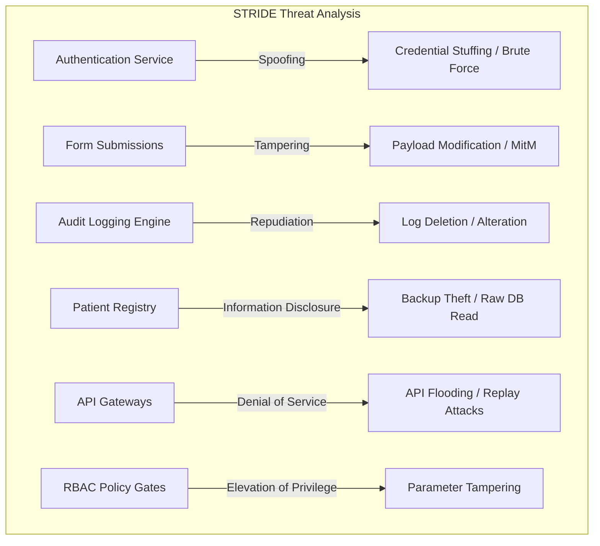
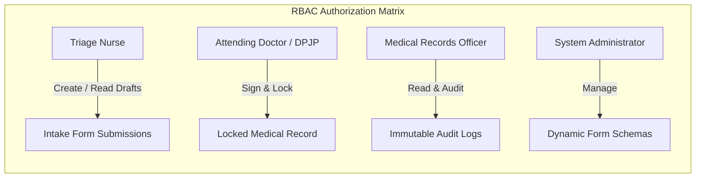
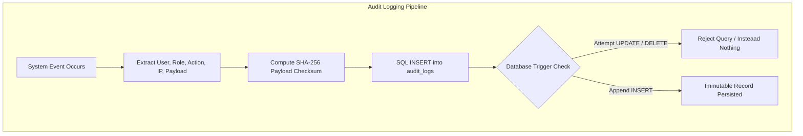

# Security Specification

## Threat Model (STRIDE, per major component)

The threat model for **KlinikForm SIMRS** evaluates security risks across the system architecture using the STRIDE methodology (Spoofing, Tampering, Repudiation, Information Disclosure, Denial of Service, Elevation of Privilege).

| Component | Threat Category | Threat Description | Attack Vector | Mitigation Strategy |
| :--- | :--- | :--- | :--- | :--- |
| **Authentication Service** | Spoofing | Impersonating a clinician or administrator to access patient health records. | Credential stuffing, dictionary attacks on login endpoints. | Enforce Bcrypt/Argon2id password hashing, mandatory multi-factor authentication (MFA) tokens for high-privilege accounts, and account lockout after 5 failed attempts. |
| **Dynamic Form Submissions** | Tampering | Modifying clinical intake values or lab measurements in transit or storage. | Man-in-the-middle attacks or unauthorized direct database modifications. | Laravel FormRequest schema validation, cryptographic SHA-256 payload signature hashing upon sign-off, and AES-256-GCM authenticated encryption. |
| **Audit Logging Engine** | Repudiation | Denying the execution of an unauthorized medical record view or export. | Attempting to delete or alter access logs after inspecting patient files. | Immutable append-only audit trail enforced via database-level rules/triggers that reject all SQL `UPDATE` and `DELETE` commands. |
| **Patient Registry & Casts** | Information Disclosure | Unauthorized extraction of sensitive patient PII (NIK, phone, address). | Database backup theft, direct SQL injection, or unencrypted storage exposure. | Field-level AES-256-GCM encryption with unique 12-byte initialization vectors per field via Laravel custom Eloquent Casts. |
| **BPJS & SatuSehat Gateways** | Denial of Service | Flooding the bridging gateway or simulating requests to overwhelm system resources. | Unauthenticated API spam or slow-loris connection holding. | Rate limiting (120 req/min), strict $\pm 300\text{ second}$ timestamp validation window, and asynchronous queue dispatching. |
| **RBAC Policy Gates** | Elevation of Privilege | A Triage Nurse escalating privileges to sign off as an Attending Doctor (DPJP). | Parameter tampering in HTTP POST requests or session role manipulation. | Server-side Spatie Role-Permission authorization checks via Laravel Gates and Policies on every controller action. |

## Authentication

Authentication to **KlinikForm SIMRS** is governed by strict session and token standards designed for hospital environments.

- **Session Guards**: Internal web portal access utilizes stateful authenticated sessions (`auth:web`) protected by HTTP-only, secure, SameSite=Strict cookies.
- **Credential Hashing**: User passwords are encrypted using Bcrypt with a high work factor or Argon2id via Laravel's native hashing service. Plaintext passwords are never persisted.
- **API Authentication**: Outbound interoperability endpoints (`/api/v1/fhir/*`) require OAuth2 Bearer tokens issued by the hospital's authorization server.
- **BPJS VClaim Handshake**: Simulated and production BPJS endpoints authenticate incoming requests using institutional headers (`X-cons-id`, `X-timestamp`, `X-signature`, and `user_key`).
- **Signature Calculation**: The HMAC-SHA256 signature is calculated as:
  $$\text{Signature} = \text{Base64}\left(\text{HashHMAC}\left(\text{SHA256}, \text{ConsID} + \text{"\&"} + \text{Timestamp}, \text{SecretKey}\right)\right)$$

## Authorization model

Role-Based Access Control (RBAC) is enforced using **Spatie Laravel-Permission** integrated with Laravel Gates and Policies.

| Role | Permissions & Access Boundaries |
| :--- | :--- |
| **Triage Nurse** | Create/read/edit draft intake forms, calculate GCS scores, pin pain maps; cannot sign off records or modify JSON schemas. |
| **Attending Doctor (DPJP)** | Review anamnesis, input objective findings, assign ICD-10 diagnostic codes, sign off and permanently lock clinical records (`status = 'LOCKED'`). |
| **Medical Records Officer** | Read-only access to all patient clinical records, full access to audit trails (`audit_logs`), and export compliance PDF reports. |
| **System Administrator** | Configure versioned JSON form schemas (`form_templates`), manage user accounts and role assignments, and monitor bridging endpoints. |

## Data protection: encryption in transit and at rest, PII handling

- **Encryption in Transit**: All communications between browser clients, application servers, and external APIs (SatuSehat, BPJS VClaim) must be encrypted using **TLS 1.3** with strict cipher suites. HTTP requests are redirected to HTTPS via HSTS headers.
- **Encryption at Rest**: Sensitive patient attributes (`nik`, `phone`, `address`) and confidential clinical anamnesis text are encrypted at rest using **AES-256-GCM** authenticated encryption via custom Eloquent Casts (`EncryptedGcm`). Each field persistence generates a unique 12-byte initialization vector and a 16-byte authentication tag.
- **Blind Indexing for Searchability**: Because AES-256-GCM ciphertext is randomized, direct SQL `WHERE` queries are impossible without full decryption. The system generates a deterministic HMAC-SHA256 blind index hash (`nik_hash`) using an isolated system pepper key (`BLIND_INDEX_PEPPER`), allowing $O(1)$ indexed lookups on NIK without exposing plaintext.
- **PII Handling**: National identification numbers (NIK) and patient contact details are masked in UI views (`331501******0001`) and excluded from all application log files.

## Secrets management

- **Environment Isolation**: All cryptographic keys, database passwords, and API secrets are stored strictly in environment variables (`.env`) and injected at runtime.
- **Repository Exclusion**: `.env` files, private keys, and application master keys are excluded from Git via `.gitignore`.
- **Master Key Protection**: The application master key (`APP_KEY`) and blind index pepper (`BLIND_INDEX_PEPPER`) must never be hardcoded or logged. Key rotation is supported via dedicated artisan commands that perform envelope re-encryption of stored ciphertexts.

## Input validation and output encoding

- **Strict Validation**: All incoming HTTP requests are validated via Laravel FormRequests enforcing type checking, string length boundaries, numeric ranges (e.g., systolic BP between 40 and 300 mmHg), and regex formatting.
- **JSON Schema Validation**: Dynamic form submissions are validated against their active `form_templates.schema_definition` JSON rules before database persistence.
- **Output Encoding**: Blade templating automatically escapes output variables using `{{ $variable }}` syntax, neutralizing Cross-Site Scripting (XSS) injection vectors. Raw HTML injection (`{!! !!}`) is strictly prohibited for user-supplied data.

## Rate limiting and abuse prevention

- **Global API Throttle**: All API endpoints enforce a rate limit of 120 requests per minute per authenticated user session using Laravel's rate limiter. Exceeding this threshold returns HTTP 429 Too Many Requests.
- **Authentication Throttle**: Login endpoints restrict attempts to 5 requests per minute per IP address to mitigate brute-force and credential-stuffing attacks.
- **Idempotency Support**: Outbound API submissions accept an `X-Idempotency-Key` header (UUIDv4) to prevent duplicate transactions during unstable network reconnects.

## Dependencies and supply chain

- **Composer Package Management**: PHP dependencies are locked via `composer.lock` with pinned version constraints.
- **Static Analysis**: The codebase is verified under **PHPStan Level 8** to guarantee strict typing, eliminate null pointer exceptions, and catch type mismatches during CI pipelines.
- **Automated Testing**: Pest PHP and PHPUnit test suites execute on every pull request, requiring $>90\%$ code coverage across all validators, casts, and bridging services.

## Logging and auditing

- **Permenkes 24/2022 Audit Compliance**: Every system interaction (`VIEW`, `CREATE`, `UPDATE`, `LOCK`, `EXPORT`, `LOGIN`) is logged in the `audit_logs` table.
- **Immutable Log Store**: The `audit_logs` table is strictly append-only. Database rules and triggers reject all SQL `UPDATE` and `DELETE` queries.
- **Checksum Integrity**: Each audit log entry calculates and records a SHA-256 payload checksum (`payload_checksum`) capturing the state of the accessed or modified entity.

## Incident response

- **Breach Detection**: Database integrity monitoring compares stored audit checksums against active entity states. Discrepancies immediately trigger security alerts.
- **Containment & Revocation**: Administrators can instantly revoke compromised user sessions and freeze user roles via the admin dashboard.
- **Key Rotation Protocol**: In the event of an encryption key compromise, administrators execute `php artisan klinikform:rotate-keys`, decrypting and re-encrypting sensitive columns under a newly provisioned master key.

## Compliance considerations and OWASP Top 10 coverage

- **Permenkes No. 24/2022 Compliance**: Enforces complete digitization, role-based access control, field-level confidentiality, and immutable access audit trails.
- **OWASP Top 10 Mitigations**:
  - *A01:2021-Broken Access Control*: Enforced via Spatie RBAC Gates and Policies.
  - *A02:2021-Cryptographic Failures*: Mitigated via AES-256-GCM authenticated encryption and TLS 1.3 in transit.
  - *A03:2021-Injection*: Mitigated via Eloquent parameterized queries and strict FormRequest validation.
  - *A07:2021-Identification and Authentication Failures*: Mitigated via Bcrypt/Argon2id hashing and login rate limiting.