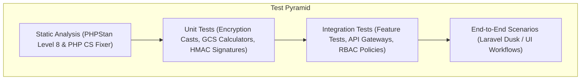

# Testing Strategy

## Test Strategy and Test Pyramid
The testing strategy for **KlinikForm SIMRS** enforces a rigorous multi-layered quality assurance framework designed to guarantee zero data loss, strict cryptographic security compliance with Permenkes No. 24/2022, HL7 FHIR R4 interoperability correctness, and high-performance execution across hospital ward terminals. 

The test pyramid structures verification across four distinct tiers:
1. **Unit Tests (Pest PHP / PHPUnit)**: Validate individual algorithmic components, custom Eloquent AES-256-GCM encryption casts, HMAC-SHA256 blind index hash calculations, Glasgow Coma Scale (GCS) computation logic, and BPJS VClaim signature generation.
2. **Integration Tests (Pest PHP Feature Tests)**: Verify database persistence integrity, dynamic form schema validation rules via FormRequests, Spatie RBAC policy gates, and API interoperability gateway endpoints (`/api/v1/fhir/*` and `/api/v1/bpjs/vclaim/*`).
3. **End-to-End Scenarios (Dusk / Browser Automation)**: Simulate complete clinical workflows across hospital user roles (Triage Nurse, Attending Doctor, Medical Records Officer) including offline draft recovery and cryptographic sign-off locking.
4. **Performance & Security Testing**: Enforce latency limits, concurrency load handling, SQL injection resistance, and static analysis verification via PHPStan Level 8.



## Unit Tests
Unit tests isolate and verify pure functions, cryptographic algorithms, clinical calculators, and model attribute casts without requiring full HTTP request lifecycles.

| Test Case ID | Target Class / Method | Test Scenario Description | Expected Outcome |
| :--- | :--- | :--- | :--- |
| **UT-01** | `App\Casts\EncryptedGcm` | Encrypt and decrypt a 16-digit NIK string through the custom Eloquent cast. | Stored ciphertext contains initialization vector (IV) and auth tag; decrypted output matches original NIK exactly. |
| **UT-02** | `App\Services\Security\BlindIndexer` | Generate deterministic HMAC-SHA256 blind index hash for NIK `3315012345670001`. | Returns a 64-character hex string matching expected hash calculated with `BLIND_INDEX_PEPPER`. |
| **UT-03** | `App\Services\Clinical\GcsCalculator` | Compute GCS sum and consciousness category given Eye=3, Verbal=4, Motor=5. | Returns total sum = `12` and category string = `"apatis"`. |
| **UT-04** | `App\Services\Interoperability\BpjsSignature` | Compute BPJS VClaim signature header using ConsID, SecretKey, and UTC timestamp $T$. | Returns Base64-encoded HMAC-SHA256 signature matching official BPJS verification test vectors. |
| **UT-05** | `App\Models\FormSubmission` | Compute SHA-256 sign-off integrity hash given submission payload, doctor UUID, and timestamp. | Returns 64-character SHA-256 hash string verifying payload integrity. |

## Integration Tests
Integration tests verify controller endpoints, FormRequest validation rules, database persistence constraints, and external interoperability gateway payloads using Pest PHP feature test suites.

| Test Case ID | Target Endpoint / Service | Test Scenario Description | Expected Outcome |
| :--- | :--- | :--- | :--- |
| **IT-01** | `POST /api/v1/encounters/{id}/submissions` | Submit intake form with systolic blood pressure = `350` (exceeding maximum boundary 300). | Request rejected with HTTP 422 and JSON error detailing vital sign boundary violation. |
| **IT-02** | `GET /api/v1/fhir/Encounter/{id}` | Request FHIR `Encounter` resource for a completed inpatient visit. | Returns HTTP 200 with valid HL7 FHIR R4 JSON schema containing correct status, class, subject, and participant references. |
| **IT-03** | `POST /api/v1/bpjs/vclaim/sep/insert` | Submit SEP creation payload with an `X-timestamp` drifted by 400 seconds from server time. | Request rejected with HTTP 401 and response body `{"metaData": {"code": "401", "message": "Timestamp kadaluarsa"}}`. |
| **IT-04** | `POST /portal/doctor/assessment/{id}/sign` | Attempt sign-off action using an authenticated user holding the `Triage Nurse` role. | Request rejected with HTTP 403 Forbidden due to Spatie RBAC policy gate restriction. |
| **IT-05** | `Database Trigger / AuditLog` | Attempt direct SQL `UPDATE` or `DELETE` query on `audit_logs` table. | Database trigger/rule intercepts query and blocks execution, preserving immutable log state. |

## End-to-End Scenarios Derived from User Flows
End-to-end browser scenarios validate complete clinical workflows across real user personas, ensuring zero data loss and correct UI rendering under operational conditions.

| Scenario ID | User Persona | Workflow Pathway | Verification Assertion |
| :--- | :--- | :--- | :--- |
| **E2E-01** | Nurse Siti (Triage Nurse) | Lookup NIK $\rightarrow$ Open `TRIAGE-ED-01` form $\rightarrow$ Enter vitals $\rightarrow$ Compute GCS $\rightarrow$ Pin pain map $\rightarrow$ Submit intake. | Record persists with encrypted NIK and anamnesis; HTTP 201 response received; browser `localStorage` draft key purged. |
| **E2E-02** | Dr. Budi, Sp.PD (DPJP) | Access worklist $\rightarrow$ Open assessment $\rightarrow$ Review decrypted nurse anamnesis $\rightarrow$ Select ICD-10 `K29.7` $\rightarrow$ Sign & Lock. | Submission status transitions to `LOCKED`; cryptographic signature hash generated; form reloads in read-only state with verification stamp. |
| **E2E-03** | Nurse Siti (Triage Nurse) | Fill intake form $\rightarrow$ Simulate Wi-Fi drop (0 kbps) $\rightarrow$ Close tab $\rightarrow$ Reopen URL. | Recovery banner appears: *"Draf belum tersimpan ditemukan"*; clicking "Restore" repopulates all inputs, GCS scores, and pain markers instantly. |
| **E2E-04** | Rian (SIMRS Admin) | Access `/admin/schemas` $\rightarrow$ Edit schema JSON $\rightarrow$ Validate syntax $\rightarrow$ Publish version `v1.3`. | New active schema version written to database; historical submissions bound to version `v1.2` render correctly without disruption. |
| **E2E-05** | Dewi, A.Md.RMIK (Rekam Medis) | Access `/compliance/audit-trail` $\rightarrow$ Filter by patient RM $\rightarrow$ Verify log integrity $\rightarrow$ Export PDF. | Audit trail displays all view/edit/export events with matching payload checksums; signed PDF report downloads successfully. |

## Performance and Load Testing
Performance benchmarks ensure the subsystem operates within strict latency boundaries during peak morning hospital admission rushes. Load testing is executed using **k6** or **Apache JMeter** against containerized staging environments.

| Metric / Scenario | Target Objective | Measurement Tool | Acceptance Threshold |
| :--- | :--- | :--- | :--- |
| **Form Page Load (FCP)** | First Contentful Paint on standard ward terminal | Lighthouse / Chrome DevTools | $< 1.2$ seconds under 10 Mbps local LAN |
| **API Read Latency** | FHIR resource retrieval (`/api/v1/fhir/*`) | k6 Load Testing Script | $< 250$ ms response time under 50 simultaneous requests |
| **Blind Index Query Latency** | $O(1)$ patient lookup by NIK (`nik_hash`) | PostgreSQL Query Log / Laravel Debugbar | $< 50$ ms across 1,000,000 patient records |
| **Concurrent Intake Throughput** | Simultaneous nurse intake submissions | k6 Spike Testing (100 VUs) | Zero failed requests; CPU utilization $< 70\%$ on application server |

## Security Testing
Security verification guarantees compliance with Permenkes No. 24/2022 and resilience against common web attack vectors.

| Test Type | Testing Mechanism / Tool | Target Focus Area | Pass Criteria |
| :--- | :--- | :--- | :--- |
| **Static Code Analysis** | PHPStan Level 8 | Codebase type safety, null pointers, method signatures | 0 errors reported across entire PHP source tree |
| **Dependency Vulnerability Scan** | Composer Audit / Dependabot | Third-party PHP and JavaScript packages | 0 high or critical CVE vulnerabilities in dependencies |
| **SQL Injection (SQLi) & XSS** | OWASP ZAP Automated Scan | Form inputs, search queries, URL parameters | 0 vulnerabilities found; parameterized queries and Blade auto-escaping verified |
| **Cryptographic Integrity Verification** | Automated Unit Test Suite | AES-256-GCM ciphertexts and blind index hashes | 100% of encrypted fields successfully decrypt with valid tags; tampered ciphertexts throw integrity exceptions |

## Test Data and Fixtures
Test execution relies on robust synthetic clinical seeders and fixtures to emulate real-world hospital admission scenarios.

- **Synthetic Patient Registry**: Seeders populate 500 encrypted test patients in table `patients` with realistic Indonesian NIKs, medical record numbers, and encrypted contact data.
- **Form Schema Fixtures**: Standardized JSON schema fixtures for `TRIAGE-ED-01` and `ASSESS-INPAT-01` are loaded into `form_templates` prior to feature and E2E test runs.
- **Mock BPJS Credentials**: Test suites utilize predefined ConsID, SecretKey, and UserKey tokens to simulate valid and invalid HMAC-SHA256 request handshakes.

## CI Integration
Continuous Integration is orchestrated via **GitHub Actions** on every push and pull request.

```mermaid
graph LR
    GitPush[Git Push / PR] --> Action[GitHub Actions CI Pipeline]
    Action --> Setup[Setup PHP 8.3 & Node.js 20]
    Setup --> Lint[Laravel Pint & PHP CS Fixer Check]
    Lint --> Static[PHPStan Level 8 Analysis]
    Static --> Test[Pest PHP Test Suite Execution (>90% Coverage)]
    Test --> Build[Vite Asset Compilation & Docker Build]
    Build --> Success[CI Pipeline Passed]
```

## Coverage Targets
- **Code Coverage**: Minimum **$90\%$ branch and line coverage** enforced across all Form Requests, Encryption Casts, Dynamic Validation Services, and Interoperability Gateways.
- **Static Analysis**: **PHPStan Level 8** clean passing status required for all PR merges.

## Release Exit Criteria
A release build is certified for regional hospital deployment (e.g., Grobogan/Purwodadi pilot wards) only when all of the following exit criteria are met:
1. **100% Test Pass Rate**: All Unit, Integration, and E2E Dusk test suites execute successfully with zero failures.
2. **Coverage & Static Analysis Met**: Automated test coverage reaches $\ge 90\%$; PHPStan Level 8 reports 0 errors.
3. **Security Sign-Off**: Zero unencrypted sensitive fields detected in raw database inspection; append-only audit table triggers verified.
4. **Interoperability Verification**: Generated HL7 FHIR R4 payloads pass 100% validation against official Kemenkes SatuSehat schema test harnesses.
5. **UAT Sign-Off**: Formal acceptance sign-off completed by regional hospital medical records officer and deployment engineers.
## Measured performance (NFR-03)

Recorded on the development machine (12 vCPU, containers on the same host).
Reproduce with the `fpm` image target rather than the CLI one — PHP's
built-in server has enough per-request overhead to distort the profile, and a
404 on the FHIR gateway costs the same ~35 ms there as a full Encounter does.

```bash
docker build -f docker/Dockerfile --target fpm -t klinikform-simrs:fpm .
docker run -d --name kf-fpm  -p 9001:9000 --network <compose-network> -e INTEROP_RATE_LIMIT_PER_MINUTE=1000000 ...
docker run -d --name kf-nginx -p 8081:80    --network <compose-network> -v fpm-vhost.conf:/etc/nginx/conf.d/default.conf:ro nginx:1.27-alpine

k6 run -e BASE_URL=http://127.0.0.1:8081 -e FAPI_TOKEN=... -e ENCOUNTER_ID=... \
       tests/Performance/k6-read-latency.js
```

`INTEROP_RATE_LIMIT_PER_MINUTE` is raised because the profiles put ~150
requests/second on the wire, which the production default of 600/minute would
reject with 429 before the latency could be measured at all.

| SAPI | Requests | p50 | p90 | p95 | Failed |
| :--- | --- | --- | --- | --- | :--- |
| `artisan serve` (CLI, 8 workers) | 11 134 | 446 ms | 485 ms | 495 ms | 0.00 % |
| `php-fpm` (static, 32 children) | 19 216 | 132 ms | 230 ms | 255 ms | 0.02 % |

**NFR-03 is met at p90 and marginally missed at p95**: 255 ms against a 250 ms
target, a 2 % overshoot. It is not reported as passing. The gap is queueing,
not work — a single unencumbered request is ~25 ms and the Encounter transform
itself is ~3 ms, so the p95 is set by pool sizing and would move on a node
tuned for the target rather than by changing application code.

The 60 s maximum is a k6-side stall; nginx logged those as `499` (client
closed the connection) with the application having returned `200`.

### A note on the rate limit

NFR-03 asks for 250 ms at a concurrency of 50, which is arithmetically
unreachable on the 120 requests/minute budget in the status-code table: 50
callers at 250 ms each is 200 requests per second. The interoperability
gateways therefore have their own limiter, keyed by the presented credential
rather than by source address — a gateway caller has no session to key on, so
keying by IP would put every hospital behind one NAT into a single bucket.

## NFR coverage added during implementation

Three requirements had no automated check. Each now has one:

| NFR | Target | Check | Result |
| :--- | :--- | :--- | :--- |
| NFR-01 | FCP < 1.2 s, TTI < 1.8 s | `tests/Browser/FrontendPerformanceTest.php` reads Chrome's own Paint Timing | pass |
| NFR-02 | Encryption overhead < 25 ms/record | wall-clock assertion in `tests/Unit/EncryptedGcmTest.php` | pass |
| NFR-07 | WCAG 2.1 AA | axe-core (WCAG2A + WCAG2AA tags) across login, nurse intake, audit console and the schema manager, in `tests/Browser/AccessibilityTest.php` | pass |

Only axe violations marked *serious* or *critical* fail the run; the moderate
and minor rules are advisory and would make the gate noise rather than signal.

Running axe immediately found a real defect: `--color-warning-600` was
`#d97706`, which is 3.19:1 on white and below the 4.5:1 WCAG AA threshold for
body text. Darkened to `#b45309` (5.02:1 on white, 4.84:1 on `warning-50`).

`axe-core` is a devDependency and is injected straight from `node_modules` at
test time, so nothing is vendored into `public/` and there is no build artefact
to keep in sync.
