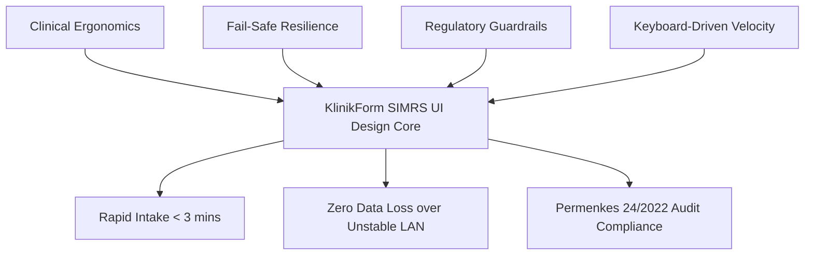
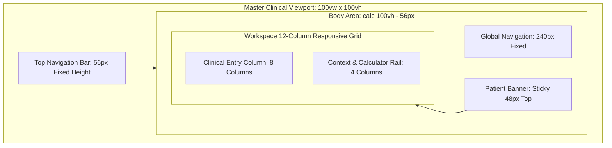
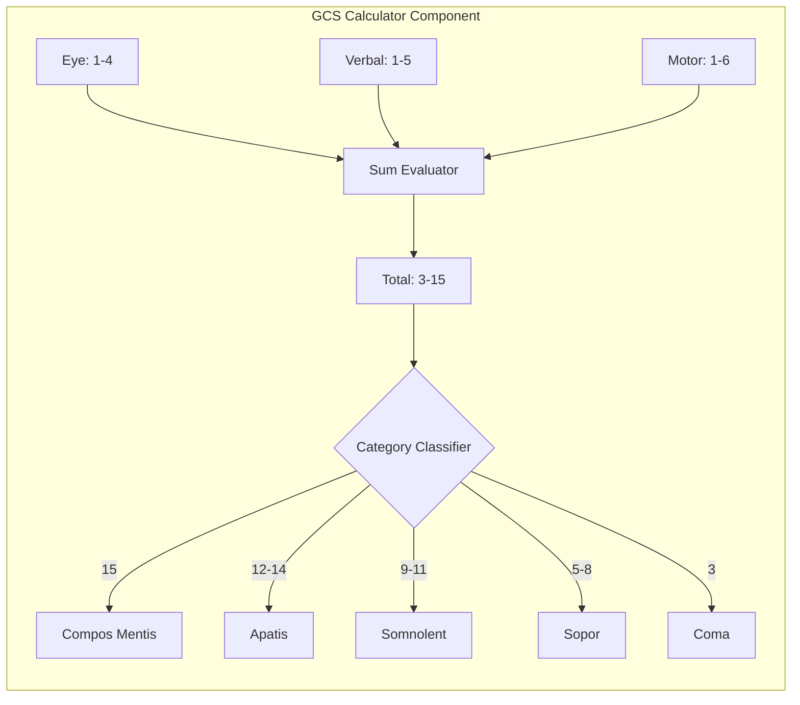

# UI Specification

## Design Principles
- **Clinical Ergonomics Under High Cognitive Load**: Interface layouts prioritize readability, high data density without visual clutter, and zero ambiguity. High-stress environments like Emergency Department (IGD) triage require instant confirmation of inputs and immediate calculation outputs.
- **Fail-Safe Client-Side Resilience**: Form state is treated as transient until acknowledged by the server. UI affordances communicate draft survival, network disconnection, and local persistence transparently without interrupting the clinician's physical intake.
- **Uncompromising Regulatory Guardrails**: Security, immutability, and Permenkes No. 24/2022 compliance mechanisms (field encryption, record locking, sign-off integrity) are surfaced directly in the interface via clear security badges, uneditable state indicators, and signature stamps.
- **Keyboard-Driven Velocity**: Every primary clinical assessment form, vital sign field, GCS picker, and diagnostic code search must be operable without a pointing device to allow ultra-fast physical rounds entry.

---

## Design Tokens

### Color Tokens
Tokens map directly to Tailwind CSS utility conventions and are defined in hex and HSL for consistent application across Blade templates and inline SVG elements.

| Token Name | Hex Value | Role / Usage | Contrast Ratio on Canvas/Bg |
| :--- | :--- | :--- | :--- |
| `color-canvas-bg` | `#F8FAFC` | Main application background (Slate-50) | N/A |
| `color-surface-base` | `#FFFFFF` | Cards, modal sheets, panels | 1.05:1 vs Canvas |
| `color-surface-subtle` | `#F1F5F9` | Read-only inputs, table zebra rows, widget wells | 1.14:1 vs Canvas |
| `color-border-subtle` | `#E2E8F0` | Structural card borders, unselected input borders | 1.25:1 vs Canvas |
| `color-border-strong` | `#94A3B8` | Focused/active borders, active card borders | 3.0:1 vs Canvas |
| `color-text-primary` | `#0F172A` | Clinical headers, primary clinical data, values | 15.6:1 vs Surface |
| `color-text-secondary` | `#475569` | Field labels, metadata strings, subheaders | 7.3:1 vs Surface |
| `color-text-muted` | `#64748B` | Helper copy, timestamps, inactive icons | 4.8:1 vs Surface |
| `color-brand-50` | `#EFF6FF` | Primary button hover highlight, light blue tint | 1.1:1 vs Surface |
| `color-brand-600` | `#2563EB` | Interactive brand primary (actions, active tab) | 4.6:1 vs Surface |
| `color-brand-700` | `#1D4ED8` | Brand active/pressed state | 6.5:1 vs Surface |
| `color-triage-resus` | `#DC2626` | Triage: Resuscitation (Red) / Critical Alert | 4.9:1 vs White |
| `color-triage-emergent` | `#EA580C` | Triage: Emergent (Orange) | 4.5:1 vs White |
| `color-triage-urgent` | `#D97706` | Triage: Urgent (Yellow/Amber) | 4.5:1 vs White |
| `color-triage-lessurgent` | `#16A34A` | Triage: Less Urgent (Green) / Normal / Locked | 4.6:1 vs White |
| `color-triage-nonurgent` | `#2563EB` | Triage: Non-Urgent (Blue) | 4.6:1 vs White |
| `color-danger-50` | `#FEF2F2` | Validation error callout background | 1.05:1 vs Surface |
| `color-danger-600` | `#DC2626` | Validation error border, inline error text | 4.9:1 vs Surface |
| `color-warning-50` | `#FFFBEB` | Local draft unsaved amber warning background | 1.05:1 vs Surface |
| `color-warning-600` | `#D97706` | Local draft unsaved border, warning badges | 4.5:1 vs Surface |
| `color-success-50` | `#F0FDF4` | Signed record background banner | 1.05:1 vs Surface |
| `color-success-700` | `#15803D` | Permenkes signature verification badge text | 5.2:1 vs Surface |

### Typography Tokens
Typography uses a clean, native system stack (`ui-sans-serif, system-ui, -apple-system, BlinkMacSystemFont, "Segoe UI", Roboto, "Helvetica Neue", Arial, sans-serif`) optimized for high legibility across generic hospital LCD monitors.

| Token Name | Font Size | Line Height | Font Weight | Letter Spacing | Purpose |
| :--- | :--- | :--- | :--- | :--- | :--- |
| `type-display-lg` | 24px (1.5rem) | 32px (2.0rem) | 700 (Bold) | -0.025em | Main Ward / Module Header |
| `type-heading-md` | 18px (1.125rem)| 28px (1.75rem) | 600 (Semibold) | -0.015em | Section Headings, Modal Titles |
| `type-heading-sm` | 14px (0.875rem)| 20px (1.25rem) | 600 (Semibold) | 0.0em | Widget Titles, Fieldset Legend |
| `type-body-md` | 14px (0.875rem)| 20px (1.25rem) | 400 (Regular) | 0.0em | Form Input Values, Standard Copy |
| `type-body-sm` | 12px (0.75rem) | 16px (1.0rem) | 400 (Regular) | 0.0em | Secondary Details, Helper Text |
| `type-caption` | 11px (0.6875rem)| 14px (0.875rem)| 500 (Medium) | +0.025em | Status Pills, Timestamp Labels |
| `type-mono-sm` | 12px (0.75rem) | 16px (1.0rem) | 500 (Medium) | 0.0em | NIK, SEP Number, ICD-10 Code, Hashes |
| `type-mono-md` | 14px (0.875rem)| 20px (1.25rem) | 600 (Semibold) | 0.0em | Vital Sign Numeric Digits |

### Spacing Tokens
Based on an 8pt layout grid with a 4pt sub-grid for compact clinical components.

| Token Name | Value | Rem Equivalent | Purpose |
| :--- | :--- | :--- | :--- |
| `space-1` | 4px | 0.25rem | Icon-to-text spacing, compact pill padding |
| `space-2` | 8px | 0.5rem | Standard element gap, inner button padding (Y) |
| `space-3` | 12px | 0.75rem | Form label to input offset, table cell padding (Y)|
| `space-4` | 16px | 1.0rem | Standard input padding (X), card inner padding |
| `space-5` | 20px | 1.25rem | Component margins, table cell padding (X) |
| `space-6` | 24px | 1.5rem | Card gap, layout column gutters |
| `space-8` | 32px | 2.0rem | Section container separating margins |
| `space-12` | 48px | 3.0rem | Top navigation bar height / portal banner gap |

### Radius Tokens
| Token Name | Value | Purpose |
| :--- | :--- | :--- |
| `radius-none` | 0px | Seamless table rows, split button corners |
| `radius-sm` | 4px | Checkboxes, badge tags, inline status indicators |
| `radius-md` | 6px | Form input controls, buttons, dropdown menus |
| `radius-lg` | 8px | Section containers, calculator cards, canvas wraps |
| `radius-xl` | 12px | Modal dialog boxes, slide-over panels |
| `radius-full` | 9999px | Circular avatar initials, triage color indicators |

### Elevation Tokens
| Token Name | CSS Box Shadow Value | Usage |
| :--- | :--- | :--- |
| `elevation-none` | `none` | Flat inputs, border-defined containers |
| `elevation-low` | `0 1px 2px 0 rgba(0, 0, 0, 0.05)` | Default cards, widget panels |
| `elevation-mid` | `0 4px 6px -1px rgba(0, 0, 0, 0.1), 0 2px 4px -2px rgba(0, 0, 0, 0.1)` | Dropdown popovers, autocomplete results, hover states |
| `elevation-high` | `0 10px 15px -3px rgba(0, 0, 0, 0.1), 0 4px 6px -4px rgba(0, 0, 0, 0.1)`| Modal dialogs, offline banner slide-ins |

---

## Layout & Grid

### Portal Master Layout
The application employs an asymmetric fixed-header, sticky-sidebar layout that maximizes vertical space for clinical intake documentation.

### Grid Parameters
- **Desktop (>= 1280px)**: 12-column grid, 24px gutter (`space-6`), 24px horizontal margin.
  - Form Column: 8 columns (`col-span-8`) for dynamic clinical inputs.
  - Summary / Calculator Rail: 4 columns (`col-span-4`) for GCS selector, anatomical map canvas, and vital summary.
- **Tablet (1024px – 1279px)**: 12-column grid, 16px gutter (`space-4`), 16px horizontal margin.
  - Form Column: 12 columns (`col-span-12`).
  - Summary / Calculator Rail: Stacks beneath form sections or renders as sticky bottom drawer.
- **App Bar Height**: 56px fixed.
- **Patient Context Strip**: 48px height, sticky beneath app bar with `z-index: 20`.

---

## Component Inventory

### 1. Patient Context Strip (`c-patient-strip`)
- **Purpose**: Provides persistent, un-scrollable clinical context of the patient under assessment (NIK, RM, Name, Age, Sex, Triaged Urgency) preventing erroneous cross-patient data entry.
- **Props**:
  - `patient_name`: string (e.g., "Joko Susanto")
  - `rm_number`: string (e.g., "00-48-21")
  - `nik`: string (Masked: "331501******0001")
  - `gender`: 'L' | 'P'
  - `age`: string (e.g., "42 thn")
  - `triage_level`: 'resuscitation' | 'emergent' | 'urgent' | 'less_urgent' | 'non_urgent' | null
  - `encounter_id`: UUID
- **States**: `loading` (pulse skeleton), `active` (populated), `unassigned` (triage color gray).
- **Variants**: Default (full metadata), Compact (mobile/tablet reduced metadata).

### 2. Clinical Numeric Input (`c-clinical-input`)
- **Purpose**: Specialized input for vital signs with bound unit labels and instantaneous threshold validation.
- **Props**:
  - `label`: string (e.g., "Sistole")
  - `unit`: string (e.g., "mmHg")
  - `min`: number (e.g., 40)
  - `max`: number (e.g., 300)
  - `step`: number (default 1)
  - `value`: number | null
  - `name`: string
  - `is_required`: boolean
  - `read_only`: boolean
- **States**: `default`, `focused`, `valid`, `error` (value outside boundary), `disabled` / `read-only`.
- **Variants**: Single unit inline, Dual input (e.g., Blood Pressure: Sistole / Diastole combined).

### 3. Glasgow Coma Scale (GCS) Widget (`c-widget-gcs`)
- **Purpose**: Captures sub-scores for Eye, Verbal, and Motor responses; computes sum and textual consciousness tier automatically.
- **Props**:
  - `value_eye`: 1 | 2 | 3 | 4 | null
  - `value_verbal`: 1 | 2 | 3 | 4 | 5 | null
  - `value_motor`: 1 | 2 | 3 | 4 | 5 | 6 | null
  - `read_only`: boolean
- **States**: `incomplete` (1 or 2 parts chosen), `computed` (all parts selected, displays total and categorization), `locked`.
- **Variants**: Segmented pill layout (desktop) vs. Dropdown select mode (tablet narrow).

### 4. Interactive Anatomical Pain Canvas (`c-widget-pain-canvas`)
- **Purpose**: Clickable anterior/posterior SVG body map capturing relative coordinate pins, anatomical zone, and Numeric Rating Scale (NRS) pain intensity.
- **Props**:
  - `markers`: Array of `{ x: number, y: number, region: string, severity: number }`
  - `active_view`: 'anterior' | 'posterior'
  - `read_only`: boolean
- **States**: `idle`, `pin-placing` (modal prompt open for score 0–10), `has-markers`, `locked`.
- **Variants**: Dual-pane side-by-side (1280px+) vs. Tabbed toggle view (1024px).

### 5. Draft Auto-Save Recovery Banner (`c-draft-banner`)
- **Purpose**: Communicates client-side `localStorage` draft detection, background sync state, or offline isolation.
- **Props**:
  - `status`: 'saved' | 'saving' | 'offline_cached' | 'recovered'
  - `last_saved_time`: string (e.g., "14:22:05 WIB")
- **States**: `hidden`, `syncing` (pulsing blue dot), `recovered_prompt` (actionable amber modal prompt), `offline` (solid warning banner).
- **Variants**: Header inline indicator, Full-width dismissible banner.

### 6. ICD-10 Autocomplete Picker (`c-icd10-picker`)
- **Purpose**: Rapid searchable select for clinical diagnostic codes matching WHO ICD-10 standards.
- **Props**:
  - `selected_code`: string | null (e.g., "K29.7")
  - `selected_description`: string | null (e.g., "Gastritis, unspecified")
  - `read_only`: boolean
- **States**: `idle`, `searching` (spinner active), `results_open`, `selected`, `disabled`.
- **Variants**: Primary Diagnosis variant (accent border) vs. Secondary Diagnosis multi-select variant.

### 7. Permenkes Cryptographic Sign-Off Stamp (`c-signature-stamp`)
- **Purpose**: Visually confirms a locked record with SHA-256 integrity hash, signing practitioner, and timestamp.
- **Props**:
  - `practitioner_name`: string (e.g., "dr. Budi Setiawan, Sp.PD")
  - `practitioner_sip`: string (e.g., "SIP: 446/120/IP.D/2023")
  - `signed_timestamp`: string (ISO-8601)
  - `sha256_hash`: string (64 hex characters)
- **States**: `verified` (green check, hash verified), `unlocked_draft` (hidden/gray placeholder).
- **Variants**: Compact row stamp, Official certificate block for print/export.

---

## Responsive Breakpoints

The clinical portal is strictly optimized for hospital hardware configurations. Handheld mobile screens (< 768px) are intentionally routed to a responsive read-only/lookup interface, as clinical form documentation requires a tablet or workstation screen.

| Breakpoint Name | Minimum Width | Target Devices | Layout Adjustments |
| :--- | :--- | :--- | :--- |
| `tablet-portrait` | 768px | Ward 10" Android tablets in portrait orientation | 1-column layout; navigation collapses to slide-over menu; Anatomical Canvas switches to anterior/posterior segmented button tabs. |
| `tablet-landscape` | 1024px | Ruggedized medical tablets, mobile triage carts | Form and rail stack into a 12-column flow; Summary Rail collapses into expandable drawer anchored to right. |
| `desktop-standard` | 1280px | Hospital ward nurse stations, Dell 20" LCDs | 8-column form + 4-column summary rail side-by-side; Patient banner permanently sticky; dual anterior/posterior canvas side-by-side. |
| `desktop-wide` | 1920px | DPJP consultation workstations, Full HD monitors | Max container width clamped at 1600px centered; increases font line-height to 24px for ergonomic viewing at arm's length. |

---

## Accessibility

- **WCAG Conformance Target**: **WCAG 2.1 Level AA**.
- **Color Contrast Ratios**:
  - Primary text (`#0F172A`) against surface base (`#FFFFFF`): **15.6:1** (Exceeds 4.5:1 requirement).
  - Secondary label text (`#475569`) against surface base: **7.3:1** (Exceeds 4.5:1 requirement).
  - Triage color indicators contain both color and textual redundancy (e.g., "Urgent (Kuning) - P2").
- **Keyboard Navigation Order**:
  1. Navigation enters through Patient Context lookup.
  2. Tab flows sequentially down the active form: Triage Category $\rightarrow$ Vital Signs (Sistole $\rightarrow$ Diastole $\rightarrow$ Nadi $\rightarrow$ RR $\rightarrow$ Temp) $\rightarrow$ GCS Eye (1–4 via Arrow keys) $\rightarrow$ Verbal (1–5) $\rightarrow$ Motor (1–6).
  3. Interactive Anatomical Canvas supports keyboard pinning: Arrow keys reposition target reticle; `Enter` drops pin; `0`–`9` keys set numeric pain severity instantly.
- **Focus Indicators**:
  - All interactive elements employ an explicit 2px solid outline with a 2px offset: `outline: 2px solid #2563EB; outline-offset: 2px;`.
  - Focused cards elevate to `elevation-mid` to indicate active context.
- **ARIA Declarations**:
  - Live vital score and GCS sum updates declare `aria-live="polite"`.
  - Draft auto-save alerts use `role="status"` and `aria-live="polite"`.
  - Error messages are dynamically linked to inputs via `aria-describedby="[input-id]-error"`.

---

## Interaction & Motion States

### Input & Widget Interactive Matrix

| Interaction State | Visual Manifestation | Duration / Easing | CSS / Tailwind Properties |
| :--- | :--- | :--- | :--- |
| **Default / Rest** | Background `#FFFFFF`, Border `#E2E8F0`, Text `#0F172A` | N/A | `bg-white border-slate-200 text-slate-900` |
| **Hover** | Border `#94A3B8`, Cursor pointer (if clickable) | 150ms ease-in-out | `hover:border-slate-400 transition-colors duration-150` |
| **Active / Focus** | Border `#2563EB`, Ring 2px `#2563EB` at 20% opacity | Instant (0ms) | `focus:border-blue-600 focus:ring-2 focus:ring-blue-600/20 outline-none` |
| **Loading / Syncing** | Pulse opacity animation between 40% and 100% | 1500ms ease-in-out infinite | `animate-pulse bg-slate-200` |
| **Empty State** | Dashed border `#CBD5E1`, Centered text `#64748B`, Icon 32px | N/A | `border-2 border-dashed border-slate-300 p-8 text-center` |
| **Inline Error** | Border `#DC2626`, Background `#FEF2F2`, Text `#DC2626` | 200ms ease-out | `border-red-600 bg-red-50 text-red-600` |
| **Success / Locked** | Background `#F0FDF4`, Border `#BBF7D0`, Read-only | N/A | `bg-green-50 border-green-200 cursor-not-allowed` |

### Motion & Micro-Transitions
- **Restoration Prompt Entry**: Slide-down from top of screen: `translate-y-0` from `-translate-y-full` over 250ms with `cubic-bezier(0.16, 1, 0.3, 1)`.
- **Pain Canvas Pin Placement**: Drop-in bounce animation on SVG point: scale `1.4` to `1.0` over 180ms.
- **Record Lock Transition**: Subtle crossfade (200ms) replacing form submission actions with the Permenkes Cryptographic Stamp container.

---

## Copy & Microcopy

To guarantee cultural and operational precision in Indonesian regional hospital settings, all clinical microcopy uses formal Indonesian terminology matching standard Ministry of Health guidelines.

### Clinical Microcopy Directory

| Placement / Key | Indonesian String | English Context / Meaning | Purpose / Trigger |
| :--- | :--- | :--- | :--- |
| `triage.category.resus` | **Kategori 1: Resusitasi (Merah)** | Category 1: Resuscitation (Red) | Triage category selector label |
| `triage.category.emergent` | **Kategori 2: Emergensi (Oranye)** | Category 2: Emergent (Orange) | Triage category selector label |
| `triage.category.urgent` | **Kategori 3: Urgensi (Kuning)** | Category 3: Urgent (Yellow) | Triage category selector label |
| `triage.category.lessurgent` | **Kategori 4: Semi-Urgensi (Hijau)**| Category 4: Semi-Urgent (Green) | Triage category selector label |
| `triage.category.nonurgent` | **Kategori 5: Non-Urgensi (Biru)** | Category 5: Non-Urgent (Blue) | Triage category selector label |
| `vitals.bp.systolic.error` | *Nilai sistol harus di antara 40 – 300 mmHg.* | Systolic must be between 40–300. | Inline validation rule failure |
| `vitals.bp.diastolic.error`| *Nilai diastol harus di antara 30 – 200 mmHg.* | Diastolic must be between 30–200. | Inline validation rule failure |
| `gcs.incomplete.warning` | *Pilih ketiga parameter (E, V, M) untuk menghitung GCS.* | Select all 3 parts to calculate. | Calculation helper text |
| `pain.modal.title` | **Tingkat Keparahan Nyeri (Skala NRS)** | Pain Severity (NRS Scale) | Modal header on canvas pin tap |
| `pain.modal.helper` | *0: Tidak Nyeri, 1–3: Ringan, 4–6: Sedang, 7–10: Berat* | 0: None, 1-3: Mild, 4-6: Mod, 7-10: Severe | Scale guidance in modal |
| `draft.recovered.banner` | **Draf Belum Tersimpan Ditemukan** | Unsaved Draft Found | LocalStorage auto-detect on open |
| `draft.recovered.body` | *Tersedia draf pemeriksaan lokal dari {timestamp}. Pulihkan data?* | Draft from {time} exists. Restore? | Dialog text for crash recovery |
| `draft.btn.restore` | **Pulihkan Draf** | Restore Draft | Primary button in recovery banner |
| `draft.btn.discard` | **Buang & Buat Baru** | Discard & Start New | Secondary button in recovery banner |
| `lock.modal.title` | **Konfirmasi Penguncian Rekam Medis** | Confirm Medical Record Lock | Modal header before DPJP sign-off |
| `lock.modal.body` | *Sesuai Permenkes No. 24/2022, rekam medis yang telah ditandatangani tidak dapat diubah kembali tanpa prosedur addendum resmi. Lanjutkan?* | Per Permenkes 24/2022, signed records cannot be changed without addendum. Proceed? | Regulatory warning on doctor sign-off |
| `lock.btn.confirm` | **Tandatangani & Kunci Permanen** | Sign & Lock Permanently | Primary destructive action button |
| `signature.stamp.label` | **Dokumen Rekam Medis Terverifikasi Secara Elektronik** | Electronically Verified EMR Document | Header in locked record stamp |
| `bpjs.drift.alert` | *Waktu komputer lokal Anda berselisih lebih dari 300 detik dengan server SIMRS. Sinkronkan jam perangkat.* | Local clock drifted >300s from SIMRS server. Sync clock. | BPJS simulator timestamp error |
| `auth.unauthorized.role` | *Akses dibatasi. Anda tidak memiliki wewenang untuk mengisi asesmen medis DPJP.* | Access restricted. Missing DPJP permissions. | RBAC Gate barrier banner |
<!--JSON-->
{
  "design_principles": [
    "Clinical Ergonomics Under High Cognitive Load: Layouts prioritize high data density without clutter and zero ambiguity under high-stress emergency ward intake conditions.",
    "Fail-Safe Client-Side Resilience: Form state buffers locally in browser storage every 5 seconds to guarantee zero clinical data loss across unstable regional hospital intranets.",
    "Uncompromising Regulatory Guardrails: Enforces Permenkes No. 24/2022 medical record security, immutable access logging, and post-signature record locking directly in UI affordances.",
    "Keyboard-Driven Velocity: All primary data entry workflows (vitals, GCS selections, diagnostic codings) support rapid, mouse-free keyboard navigation."
  ],
  "design_tokens": {
    "color": {
      "color-canvas-bg": "#F8FAFC",
      "color-surface-base": "#FFFFFF",
      "color-surface-subtle": "#F1F5F9",
      "color-border-subtle": "#E2E8F0",
      "color-border-strong": "#94A3B8",
      "color-text-primary": "#0F172A",
      "color-text-secondary": "#475569",
      "color-text-muted": "#64748B",
      "color-brand-50": "#EFF6FF",
      "color-brand-600": "#2563EB",
      "color-brand-700": "#1D4ED8",
      "color-triage-resus": "#DC2626",
      "color-triage-emergent": "#EA580C",
      "color-triage-urgent": "#D97706",
      "color-triage-lessurgent": "#16A34A",
      "color-triage-nonurgent": "#2563EB",
      "color-danger-50": "#FEF2F2",
      "color-danger-600": "#DC2626",
      "color-warning-50": "#FFFBEB",
      "color-warning-600": "#D97706",
      "color-success-50": "#F0FDF4",
      "color-success-700": "#15803D"
    },
    "typography": {
      "type-display-lg": { "fontSize": "24px", "lineHeight": "32px", "fontWeight": "700", "letterSpacing": "-0.025em" },
      "type-heading-md": { "fontSize": "18px", "lineHeight": "28px", "fontWeight": "600", "letterSpacing": "-0.015em" },
      "type-heading-sm": { "fontSize": "14px", "lineHeight": "20px", "fontWeight": "600", "letterSpacing": "0.0em" },
      "type-body-md": { "fontSize": "14px", "lineHeight": "20px", "fontWeight": "400", "letterSpacing": "0.0em" },
      "type-body-sm": { "fontSize": "12px", "lineHeight": "16px", "fontWeight": "400", "letterSpacing": "0.0em" },
      "type-caption": { "fontSize": "11px", "lineHeight": "14px", "fontWeight": "500", "letterSpacing": "+0.025em" },
      "type-mono-sm": { "fontSize": "12px", "lineHeight": "16px", "fontWeight": "500", "letterSpacing": "0.0em" },
      "type-mono-md": { "fontSize": "14px", "lineHeight": "20px", "fontWeight": "600", "letterSpacing": "0.0em" }
    },
    "spacing": {
      "space-1": "4px",
      "space-2": "8px",
      "space-3": "12px",
      "space-4": "16px",
      "space-5": "20px",
      "space-6": "24px",
      "space-8": "32px",
      "space-12": "48px"
    },
    "radius": {
      "radius-none": "0px",
      "radius-sm": "4px",
      "radius-md": "6px",
      "radius-lg": "8px",
      "radius-xl": "12px",
      "radius-full": "9999px"
    },
    "elevation": {
      "elevation-none": "none",
      "elevation-low": "0 1px 2px 0 rgba(0, 0, 0, 0.05)",
      "elevation-mid": "0 4px 6px -1px rgba(0, 0, 0, 0.1), 0 2px 4px -2px rgba(0, 0, 0, 0.1)",
      "elevation-high": "0 10px 15px -3px rgba(0, 0, 0, 0.1), 0 4px 6px -4px rgba(0, 0, 0, 0.1)"
    }
  },
  "layout_and_grid": {
    "structure": "Fixed-header (56px) + sticky patient strip (48px) + fixed side navigation (240px) + 12-column responsive workspace grid.",
    "desktop_1280": {
      "columns": 12,
      "gutter": "24px",
      "form_column_span": 8,
      "summary_rail_span": 4
    },
    "tablet_1024": {
      "columns": 12,
      "gutter": "16px",
      "form_column_span": 12,
      "summary_rail_mode": "Collapsible sticky bottom drawer"
    }
  },
  "component_inventory": [
    {
      "name": "c-patient-strip",
      "purpose": "Provides persistent clinical context of the patient under assessment (NIK, RM, Name, Age, Sex, Triaged Urgency) preventing erroneous cross-patient data entry.",
      "props": ["patient_name", "rm_number", "nik", "gender", "age", "triage_level", "encounter_id"],
      "states": ["loading", "active", "unassigned"],
      "variants": ["default", "compact"]
    },
    {
      "name": "c-clinical-input",
      "purpose": "Specialized input for vital signs with bound unit labels and instantaneous threshold validation.",
      "props": ["label", "unit", "min", "max", "step", "value", "name", "is_required", "read_only"],
      "states": ["default", "focused", "valid", "error", "disabled", "read-only"],
      "variants": ["single-inline", "dual-split"]
    },
    {
      "name": "c-widget-gcs",
      "purpose": "Captures sub-scores for Eye, Verbal, and Motor responses; computes sum and textual consciousness tier automatically.",
      "props": ["value_eye", "value_verbal", "value_motor", "read_only"],
      "states": ["incomplete", "computed", "locked"],
      "variants": ["segmented-pill", "dropdown-select"]
    },
    {
      "name": "c-widget-pain-canvas",
      "purpose": "Clickable anterior/posterior SVG body map capturing relative coordinate pins, anatomical zone, and Numeric Rating Scale (NRS) pain intensity.",
      "props": ["markers", "active_view", "read_only"],
      "states": ["idle", "pin-placing", "has-markers", "locked"],
      "variants": ["dual-pane-side-by-side", "tabbed-toggle"]
    },
    {
      "name": "c-draft-banner",
      "purpose": "Communicates client-side localStorage draft detection, background sync state, or offline isolation.",
      "props": ["status", "last_saved_time"],
      "states": ["hidden", "syncing", "recovered_prompt", "offline"],
      "variants": ["inline-pill", "full-width-banner"]
    },
    {
      "name": "c-icd10-picker",
      "purpose": "Rapid searchable select for clinical diagnostic codes matching WHO ICD-10 standards.",
      "props": ["selected_code", "selected_description", "read_only"],
      "states": ["idle", "searching", "results_open", "selected", "disabled"],
      "variants": ["primary-diagnosis", "secondary-diagnosis-multi"]
    },
    {
      "name": "c-signature-stamp",
      "purpose": "Visually confirms a locked record with SHA-256 integrity hash, signing practitioner, and timestamp per Permenkes 24/2022.",
      "props": ["practitioner_name", "practitioner_sip", "signed_timestamp", "sha256_hash"],
      "states": ["verified", "unlocked_placeholder"],
      "variants": ["compact-row", "official-block"]
    }
  ],
  "responsive_breakpoints": {
    "tablet-portrait": {
      "min_width": "768px",
      "target_devices": "Ward 10-inch Android tablets in portrait orientation",
      "layout_adjustments": "Single-column flow; navigation collapses to slide-over menu; anatomical canvas switches to segmented toggle view."
    },
    "tablet-landscape": {
      "min_width": "1024px",
      "target_devices": "Ruggedized medical tablets, mobile triage workstation carts",
      "layout_adjustments": "12-column grid; summary rail docks to bottom drawer or expandable right drawer."
    },
    "desktop-standard": {
      "min_width": "1280px",
      "target_devices": "Hospital ward nurse stations, Dell 20-inch LCD monitors",
      "layout_adjustments": "8-column form + 4-column summary rail; persistent sticky patient strip; dual anatomical body maps side-by-side."
    },
    "desktop-wide": {
      "min_width": "1920px",
      "target_devices": "DPJP consultation workstations, Full HD medical monitors",
      "layout_adjustments": "Max container width clamped at 1600px centered; increases body text line-height for arm's length viewing."
    }
  ],
  "accessibility": {
    "wcag_target": "WCAG 2.1 Level AA",
    "contrast_targets": {
      "text_primary": "15.6:1 against white",
      "text_secondary": "7.3:1 against white",
      "interactive_brand": "4.6:1 against white"
    },
    "keyboard_order": "Patient Lookup -> Form Top -> Triage Category -> Vital Signs -> GCS Components -> Anatomical Map Canvas (Reticle via Arrows, Enter to drop pin) -> Diagnosis Search -> Submit/Lock.",
    "focus_management": "2px solid #2563EB outline with 2px offset on all active elements; focus scrolls automatically to first invalid input upon FormRequest 422 response.",
    "aria_declarations": "aria-live='polite' on GCS and draft-sync alerts; role='status' on sync indicators; aria-describedby for dynamic validation errors."
  },
  "interaction_and_motion_states": {
    "states": {
      "default": "bg-white border-slate-200 text-slate-900",
      "hover": "hover:border-slate-400 transition-colors duration-150",
      "active_focus": "focus:border-blue-600 focus:ring-2 focus:ring-blue-600/20 outline-none",
      "loading": "animate-pulse bg-slate-200",
      "empty": "border-2 border-dashed border-slate-300 p-8 text-center text-slate-500",
      "error": "border-red-600 bg-red-50 text-red-600",
      "locked": "bg-green-50 border-green-200 cursor-not-allowed"
    },
    "transitions": {
      "draft_banner_entry": "translate-y-0 from -translate-y-full over 250ms cubic-bezier(0.16, 1, 0.3, 1)",
      "pain_marker_drop": "scale 1.4 to 1.0 over 180ms ease-out",
      "lock_transition": "opacity crossfade over 200ms ease-in-out"
    }
  },
  "copy_and_microcopy": {
    "triage.category.resus": "Kategori 1: Resusitasi (Merah)",
    "triage.category.emergent": "Kategori 2: Emergensi (Oranye)",
    "triage.category.urgent": "Kategori 3: Urgensi (Kuning)",
    "triage.category.lessurgent": "Kategori 4: Semi-Urgensi (Hijau)",
    "triage.category.nonurgent": "Kategori 5: Non-Urgensi (Biru)",
    "vitals.bp.systolic.error": "Nilai sistol harus di antara 40 – 300 mmHg.",
    "vitals.bp.diastolic.error": "Nilai diastol harus di antara 30 – 200 mmHg.",
    "gcs.incomplete.warning": "Pilih ketiga parameter (E, V, M) untuk menghitung GCS.",
    "pain.modal.title": "Tingkat Keparahan Nyeri (Skala NRS)",
    "pain.modal.helper": "0: Tidak Nyeri, 1–3: Ringan, 4–6: Sedang, 7–10: Berat",
    "draft.recovered.banner": "Draf Belum Tersimpan Ditemukan",
    "draft.recovered.body": "Tersedia draf pemeriksaan lokal dari {timestamp}. Pulihkan data?",
    "draft.btn.restore": "Pulihkan Draf",
    "draft.btn.discard": "Buang & Buat Baru",
    "lock.modal.title": "Konfirmasi Penguncian Rekam Medis",
    "lock.modal.body": "Sesuai Permenkes No. 24/2022, rekam medis yang telah ditandatangani tidak dapat diubah kembali tanpa prosedur addendum resmi. Lanjutkan?",
    "lock.btn.confirm": "Tandatangani & Kunci Permanen",
    "signature.stamp.label": "Dokumen Rekam Medis Terverifikasi Secara Elektronik",
    "bpjs.drift.alert": "Waktu komputer lokal Anda berselisih lebih dari 300 detik dengan server SIMRS. Sinkronkan jam perangkat.",
    "auth.unauthorized.role": "Akses dibatasi. Anda tidak memiliki wewenang untuk mengisi asesmen medis DPJP."
  }
}