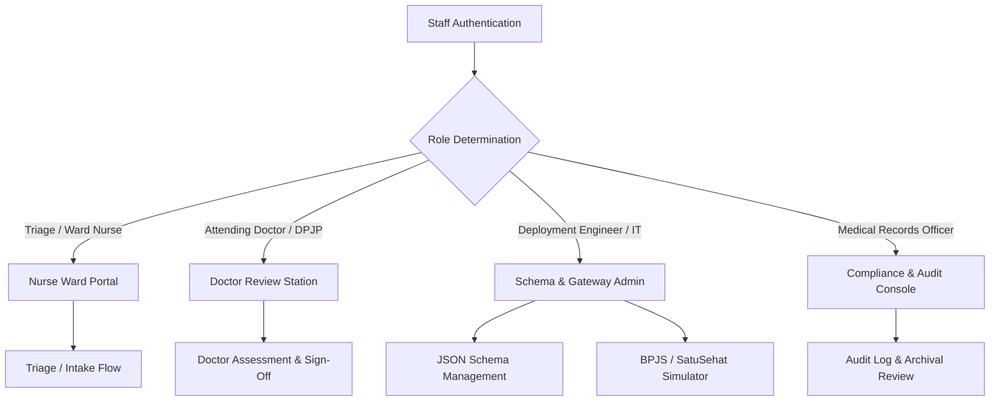
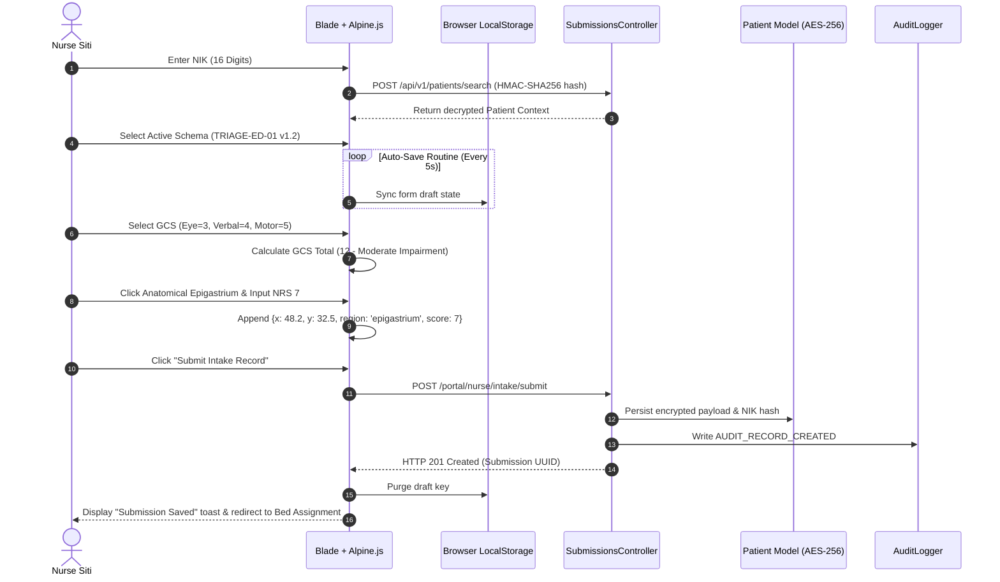
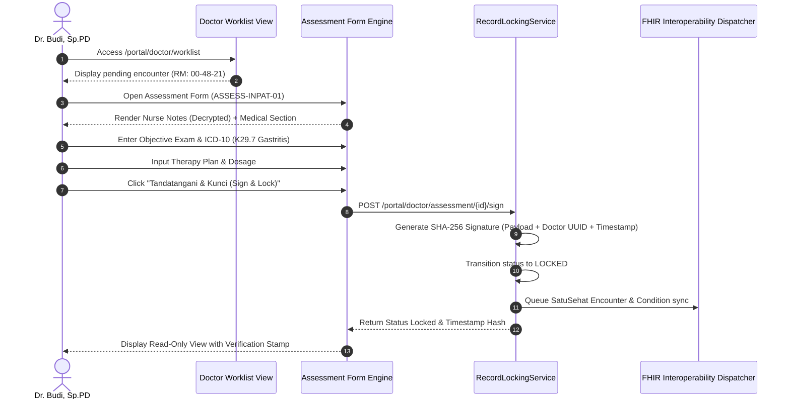
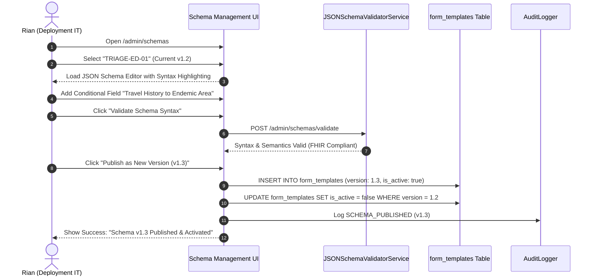
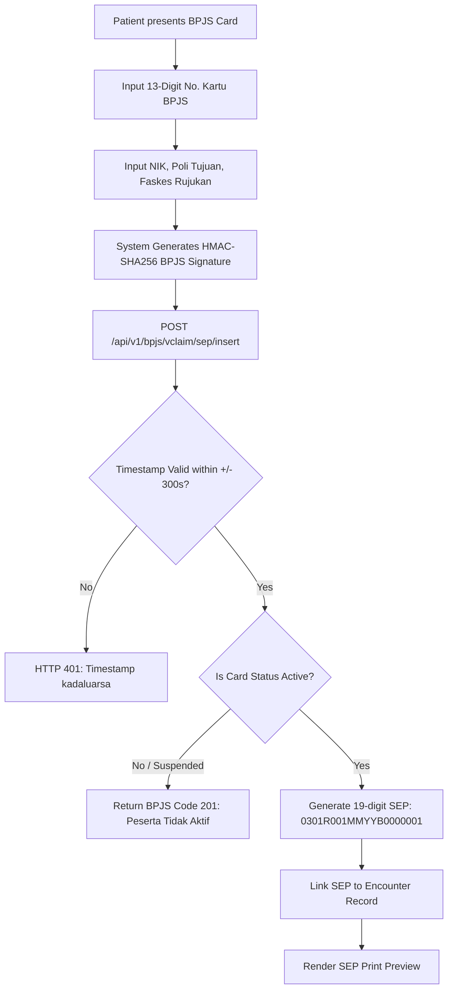
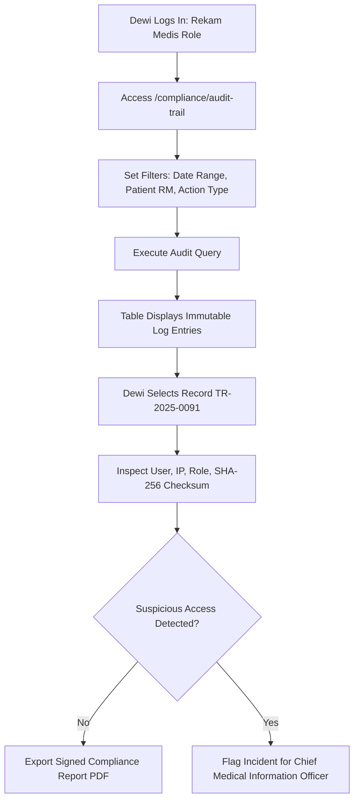
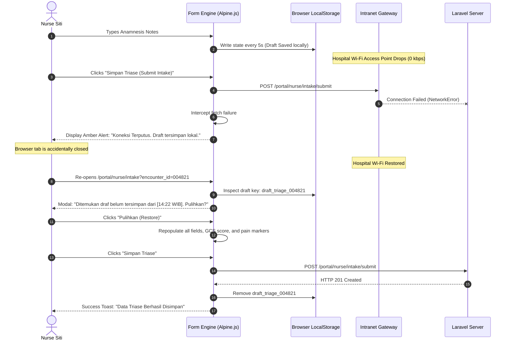

# User Flow

## Overview
The KlinikForm SIMRS user flow documents the behavioral pathways across the digital clinical documentation subsystem built on Laravel 11, Blade, Tailwind CSS, and Alpine.js. The interface replaces paper-based clinical intake forms (*Formulir Triase Gawat Darurat* and *Asesmen Awal Keperawatan dan Medis Rawat Inap*) in regional Indonesian hospitals.

All interaction loops prioritize clinical ergonomics: rapid data capture, persistent client-side state recovery, zero data loss over unstable ward intranets, and Permenkes No. 24/2022 regulatory conformance. Sensitive records are encrypted transparently at the Eloquent model layer using AES-256-GCM, audited immutably, and bridged asynchronously to SatuSehat HL7 FHIR R4 and BPJS VClaim APIs.



---

## Personas & Entry Points

| Persona | Primary Role & Ward | Access Terminal & Environment | Core Entry Point URL | Initial Session Action |
| :--- | :--- | :--- | :--- | :--- |
| **Nurse Siti** | Triage & Ward Nurse (IGD / Rawat Inap) | Wall-mounted PC, ward desktop, or ruggedized Android tablet running Chrome (1024x768 min resolution). | `/portal/nurse/intake` | Scans patient barcode, enters Medical Record Number (RM), or looks up 16-digit NIK via blind index. |
| **Dr. Budi, Sp.PD** | Attending Physician / DPJP | Polyclinic / Ward workstation PC (1080p single monitor). | `/portal/doctor/worklist` | Reviews unverified admissions, loads pending assessments, validates anamnesis, and inputs diagnoses. |
| **Rian** | SIMRS Deployment Engineer (Medify IT) | High-resolution laptop / workstation terminal with developer tools. | `/admin/schemas` | Edits JSON schema layouts, tests dynamic form versions, and validates FHIR/BPJS API bridging endpoints. |
| **Dewi, A.Md.RMIK** | Medical Records Officer (*Perekam Medis*) | Medical Record Office desktop terminal. | `/compliance/audit-trail` | Audits access logs, searches patient trail by NIK/RM, reviews SatuSehat dispatch queues, and inspects immutable records. |

---

## Primary Flows

### Flow 1: Emergency Triage Intake (*Nurse Siti*)

#### Objective
Intake an incoming emergency room patient, record physical assessment data, auto-compute GCS, pin pain locations on an anatomical map, and submit under the 3-minute regulatory target.



#### Step-by-Step Procedure
1. **Patient Identification**:
   - Nurse Siti navigates to `/portal/nurse/intake`.
   - Types patient NIK (`3315012345670001`) into the lookup field.
   - The system computes the HMAC-SHA256 blind index hash client-side/server-side and executes `SELECT * FROM patients WHERE nik_hash = ?`.
   - The matched patient is displayed: "Tn. Joko Susanto, 42 thn, RM: 00-48-21". Siti clicks **Confirm Patient**.
2. **Schema Instantiation**:
   - The intake view retrieves the active `TRIAGE-ED-01` schema (v1.2).
   - Alpine.js instantiates form fields, setting the auto-save worker key to `draft_triage_004821`.
3. **Vital Signs & Triage Category Entry**:
   - Siti selects Triage Category: **Urgent (Yellow)**.
   - Inputs vital signs: Systolic BP: `130`, Diastolic BP: `85`, Heart Rate: `92`, Resp Rate: `20`, Temp: `37.1`.
   - Real-time client-side Alpine.js rules validate boundaries (e.g., Systolic 40–300 mmHg).
4. **Interactive Widget Evaluations**:
   - **GCS Calculator**: Siti taps Eye = `3` (To Speech), Verbal = `4` (Confused), Motor = `5` (Localizes Pain). Component auto-calculates sum: `12 (Moderate Impairment)`.
   - **Anatomical Pain Canvas**: Siti taps the upper abdomen region on the anterior SVG body map. A pin drops at coordinate `X: 48.2%`, `Y: 32.5%`. A modal prompts for pain severity; she selects `7` (NRS) and selects character: `Cramping`.
5. **Form Submission & Persistence**:
   - Siti clicks **Simpan Triase (Submit Intake)**.
   - The payload triggers Laravel FormRequest validation.
   - Field-level encryption cast encrypts confidential anamnesis using AES-256-GCM.
   - An immutable record is created in `audit_logs` capturing `user_id`, IP, user-agent, and SHA-256 payload checksum.
   - Server returns HTTP 201. Alpine.js deletes `localStorage[draft_triage_004821]`.
   - UI shows confirmation banner: *"Data Triase Berhasil Disimpan - ID: TR-2025-0091"*.

---

### Flow 2: Clinical Assessment, ICD-10 Coding, and DPJP Sign-Off (*Dr. Budi, Sp.PD*)

#### Objective
Review nurse triage observations, input specialist medical findings, assign ICD-10 diagnosis, compute pediatric dosage overrides if applicable, and generate a SHA-256 tamper-evident locked record.



#### Step-by-Step Procedure
1. **Worklist Selection**:
   - Dr. Budi accesses `/portal/doctor/worklist`.
   - The dashboard filters for "Encounters Pending Physician Assessment".
   - Budi clicks on patient record: "Tn. Joko Susanto (RM: 00-48-21)".
2. **Reviewing Nurse Anamnesis**:
   - The assessment workspace renders form `ASSESS-INPAT-01`.
   - The system fetches Nurse Siti’s triage payload, decrypting the encrypted anamnesis text via Laravel custom Eloquent Cast.
   - The anatomical pain canvas displays the pre-marked marker at epigastrium with severity `7/10`.
3. **Medical Findings & Diagnostic Coding**:
   - Budi inputs the Physician Objective Physical Exam: "Abdomen: Nyeri tekan epigastrium (+), defans muskular (-)".
   - Uses the inline ICD-10 autosuggest search field: queries "gastritis", selects `K29.7 (Gastritis, unspecified)`.
   - Inputs secondary diagnosis if required.
4. **Therapy Planning & Dosage Evaluation**:
   - Prescribes: "Omeprazole IV 40 mg / 12 jam".
   - If the patient were pediatric, the weight-based dosage widget would highlight safe daily dose bounds (e.g., max 1 mg/kg/day); Budi verifies or adjusts.
5. **Cryptographic Sign-Off & Lock**:
   - Budi clicks **Tandatangani & Kunci Asesmen (Sign & Lock)**.
   - A modal requires confirmation: *"Once signed, Permenkes No. 24/2022 prohibits modifications without formal addendum. Proceed?"*
   - Budi confirms. The server generates a signature string:
     $$\text{hash} = \text{hash('sha256', } \text{payload} + \text{doctor\_uuid} + \text{timestamp)}$$
   - Record status is committed as `LOCKED`.
   - An asynchronous job is dispatched to queue SatuSehat FHIR `Encounter` and `Condition` resource synchronization.
   - Form reloads in read-only state with green banner: *"Telah Ditandatangani Elektronik oleh Dr. Budi, Sp.PD pada [Timestamp]"*.

---

### Flow 3: Dynamic Schema Configuration & Publishing (*Rian*)

#### Objective
Deploy a revised clinical intake form version containing new conditional triage prompts without database migrations or code deployment.



#### Step-by-Step Procedure
1. **Accessing Schema Manager**:
   - Rian navigates to `/admin/schemas`.
   - The table displays active and archived templates (`TRIAGE-ED-01`, `ASSESS-INPAT-01`).
   - Clicks **Edit / Version Up** on `TRIAGE-ED-01` (active version is `1.2`).
2. **Schema Editing**:
   - Rian views the JSON schema definition in the built-in syntax-highlighted editor.
   - Adds a new conditional field under `anamnesis_section`:
     ```json
     {
       "field_name": "travel_endemic_area",
       "label": "Riwayat Perjalanan Daerah Endemis",
       "type": "radio",
       "options": ["Ya", "Tidak"],
       "conditional_display": {
         "depends_on": "body_temperature",
         "operator": ">=",
         "value": 38.0
       },
       "validation_rules": ["required_if:body_temperature,>=,38.0"]
     }
     ```
3. **Dry-Run Validation**:
   - Clicks **Uji Validasi Schema (Validate Schema)**.
   - Backend service verifies JSON against schema specification rules: ensuring unique field keys, valid field types, valid FHIR-mapping metadata, and safe conditional operators.
   - The UI displays: *"Validasi Berhasil: 0 Error, 1 Field Baru Terdeteksi"*.
4. **Publishing New Version**:
   - Clicks **Terbitkan Versi Baru (Publish v1.3)**.
   - The backend creates a new row with `version = 1.3`, flags `is_active = true`, and sets `version = 1.2` to `is_active = false`.
   - Historical submissions bound to `v1.2` remain linked to their original template ID and render unchanged.
   - Audit trail records: `SCHEMA_VERSION_CREATED` for template `TRIAGE-ED-01`.

---

## Secondary Flows

### Flow 4: BPJS VClaim SEP Verification Simulator (*Nurse Siti / Admission Clerk*)



1. **Initiation**: User opens BPJS Bridging tab within intake modal (`/portal/intake/bpjs-bridge`).
2. **Data Input**: User types 13-digit BPJS card number `0001234567890`, selects Poli: `IGD`, and inputs referral origin code.
3. **Signature Handshake**: Application calculates headers:
   - `X-cons-id`: Configured hospital ID.
   - `X-timestamp`: Current UTC timestamp in seconds.
   - `X-signature`: `Base64(HMAC-SHA256(ConsID + "&" + Timestamp, SecretKey))`.
   - `user_key`: Provisioned BPJS web service key.
4. **Simulator Validation**: The simulation endpoint receives the request, validates that the timestamp is within $\pm 300$ seconds, verifies the signature against the local secret, and evaluates card validity.
5. **Output**: System generates valid SEP response:
   - SEP Number: `0301R0010325B0000142`
   - Binds the SEP number to the current clinical encounter record.

---

### Flow 5: Permenkes No. 24/2022 Regulatory Audit & Access Monitoring (*Dewi*)



1. **Accessing Console**: Dewi navigates to `/compliance/audit-trail`.
2. **Filtering Operations**: Enters Patient Medical Record Number `00-48-21` and selects date range: Last 7 days.
3. **Log Examination**: View displays table with columns: *Timestamp (WIB)*, *User*, *Role*, *Action*, *Target Resource*, *IP Address*, *Integrity Checksum*.
4. **Checksum Verification**: System verifies the stored SHA-256 integrity hash against current database state. Green icon confirms: *"Data Intact / No Unauthorized Alterations"*.
5. **Compliance Export**: Dewi clicks **Ekspor Laporan Audit Permenkes 24/2022**. System compiles signed PDF report recording every user who viewed or modified the record.

---

## Error & Edge Case Flows

### 1. Offline Ward Network Disruption & Draft Restoration



### 2. Form Validation Boundary Violations

| Violation Trigger | Client Behavior (Alpine.js) | Server Fallback Behavior (FormRequest) | UI Error Presentation |
| :--- | :--- | :--- | :--- |
| **Systolic BP outside bounds** (e.g., entered `350` or `15`) | Field border changes to red; inline warning displays immediately on blur; submit button disabled. | Rejects with HTTP 422: `{"errors": {"systolic": ["Nilai sistol harus di antara 40 dan 300 mmHg."]}}`. | Focus automatically scrolls to first invalid field; error badge displays: *"Tekanan darah tidak realistis"*. |
| **GCS Component Incomplete** (Eye chosen, but Verbal missing) | Calculates GCS as `NaN` or incomplete string; displays amber tag: *"Komponen GCS belum lengkap"*. | Rejects with HTTP 422: `{"errors": {"gcs.verbal": ["Komponen verbal wajib diisi."]}}`. | GCS widget container highlights in red with icon indicating missing sub-parameter. |
| **Anatomical Pain Coordinates Outside Canvas** | Coordinate click boundary is mathematically clamped to `[0.0, 100.0]`. | Validates `coordinates.*.x` between 0 and 100 via regex/numeric rules. | Prevents out-of-bounds pointer capture; re-centers pin inside boundary. |

### 3. SatuSehat FHIR Mapping Divergence / Payload Malformation
If a practitioner submits an encounter without an assigned standard ICD-10 code:
1. Form engine flags that the diagnostic field has no mapped ICD-10 identifier.
2. If forced through as a raw draft, the SatuSehat dispatcher catches the validation exception prior to queueing.
3. The encounter is saved locally in SIMRS database with bridging status `SATUSEHAT_PENDING_MAPPING`.
4. The record appears in Dewi's compliance view: *"Diagnosis K29.7 requires explicit mapping confirmation for SatuSehat sync."*
5. Database record remains preserved and locked locally without blocking hospital clinical workflows.

### 4. BPJS Simulator Timestamp Drift Failure
1. If the hospital client terminal's internal clock drifts by more than 300 seconds from UTC server time:
2. The generated `X-timestamp` header is rejected by the simulator backend.
3. Server returns HTTP 401: `{"metaData": {"code": "401", "message": "Timestamp kadaluarsa. Selisih waktu PC lokal melebihi 300 detik."}}`.
4. Client UI displays an explicit alert: *"Waktu komputer lokal Anda tidak sinkron dengan server SIMRS. Silakan periksa pengaturan jam sistem operasi."*

---

## Navigation Map

```mermaid
flowchart TD
    Login[/Login Screen: /login/] --> RoleSplit{User Role?}

    %% Nurse Branch
    RoleSplit -->|Nurse| N_Dash[/Nurse Portal: /portal/nurse/intake/]
    N_Dash --> N_Search[Patient Search: NIK / RM]
    N_Search --> N_Form[/Triage Intake Form: /portal/nurse/intake/form/]
    N_Form --> N_Widget1[GCS Calculator]
    N_Form --> N_Widget2[Pain Canvas]
    N_Form --> N_Widget3[Pediatric Dosage]
    N_Form --> N_Save{Submission Action}
    N_Save -->|Auto-save / Offline| N_Local[(Browser LocalStorage)]
    N_Local -.->|Network Restored| N_Form
    N_Save -->|Submit| N_Confirm[Submission Confirmation]
    N_Confirm --> N_Dash

    %% Doctor Branch
    RoleSplit -->|Doctor| D_Work[/Doctor Worklist: /portal/doctor/worklist/]
    D_Work --> D_Select[Select Patient Encounter]
    D_Select --> D_Assess[/Medical Assessment: /portal/doctor/assessment/]
    D_Assess --> D_ICD[ICD-10 Diagnostic Search]
    D_Assess --> D_Sign[Sign & Lock Modal]
    D_Sign --> D_Locked[/Locked Record View: /portal/doctor/record/{id}/]
    D_Locked --> D_Work

    %% Admin Branch
    RoleSplit -->|Admin / IT| A_Menu[/Admin Dashboard: /admin/]
    A_Menu --> A_Schemas[/Schema Manager: /admin/schemas/]
    A_Schemas --> A_Editor[JSON Schema Editor]
    A_Editor --> A_Validate[Schema Syntax & FHIR Test]
    A_Validate --> A_Publish[Publish Version Increment]
    A_Publish --> A_Schemas
    A_Menu --> A_BPJS[/BPJS VClaim Simulator: /admin/bpjs-simulator/]
    A_Menu --> A_FHIR[/SatuSehat FHIR Explorer: /admin/fhir-gateway/]

    %% Medical Records Branch
    RoleSplit -->|Rekam Medis| R_Audit[/Audit Console: /compliance/audit-trail/]
    R_Audit --> R_Filter[Filter by Date, NIK, Resource]
    R_Filter --> R_Inspect[Inspect Immutable Audit Row]
    R_Inspect --> R_Export[Export Permenkes 24/2022 PDF Report]
```

---

## Success Criteria per Flow

| Flow Identifier & Name | Key Success Indicators | Usability / Performance Target | Permenkes / Regulatory Pass Criteria |
| :--- | :--- | :--- | :--- |
| **Flow 1: Emergency Triage Intake** | - Successful persist into `form_submissions`.<br>- Total GCS and anatomical coordinates correctly structured in JSON.<br>- NIK encrypted via AES-256-GCM. | - Total time from form open to submission $< 180$ seconds.<br>- Zero input lag during keyboard traversal. | - 0 plain-text NIK or anamnesis instances in database storage.<br>- Blind index lookup responds in $< 50$ ms. |
| **Flow 2: Clinical Assessment & DPJP Sign-Off** | - Assessment status transitions to `LOCKED`.<br>- Immutable SHA-256 signature generated.<br>- Read-only locking enforced across all interfaces. | - Doctor completes review and sign-off in $< 90$ seconds.<br>- ICD-10 autocomplete results appear in $< 150$ ms. | - Medical record locked against post-sign alterations per Permenkes 24/2022.<br>- SatuSehat FHIR payload validates 100% against schema. |
| **Flow 3: Dynamic Schema Configuration** | - New version row written without DB migrations.<br>- Historical submissions remain rendered against their creation schema version. | - Schema authoring to active deployment $< 4$ hours.<br>- Validator tests execute in $< 500$ ms. | - Schema version changes generate audit log entries attributing IT user ID. |
| **Flow 4: BPJS VClaim SEP Verification** | - Accurate HMAC-SHA256 signature calculated.<br>- Valid 19-character SEP string produced and associated with encounter. | - Simulation handshake resolves in $< 200$ ms.<br>- Immediate UI feedback on token/timestamp drift. | - Emulates national BPJS protocol with header authentication. |
| **Flow 5: Permenkes 24/2022 Access Auditing** | - Every view, update, and export logged.<br>- Checksums match without corruption.<br>- PDF audit summary export generated. | - Search query returns under 10,000 log records in $< 300$ ms.<br>- Export PDF rendered within 2.5 seconds. | - Strict read-only audit log table (no SQL update/delete permissions).<br>- Captures IP, user-agent, role, and timestamp. |
| **Flow 6: Offline Draft Recovery** | - Form state writes to `localStorage` every 5 seconds.<br>- 100% of field state restored after simulated tab crash or Wi-Fi drop. | - Restoration prompt appears instantly upon route reload.<br>- Restores data with zero server Round Trip Time. | - Local drafts automatically wiped from browser storage immediately upon HTTP 201 receipt. |