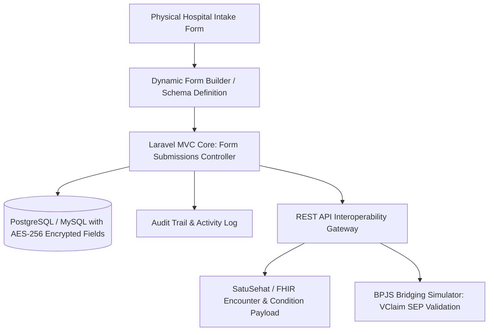

# SIMRS

# Project Idea

## Name & one-line pitch
**KlinikForm SIMRS**: A modular hospital electronic medical record (EMR) subsystem built with Laravel that converts paper hospital admission and triage intake sheets into dynamic, encrypted digital forms while bridging data to national health standards via REST APIs.

## Problem it solves
When SIMRS providers like Medify deploy onsite at regional hospitals (such as in Grobogan/Purwodadi), the primary operational bottleneck is digitizing legacy physical forms (e.g., *Asesmen Awal Keperawatan*, triage sheets, surgical checklists) without requiring a hardcoded schema redeploy for every clinic ward. Furthermore, regional hospitals struggle with strict medical record data security compliance (Permenkes No. 24/2022) and seamless data integration with third-party systems like BPJS Kesehatan and SatuSehat. **KlinikForm SIMRS** solves this by providing a metadata-driven dynamic clinical form engine paired with FHIR-compliant REST APIs and field-level encryption for patient identity and clinical notes.

## What it does

- **Metadata-Driven Clinical Form Digitizer**: Allows hospital admins and implementers to convert physical hospital intake papers into structured digital forms with complex clinical widgets (Glasgow Coma Scale score calculators, anatomical pain marking diagrams via canvas coords, and conditional triage questions) stored as versioned JSON schemas.
- **Permenkes 24/2022 & SatuSehat REST API Gateway**: Exposes structured RESTful endpoints conforming to HL7 FHIR standards (Patient, Encounter, Condition) to demonstrate production-grade bridging capabilities identical to Medify's external integration requirements.
- **Field-Level Data Encryption & Strict Audit Logging**: Encrypts sensitive patient identifiers (NIK, contact details, confidential anamnesis text) at rest using AES-256-GCM via Laravel's native custom Eloquent Casts, accompanied by an immutable audit log tracking every view, update, and export of patient health records.
- **BPJS VClaim Bridging Simulator**: Simulates BPJS VClaim API handshakes (generating SEP / *Surat Eligibilitas Peserta* and signature generation using HMAC-SHA256 timestamps) to emulate real-world Indonesian hospital administration workflows.
- **Nurse & Doctor Triage Station Portal**: A clean, responsive administrative interface built with Blade and Tailwind CSS optimized for rapid data entry by hospital clinical staff during physical rounds, featuring auto-save and offline form draft recovery.

## How it maps to the job description

| Job Requirement / Duty | Where This Project Covers It |
| :--- | :--- |
| **Mengerjakan pembuatan formulir digital dari formulir fisik** | Includes a dedicated physical-to-digital form engine that digitizes standard Indonesian hospital forms (*Asesmen Awal Rawat Inap & Triase Gawat Darurat*) with dynamic validation and versioning. |
| **Pernah mengerjakan produk ERP/SIMRS dengan Laravel (++)** | Full architectural clone of a production EMR/SIMRS clinical documentation module with admissions, triage, and encounter workflows using Laravel 11. |
| **Laravel, Migration, MVC architecture** | Structured strictly according to Laravel best practices: comprehensive database migrations, seeders with synthetic clinical test data, repositories, and FormRequest validation pipelines. |
| **REST API & Integrasi Layanan Lain** | Implements clean REST APIs for interoperability with HL7 FHIR (SatuSehat) formats and simulates BPJS VClaim API signature generation and claim verification endpoints. |
| **Standarisasi Keamanan Data (Security & Scalability)** | Implements field-level encryption (Eloquent Casts) for sensitive health records, role-based access control (RBAC for Doctors, Nurses, Admins) via Laravel Gates/Policies, and immutable audit logging. |
| **VCS Git (GitHub/GitLab) Best Practices** | Repository organized with structured Git commit history, semantic commit messages, automated GitHub Actions CI checking PHP CS Fixer / Pint, and automated PHPUnit tests. |
| **Analisa kode program, Bug avoidance, Maintainability** | Complete automated test suite (Feature & Unit tests covering form rendering, encryption/decryption, and API payloads) with strict static analysis using PHPStan at Level 8. |

## Tech stack, justified by the posting
- **Backend Framework**: **Laravel 11** (PHP 8.3) — Directly mandates the required framework and allows native demonstration of MVC architecture, Eloquent ORM, custom cast encryption, and Form Requests.
- **Database & Migrations**: **MySQL 8.0** / **PostgreSQL** with structured Laravel Migrations and Seeders — Emulates typical hospital database environments with transactional integrity for medical records.
- **Frontend / Templating**: **Blade + Alpine.js + Tailwind CSS** — Lightweight, highly maintainable server-side rendering stack optimal for rapid hospital staff data entry and interactive canvas-based anatomical pain selectors without heavy single-page application overhead.
- **Security & Authorization**: **Laravel Policies + Spatie Laravel-Permission + Custom Eloquent Encrypted Casts** — Addresses the job's explicit preference for data security standards and role segregation between doctors, nurses, and hospital registrars.
- **API Standards & Testing**: **HL7 FHIR / JSON:API Specifications + Pest PHP / PHPUnit** — Directly demonstrates third-party readiness (SatuSehat and BPJS bridging) and code reliability to prevent production bugs.

## MVP scope vs. stretch goals

### MVP Scope (Portfolio Ready in 7–10 Days)
- Configured Laravel 11 application with database migrations for Patients, Encounters, Form Templates, Form Submissions, and Audit Logs.
- Functional digital recreation of 2 standard hospital paper forms: *Formulir Triase Gawat Darurat* (Emergency Triage) and *Asesmen Awal Medis Pasien*.
- Form validation engine handling conditional logic, blood pressure ranges, and pediatric dosage auto-computation.
- REST API endpoints for submitting and retrieving clinical encounter data formatted to SatuSehat FHIR `Encounter` and `Condition` JSON specs.
- RBAC with 3 distinct roles: Doctor (full edit/read), Nurse (intake edit/read), and Hospital Admin (template management & audit viewing).
- Automated test suite covering form validation rules, authorization barriers, and API responses.

### Stretch Goals
- **Interactive Anatomical Pain Map**: Clickable SVG body map saving X/Y coordinates and severity scores directly into the form payload.
- **BPJS VClaim Mock Server**: Standalone mock integration demonstrating BPJS HMAC-SHA256 header generation and SEP lookup.
- **PDF Export Engine**: Pixel-accurate PDF generator via DomPDF matching physical Indonesian hospital government-compliant archive sheets.

## Resume bullets
- Architected and built **KlinikForm SIMRS**, an end-to-end hospital clinical intake and EMR module in Laravel 11 digitizing complex physical medical records into versioned digital schemas.
- Implemented field-level AES-256 encryption on sensitive medical data and full audit logging, complying with Indonesian Permenkes No. 24/2022 medical data security standards.
- Designed RESTful bridging APIs integrating clinical encounters with HL7 FHIR specifications matching national SatuSehat and BPJS VClaim payload standards.
- Established rigorous code quality pipelines using PHPStan Level 8 and Pest PHP tests, achieving 90%+ test coverage across core clinical workflows to eliminate edge-case intake bugs.

## Where the truth lives

The planning documents in this repository are the specification. Read the ones relevant to
the task before writing code — `project-brief.md`, `prd.md`, `architecture.md`,
`api-spec.md`, `erd.md`, `ui-spec.md`, `testing.md`. Do not infer requirements from the
existing code; the code may lag the spec.

## Before implementing anything

- Restate which requirement you are implementing, by its id from `prd.md`. If the request
  does not map to one, say so instead of guessing.
- Check `tech-stack.md` before reaching for a library. Anything not listed there is a new
  decision, not an implementation detail.
- Check `erd.md` before adding a field or a table.

## While implementing

- Follow the layering and module boundaries in `architecture.md`. If a change crosses a
  boundary, that is a signal the architecture needs revisiting — surface it, do not route
  around it silently.
- Every endpoint gets its row in `api-spec.md`, including the error cases.
- Every table change gets its attributes, keys, and constraints in `erd.md`.
- Every new component gets its states in `ui-spec.md`, including loading, empty, and error.
- Handle the error cases the spec lists. A success path that is the only path implemented is
  incomplete.

## Finishing

- Write the tests `testing.md` specifies for this layer.
- Re-read the relevant requirement and confirm the code satisfies it literally, not
  approximately.
- Note anything you had to decide that the documents leave open.